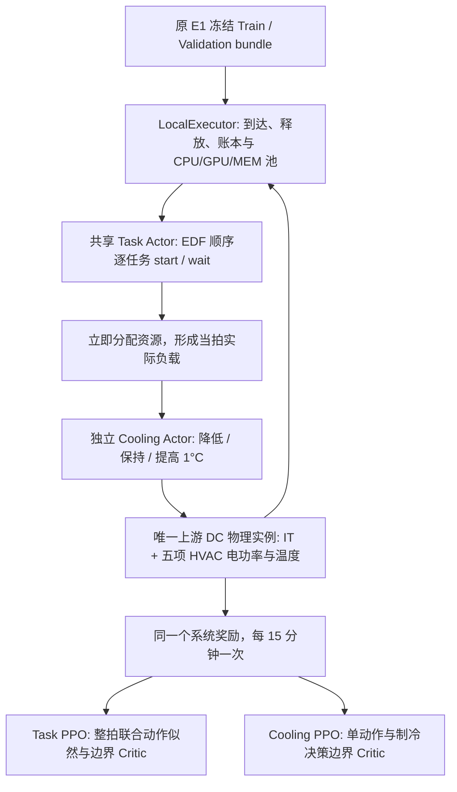

# JointRL-V1 交付报告

本实现是可复现的单数据中心任务调度与制冷 IPPO 基础模型。短程验收不用于判断收敛或算法优越性。

## 实施设计与工作记录

起点：远端 `research/e1-carbon-deadline`，实际 SHA `8d896b6365c0cd75390eaf534544c3b79e29d1ea`；已于 2026-10-15 核实并 fetch。独立干净发布仓库派生 `research/joint-task-hvac-ippo`，原科研工作目录及 main 不动。

实施顺序：

- [x] 审计温度域与六项 HVAC 返回值，新增兼容功率输出和联合适配器。
- [x] 复用 LocalExecutor，加入逐任务共享策略与每拍制冷调用、因果归一化状态和系统奖励。
- [x] 使用 SB3 ActorCriticPolicy，实现每物理时隙一次 GAE、联合任务动作概率的两个独立 PPO。
- [x] 提供独立 B1/B2/B3 训练及 B0/B1/B2/B3/RiskOnly 统一评价和冻结配置。
- [x] 集中运行旧回归、新契约和一次短程真实 Train/Validation 端到端验收；修正暴露的缺陷。
- [x] 完成独立审阅、证据记录、提交和推送。

接口：`JointPowerModel.measure()` 与旧执行器同签名；调度后该调用内部先取得制冷动作再推进唯一物理实例。`JointEnv.step(task_actor,cooling_actor)` 返回一个 `SlotOutcome`。`IPPOAgent.update()` 每个 `SlotTransition` 只接收一个奖励；任务动作列表保存逐候选观测、mask、动作及旧 log probability。

重点检查空任务拍、同拍多任务、动态容量、长积压无截断、单动作 mask、未来输入扰动、未完成截断负债、错误 checkpoint 模式/数据身份和不可行候选的选择拒绝。以下记录实际实现与验收结果。

## 最终架构与时序



每拍首先接收到达任务并释放已完成任务。原 `LocalExecutor` 对全部 pending 按 EDF 排序，只遍历一次；资源不足由 `can_schedule()` 判定并记为容量等待，不调用 Actor。每个可启动候选收到 start/wait 动作，启动立即扣减资源，后续候选读取更新后的可用量。同一任务同拍不会再次被询问，没有固定队列前缀、遗漏上限或静默丢弃。

调度结束后，执行器调用功率桥。桥先将本拍 CPU/GPU/MEM 利用率、当前天气、旧设定值和上一拍传感器送入 Cooling Actor，再应用合法温度动作，最后推进唯一的 `dc_gym` 物理实例一次。物理结果用于积分电量和碳、更新传感器；执行器进入下一个边界，释放完成任务，再计算首次 Deadline 违约和系统奖励。终点仅进行完成释放，不再接收任务、启动任务或积分能耗。

## 两个 Agent 的准确状态与动作

Task 状态共 **35 维**，字段顺序由 `env.TASK_FIELDS` 固定。前十维是候选存在标记、CPU/GPU/MEM 需求的有界表示、各需求/总容量的有界表示、Duration、已等待分钟数和理论剩余 Slack；随后为可用资源比例三维、占用比例三维、Running/Pending/紧迫任务数三维、待运行队列资源总需求三维；再为当前 CI、过去四拍已观测 CI 和历史有效比例六维；最后为 UTC 日内/星期正余弦四维、当前 CRAC 设定值及上一拍 IT/HVAC 功率三维。Critic 使用同拍调度前的边界状态，候选十维置零；Actor 使用每个具体候选的当前状态。所有输入只来自已到达任务和已观测数据。

Task 动作：`0=start`，`1=wait one slot`。资源不足不调用 Actor；`now + 15min > deadline - duration` 时 wait 被 mask。恰好剩余 15 分钟 Slack 仍可等待。该规则不预约未来容量，不保证 DMR。强制单一合法动作保留在执行日志，Actor 梯度和熵为零。

Cooling 状态共 **17 维**，字段由 `env.COOLING_FIELDS` 固定：当前 CPU/GPU/MEM 利用率、当前负载下旧设定值对应的 IT 功率、上一拍 IT/HVAC 功率、当前 CRAC 设定值、上一拍最大机架入口/出口温度、热传感器有效标记、当前干球/湿球温度、当前 CI、UTC 日内/年内正余弦。当前 IT 使用原 rack 的代数方程测算，读取后恢复其风机缓存，不推进环境，也不调用当拍控制之后的 HVAC/热计算。首次状态没有历史传感器：上一拍功率与出口读数为零，入口使用已知供风关系，传感器有效标记为假。

Cooling 动作：`0=-1°C`、`1=hold`、`2=+1°C`，初始 22°C，每物理拍一次，越界动作在采样及重放时均屏蔽。电池容量零，模型没有电池控制动作。

状态固定采用工程归一化 `b(x;s)=x/(s+abs(x))`。CI 尺度 1000 g/kWh、任务数 1000、时间 120min、功率 1000kW、温度 40°C；资源比例和周期正余弦直接输入。归一化不读取 Validation 或 Test 拟合统计量；没有复制旧 54 维状态，没有碳收益预测器。

## 功率边界与单位审计

六个 `calculate_HVAC_power()` 返回量中，第 1、2、4、5、6 项是 W 电功率，第 3 项是 W 热负荷。新边界固定为 `joint_full_hvac_v1`：

\[
P_{total}=P_{IT}+P_{CRACfan}+P_{CTfan}+P_{compressor}+P_{CWpump}+P_{CTpump}.
\]

所有返回值先除以 1000 转为 kW，再以 `E=P*0.25` 得到 kWh，`C=E*CI/1000` 得到 kgCO2e。IT 已包含 CPU、GPU、服务器风机及 `0.07 W/GB` 的背景 DRAM；服务器风机不再加入 HVAC。

原始方程保持不变，符号与配置相对应：

| 项 | 模型公式/计算方式 | 新记录键 |
|---|---|---|
| IT | 原 rack CPU + GPU + IT 风机的向量方程，按 rack 数扩展，再加背景 DRAM | `it_*` |
| CRAC 风机 | `CRAC_FAN_REF_P*(supply_airflow_pu/reference_airflow_pu)^3` | `crac_fan_*` |
| CRAC 热负荷，仅诊断 | `rho_air*supply_airflow_pu*dc_full_load*C_air*max(T_return-T_set,0)` | `crac_thermal_kw`，不计电量/碳 |
| 压缩机 | 原 `calculate_chiller_power(CT_FAN_REF_P,Q_CRAC,T_ambient)`，包括容量、部分负载和循环修正，额定 COP=3 | `compressor_*` |
| 冷却塔风机 | `CT_FAN_REF_P*min(v_air/ctafr,1)^3`；`v_air=(Q_CRAC+P_compressor)/(C_air*max(50-(T_ambient-T_set),1)*rho_air)`；环境低于5°C时此项为零 | `ct_fan_*` |
| 冷冻水泵 | `CW_PRESSURE_DROP*CW_WATER_FLOW_RATE/CW_PUMP_EFFICIENCY` | `cw_pump_*` |
| 冷却塔水泵 | `CT_PRESSURE_DROP*CT_WATER_FLOW_RATE/CT_PUMP_EFFICIENCY` | `ct_pump_*` |

`*_power_kw`、`*_energy_kwh`、`*_carbon_kg` 在逐拍日志和汇总中均提供，功率另有平均和最大值。总电量、总碳必须分别等于六项之和；HVAC 等于五项电力设备之和。

旧 `dc_HVAC_total_power_kW` 仍只等于塔风机+压缩机，`dc_total_power_kW` 仍为 IT+旧 HVAC，E1 口径不变。原 `dc_CW_pump_power_kW` 和 `dc_CT_pump_power_kW` 实际是 W 的历史命名错误，本次保留其内容，并新增明确的 `*_electric_power_kW` 字段。固定22°C的新旧比较仅用于兼容性检查，**不能把新全 HVAC 碳与历史 E1 碳混算节省率**。这是模型可核算组件的总和，不是实测全部设施能耗。

## 温度域依据与物理限制

逐文件检查结论：`sustaindc_env.py` 的上层控制范围18–27°C不等于底层模型的有效域；`dc_gym.step()` 直接接受温度并不执行该约束；`utils/make_envs.py` 的15–21.6°C用于原设备尺寸计算与环境元数据，也不能直接作为运行强约束。`dc_config.json` 的服务器入口参数域为16–28°C。`DC_Config` 将供风 approach 列表平均为5.15°C，当前均质 rack 实现使用首 rack 方程广播，因此入口关系为 `T_inlet=T_CRAC+5.15`。

冻结 CRAC 范围18–22°C意味着入口23.15–27.15°C，包含历史22°C且不超过配置入口上界28°C。入口安全惩罚阈值采用28°C，控制步长1°C，所有边界在 `JointPowerModel` 初始化时依据实际模型参数再次检查；不满足则失败，不训练。保留原 chiller sizing 参数，避免改变历史设备规模与基线方程。

该域是保守的参数化适用限制，不是实测验证或设备认证。原模型为代数准稳态、同质均匀负载，没有新加入热惯性。合法动作下入口通常天然不越界，温度违规为零不能说明策略学会了风险控制。出口温度用于观测与记录，未捏造缺乏依据的出口安全阈值。

## 系统奖励及物理时间上的 IPPO

每拍两个策略共享同一个：

\[
R_t=-\left(C_t/1000+15N_{pending}/15000+10N_{newmiss}/1000+10\max(T_{inlet,max}-28,0)+10L_T\right).
\]

`L_T` 只在有限终点非零：`N_unfinished/1000 + max_r(remaining_resource_minutes_r/(capacity_r*120))`；pending 使用完整 Duration、running 使用剩余执行时间，按15分钟占用网格向上取整。只计已到达任务，既计任务数也计剩余资源工作量。Deadline 首次发生违约时加入集合，此后不重复罚。碳、等待、Deadline 和终点负债沿用 E1 默认尺度及基本定义。新增热成本采用与 Deadline 系数相同的10，每1°C超限每拍计一次，未根据短程结果调整；物理合法性仍由 mask 而非奖励保障。

两个独立 SB3 `ActorCriticPolicy`，各自 `[64,64]` Tanh Actor/Critic 与 Adam，独立初始化、采样 RNG 和优化器；CPU 单线程、确定性 PyTorch 算法。普通 PPO 的 clip=0.2、学习率0.0003、gamma=0.99、GAE lambda=0.95、10 epochs、64个**物理拍** minibatch、熵系数0.01、value系数0.5、梯度范数0.5、target KL=0.03，全部冻结在配置。种子为20261015，加模式偏移 B1=100/B2=200/B3=300，再加 task=1/cooling=2；物理模型沿用seed123。

Task 整拍动作是按 EDF 依次作出的条件决策序列，不定长且可为空：

\[
\log\pi_T(A_t|s_t)=\sum_{i=1}^{n_t}\log\pi_T(a_{ti}|o_{ti},m_{ti}),\qquad
r_t=\exp\left(\sum_i\log\pi_{new}-\sum_i\log\pi_{old}\right).
\]

一次 slot 只使用一个 `R_t`、一个 advantage 和一次 PPO ratio clipping，不对各任务重复奖励，也不平均 log probability 替代联合概率。训练重放保存的候选观测、已执行前缀和合法 mask，不重新抽样前缀。单一合法动作概率为1，联合似然贡献为零；无自由任务动作的拍仍训练 Critic、参与 GAE，并推进一次时间折扣，但 Actor 梯度保持缺失，避免 Adam 历史动量移动强制动作策略。

`delta_t=R_t+gamma*(1-d_t)*V_{t+1}-V_t`，`A_t=delta_t+gamma*lambda*(1-d_t)*A_{t+1}`，两式每物理拍一次。Cooling Critic 在实际调度后、物理前的制冷边界计算；Task Critic 在调度前计算。collector 收集完整有限 episode，最终带负债的有限终点是该目标的终止，bootstrap=0；不把未完成的 cooling 预览误作下一拍实际边界。跨 episode 拼接用 done 阻断 GAE。配置的 n_steps=256仅为常规 PPO 预算元数据，实际更新按完整 episode，不能声称每256拍切一次 rollout。

较长任务序列可能带来较高联合 ratio 方差。记录序列长度、联合 KL、clip fraction、actor slots 和更新数；超过 target KL 的 minibatch 在更新前停止，极端 `abs(logratio)>60` 数值保护直接停止该更新。没有偷偷改单任务 clipping 或缩放系统奖励。

## 模式、评价终点与可复现输入

| 模式 | 任务控制 | 制冷控制 | 拟合来源 |
|---|---|---|---|
| B0 | EDF | 固定22°C | 无 |
| B1 | 逐任务 PPO | 固定22°C | 独立 Train B1 |
| B2 | EDF | HVAC PPO | 独立 Train B2 |
| B3 | 逐任务 PPO | HVAC PPO | 独立 Train B3 |
| RiskOnly | 原 `cars_risk_only` | 固定22°C | 原冻结规则 |

CLI 只接受 Train 和 Validation 角色，复用 `load_bundle` 在读取 payload 前拒绝 Test/错误角色，并逐文件核查任务、环境、配置、物理配置和原始来源哈希。容量50000 CPU/1000 GPU/80000 MEM，resource multiplier5、SLA multiplier1.5、April CI阈值161.075不变。Train 到达区间为2023-05-01 05:00至05-03 05:00 UTC，Validation为2023-07-08 05:00至07-10 05:00 UTC。正式训练与评价使用各 bundle 的冻结环境终点（Train 06-02 05:00，Validation08-09 05:00 UTC），完成后仍积分空闲功率至同一固定终点，不因策略早完成而截短能耗。

本轮采用既有 factor1：Train5542任务、stress seed510001、manifest SHA256 `bf80a31419983606431775f101141cdf7bb4de69f75180c77553a4b3c31a0d45`；Validation8708任务、seed520001、manifest SHA256 `db65bf311e533991ef4cb2f0698c96570d2ebba0185b963c3bb3c16e656a0a18`。压力因子需匹配，三个拟合模式必须使用完全相同 Train 身份。

统一输出五组碳、IT/HVAC及组件能量/碳、资源占用、Deadline/DMR、完成数、已完成JCT、观察等待时间、温度超限、决策耗时、动作分布和奖励组成。`DMR=观察到的违约数/已到达任务数`；右删失和未完成另列，均禁止候选进入可行集合。选择仅在 DMR≤5%、零入口温度违规且无未完成/删失时允许；每种模式只有一个最终候选，Validation 比较后选择合格者中碳最小者，没有可行候选则明确写 `no_feasible_candidate`。短程结果一律 `smoke_only`，不参加正式模型选择。

Checkpoint 保存网络、Adam、RNG、配置和更新计数。加载前检查模式、Train角色、输入身份、归一化状态字段、配置、checkpoint和provenance文件哈希；评价保留确定性动作。模型与原始 bundle 路径必须可访问；本发布仓库不分发原始数据或模型二进制。

## 新增与修改文件

新增 `experiments/joint/`：`__init__.py` 定义统计边界；`config.yaml`/`config.py` 冻结配置及检查；`power.py` 物理适配和组件单位；`env.py` 顺序控制与指标；`reward.py` 系统成本；`ppo.py` 物理拍轨迹及两种 Actor/Critic 共用实现；`inputs.py` 角色和冻结输入接口；`train.py` 独立模式训练；`evaluate.py` 五组统一评价与可行性筛选；`pipeline.py` 一键训练/对照。

新增 `tests/joint/{__init__,test_power,test_env,test_ppo,test_commands}.py`。唯一修改的旧代码是 `envs/sustaindc/dc_gym.py` 的新增 info 字段，旧字段表达式未改变。旧 `experiments/e1`、`datacenter_model.py`、`utils/make_envs.py`、物理JSON及原始数据均未修改。本文是唯一新增交付报告；详细日志、模型和中间结果在 git 忽略的 `research_notes/joint/`。

## 方法来源及未解决限制

Liu等 Applied Energy 2023：所给PDF第4页§3.2和第5页§3.3支持异质任务状态、资源合法性筛选和同拍多次任务决策；本研究改为已确认的聚合资源池 start/wait，不复制其任务/服务器动作或固定队列前缀。SustainDC：第5页§4.2及第24–25页附录支持共享物理环境、温度三动作及IT/HVAC反馈；文中的16–23°C不能替代本仓库具体有效域，也不引入其未来CI预测。DeepEE：第4页§3.1.3和第7页§4.3仅用于IT/HVAC耦合动机，没有引入PADQN、服务器放置或动态控制频率。

边界：单数据中心、聚合非抢占、合成Deadline、15分钟左边界负载保持、无电池、无未来任务/CI/天气输入。模型准稳态和均质假设、原天气插值/湿球近似、背景内存功率、固定原尺寸及较长空闲尾段可能影响结果；没有重新验证其现实精度。Validation曾用于既有开发诊断，不是新的独立泛化证据；Test本轮完全封存。正式配置可运行但本轮不运行长训练，不保证收敛、可行或优于基线。每模式只评估最终checkpoint，没有进行超参搜索、多seed统计或最优算法主张。

## 集中验收：实际短程运行

运行环境：WSL Ubuntu22.04，Python3.10.22、PyTorch2.14.1、SB3 2.9.0、Gymnasium1.4.0、NumPy2.2.6、pandas2.3.3；复用已安装的 E1-5B `runtime-deps`，没有升级依赖。单线程 CPU；测试与短程训练在同次验收窗口内执行，决策耗时不是隔离硬件基准。

首次回归命令漏加历史 E1-7A 独立 OR-Tools 路径，旧离线求解器用例产生 `ModuleNotFoundError: ortools`；单例诊断已复现。补上原有 `solver-runtime` 后，同一旧模块25个测试全部通过（7.27s），没有安装依赖、改动旧算法或跳过这些用例。两个历史私有档案比较测试按原代码因发布仓库不附带对应档案而跳过：`test_approved_archive_head_preserves_research_provenance_not_publication_sha`、`test_historical_e1_1a_fifo_legacy_fields_and_numbers_unchanged`。固定22°C旧功率字段的兼容性由新真实模型测试另行验证，不把缺档跳过算作历史档案回放成功。原多DC的 `tests/test_env_setup.py`、`test_training_loop.py` 会调用原全数据入口，未运行，以维持本次单DC范围和Test封存。

主测试实际结果为 **747 passed、15 failed、2 skipped，1232.10s**；15项失败全部位于上述缺少依赖路径的旧模块，随后25项模块复测覆盖并通过全部15项。最终以完整依赖路径复核全部联合模型测试、旧功率、时钟、离线求解器及物理模型：**75 passed，14.62s，退出码0**。同一验收代码覆盖的独立用例合计762通过、2缺档跳过，无未解决测试失败；这不是声称首次主命令退出码为0。代码在验收过程中未调整权重或追加真实训练。

| 验收项 | 实际证据 | 结果 |
|---|---|---|
| 旧E1与22°C兼容性 | 旧策略golden/逐拍回放；真实模型旧IT、旧HVAC、旧total逐字段相等 | 通过；两个缺档比较按上文披露 |
| 单位/非负/守恒 | 低温、常温、高温及idle/mid/full真实模型组件测试；五组日志残差审计 | 通过 |
| CPU/GPU/MEM及账本 | 原执行器容量/ownership检查、动态资源释放、300任务队列同拍遍历 | 通过 |
| 逐任务合法决策 | 同拍start/wait、紧迫mask、容量等待、非法动作拒绝和无前缀截断 | 通过 |
| 真实制冷影响 | 18°C与22°C入口分别23.15/27.15°C，IT/HVAC/出口均变化；边界mask | 通过 |
| 因果时序 | 未来任务/CI/天气扰动不改变当前状态及第一拍物理结果；预观测不改传感器 | 通过 |
| 双PPO训练与加载 | 物理拍GAE手算、联合ratio、空/强制动作、Adam动量、Actor/Critic分项变化及确定性回放 | 通过 |
| 五组入口与封存 | 三种独立拟合模式、五组共同终点、错误角色/模式/哈希拒绝、smoke禁止正式选择 | 通过 |

独立只读审阅未发现P1/P2问题。审阅指出仅比较整个policy哈希可能把Critic更新误当成Actor更新，故本次额外按Actor/Critic分项核查，证据见下表。本轮没有实质实现阻碍；未验证的研究效果和两项历史缺档仍属于交付限制。

唯一真实 Train/Validation 短程流水线：B1/B2/B3各2 episode×32拍，共192个训练物理拍；五组各32拍，共160个评价物理拍。每个模式完整读取原冻结输入，再以8小时有限目标终点截断，只将已到达任务送给控制器，终点负债正常计入。评价共同终点为2023-07-08 13:00 UTC，各组已到达1954任务。

| 模式 | 模型边界总碳 kg | 已完成 | 未完成/右删失 | 观察到的DMR | 温度违规 | 正式可行 |
|---|---:|---:|---:|---:|---:|---|
| B0 | 1796.866658 | 1733 | 221 | 0 | 0 | 否 |
| B1 | 1687.588012 | 1613 | 341 | 0 | 0 | 否 |
| B2 | 1676.332918 | 1733 | 221 | 0 | 0 | 否 |
| B3 | 1796.866658 | 1733 | 221 | 0 | 0 | 否 |
| RiskOnly | 1682.496204 | 1617 | 337 | 0 | 0 | 否 |

**这些前缀碳量不能解释为节省率。** 较低碳可能来自较多未完成任务，观察DMR=0也不等于最终DMR=0；所有候选均为 `smoke_only`，selected mode为null。B3确定性策略在该窗口恰好选择EDF+hold，与B0相等，未隐藏或挑选结果。

训练实际动作计数：B1 task start2195/wait1505；B2 cooling lower20/hold27/raise17；B3 task start2191/wait1408，cooling lower19/hold31/raise14。B1固定制冷64次hold；B2任务均为EDF。两控制器都执行过有意义的非固定选择。

额外验收仅检查上述保存结果，不增加训练：逐一从已记录种子重建初始网络，核对初始/最终SHA，并分别检查Actor和Critic张量变化。

| 网络 | Actor最大绝对参数变化 | Critic最大绝对参数变化 | 有自由动作的物理拍 | Adam更新次数 |
|---|---:|---:|---:|---:|
| B1 task | 0.00586757 | 0.00629972 | 64 | 20 |
| B2 cooling | 0.00627987 | 0.00630338 | 64 | 20 |
| B3 task | 0.00461710 | 0.00496497 | 64 | 16 |
| B3 cooling | 0.00623346 | 0.00630683 | 64 | 20 |

B3 task第一次更新因正常target-KL停止，第二次正常完成；没有调参重跑。加载后的B3再确定性回放32拍，去除两项墙钟耗时后，所有状态、动作、mask、功率组件和奖励逐拍一致，科学输出SHA256为 `df044c27227b1245252198bcc373020bdc0e73e25bbcb788cef97997054ac73a`。五组分项守恒最大残差：功率4.55e-13 kW、电量1.14e-13 kWh、碳2.85e-14 kg，均为浮点舍入量级。

本地证据：`research_notes/joint/pytest-001.log`、`dependency-diagnosis-001.log`、`solver-recheck-001.log`、`final-focused-001.log`、`smoke-001.log`、`smoke-001/{models,evaluation}/`、`acceptance-audit.json`、`audit-001.log`。模型、详细轨迹和大体积结果保持本地，不进入源代码发布；本文保留精简验收事实。

## 实际命令和后续正式一键运行

以下 PowerShell 环境变量指向原有运行环境及已冻结数据；它们不需要复制或更改原始输入：

```powershell
$jointRepo = '/mnt/d/A-myprofile/SustainCluster/publication/sustaincluster-carbon-scheduling-001'
$jointPython = '/home/hwj/miniconda3/envs/sustaincluster/bin/python'
$jointDeps = '/mnt/d/A-myprofile/SustainCluster/upstream/research_notes/E1/E1-5B/runtime-deps'
$jointSolverDeps = '/mnt/d/A-myprofile/SustainCluster/upstream/research_notes/E1/E1-7A/solver-runtime'
$jointTrain = '/mnt/d/A-myprofile/SustainCluster/upstream/research_notes/E1/E1-5B/precheck-001/load-1/input'
$jointValidation = '/mnt/d/A-myprofile/SustainCluster/upstream/research_notes/E1/E1-5C/diagnostics-001/inputs/validation-1'
```

本次实际测试命令（从发布仓库工作目录执行，日志为`pytest-001.log`）：

```powershell
wsl -d Ubuntu-22.04 --cd $jointRepo -- env PYTHONDONTWRITEBYTECODE=1 PYTHONUNBUFFERED=1 OMP_NUM_THREADS=1 OPENBLAS_NUM_THREADS=1 MKL_NUM_THREADS=1 "PYTHONPATH=$jointDeps" $jointPython -m pytest tests/e1 tests/joint tests/test_model.py -q -p no:cacheprovider --basetemp=research_notes/joint/acceptance-pytest-001
```

受影响旧模块的实际依赖修正复测命令，日志`solver-recheck-001.log`，结果25 passed。完整复现以上主测试时应同样加入 `$jointSolverDeps`，并使用新的basetemp目录：

```powershell
wsl -d Ubuntu-22.04 --cd $jointRepo -- env PYTHONDONTWRITEBYTECODE=1 PYTHONUNBUFFERED=1 OMP_NUM_THREADS=1 OPENBLAS_NUM_THREADS=1 MKL_NUM_THREADS=1 "PYTHONPATH=${jointSolverDeps}:$jointDeps" $jointPython -m pytest tests/e1/test_offline_schedule.py -q -p no:cacheprovider --basetemp=research_notes/joint/solver-recheck-001
```

最终聚焦复核实际命令，日志`final-focused-001.log`，75 passed：

```powershell
wsl -d Ubuntu-22.04 --cd $jointRepo -- env PYTHONDONTWRITEBYTECODE=1 PYTHONUNBUFFERED=1 OMP_NUM_THREADS=1 OPENBLAS_NUM_THREADS=1 MKL_NUM_THREADS=1 "PYTHONPATH=${jointSolverDeps}:$jointDeps" $jointPython -m pytest tests/joint tests/e1/test_power.py tests/e1/test_stepwise.py tests/e1/test_offline_schedule.py tests/test_model.py -q -rs -p no:cacheprovider --basetemp=research_notes/joint/final-focused-001
```

本次唯一短程训练/对照的实际命令：

```powershell
wsl -d Ubuntu-22.04 --cd $jointRepo -- env PYTHONDONTWRITEBYTECODE=1 PYTHONUNBUFFERED=1 OMP_NUM_THREADS=1 OPENBLAS_NUM_THREADS=1 MKL_NUM_THREADS=1 "PYTHONPATH=$jointDeps" $jointPython -m experiments.joint.pipeline --train-bundle $jointTrain --validation-bundle $jointValidation --output research_notes/joint/smoke-001 --episodes 2 --max-episode-steps 32
```

保存结果的Actor/Critic更新审计及单次确定性回放命令：

```powershell
wsl -d Ubuntu-22.04 --cd $jointRepo -- env PYTHONDONTWRITEBYTECODE=1 PYTHONUNBUFFERED=1 OMP_NUM_THREADS=1 OPENBLAS_NUM_THREADS=1 MKL_NUM_THREADS=1 "PYTHONPATH=.:$jointDeps" $jointPython research_notes/joint/audit_acceptance.py
```

**正式一键训练与五组共同终点评价**：去掉两个smoke覆盖参数，完整使用冻结配置中的100 episodes/模式及环境终点。下面命令本轮没有执行：

该配置每模式307200个物理拍，三个拟合模式总计921600拍；评价五组各3072拍，包含共同的空闲尾段。实际更新按完整episode进行，运行成本随真实候选数变化，没有本轮正式训练时长或收敛性证据。

```powershell
wsl -d Ubuntu-22.04 --cd $jointRepo -- env PYTHONDONTWRITEBYTECODE=1 PYTHONUNBUFFERED=1 OMP_NUM_THREADS=1 OPENBLAS_NUM_THREADS=1 MKL_NUM_THREADS=1 "PYTHONPATH=$jointDeps" $jointPython -m experiments.joint.pipeline --config experiments/joint/config.yaml --train-bundle $jointTrain --validation-bundle $jointValidation --output research_notes/joint/formal-001
```

只重新评价已正式训练的三个独立模式，仍使用同一冻结配置及数据终点：

```powershell
wsl -d Ubuntu-22.04 --cd $jointRepo -- env PYTHONDONTWRITEBYTECODE=1 OMP_NUM_THREADS=1 OPENBLAS_NUM_THREADS=1 MKL_NUM_THREADS=1 "PYTHONPATH=$jointDeps" $jointPython -m experiments.joint.evaluate --config experiments/joint/config.yaml --validation-bundle $jointValidation --models-root research_notes/joint/formal-001/models --output research_notes/joint/formal-replay-001
```

也可用 `python -m experiments.joint.train --mode B1|B2|B3 --train-bundle ... --output ...` 分别训练。三种入口都是完整模式训练，不是从B3关闭一个控制器得到B1/B2。所有输出目录必须不存在，避免覆盖旧结果；训练/评价入口没有Test选项。

## Git 交付与分支状态

- 实际起点：`8d896b6365c0cd75390eaf534544c3b79e29d1ea`，首次远端核查与fetch一致。
- 验收源码提交：`f1c6bbe23f33ecec9f5fe54a09a06ee274044832`，`feat: add causal task-cooling IPPO research baseline`，17个代码/配置/测试文件，2279行新增；随后仅提交本文。
- 本地与推送分支：`research/joint-task-hvac-ippo`，远端`personal`指向`https://github.com/cout-he/sustaincluster-carbon-scheduling.git`。交付时核对远端分支HEAD与本地HEAD一致，源代码工作树干净；忽略的本地模型与验收日志保留。
- 原`research/e1-carbon-deadline`保持上述起点；main未改动、未合并、未推送。原`upstream/`科研目录的未提交修改未动。

验收在源码提交前执行，因此训练provenance的`git_head`为起点SHA，实际验收源码由逐文件`code_sha256`绑定；提交后再核对这些文件字节未变。上面的源码SHA明确指向被验收实现。本文不能包含自身内容寻址提交SHA，完整交付文档的最终HEAD由下面命令及最终交付消息给出：

```powershell
git rev-parse HEAD
git status --short --branch
git ls-remote personal refs/heads/research/joint-task-hvac-ippo refs/heads/research/e1-carbon-deadline
```

本轮交付完成的是可运行、可训练、可保存加载、可复现评价的双智能体基础模型。正式训练、独立泛化和算法优势仍待后续已声明协议下验证。
