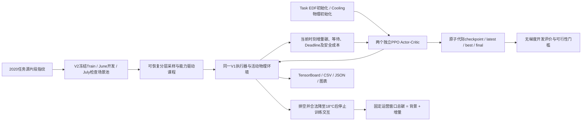

# JointRL-V2 多场景 B3 训练系统交付

## 版本与实施设计

起点为2026-10-16核实的远端 `research/joint-task-hvac-ippo` 最新提交 `30f8005fb9e7f01e861842fe7fc01f3c8fcfa0f7`，派生新分支 `research/joint-v2-training`。新实现集中于 `experiments/joint_v2/`，没有改写V1/E1执行器、35/17维观察、非抢占资源池、15分钟时钟、18–22°C温度域及 `joint_full_hvac_v1` 方程。目标是可持续训练和恢复的B3系统，不以本次训练证明收敛或优越性。

本次采用已给定研究边界直接实施，内部按以下依赖完成：原始片段指纹与冻结场景→可复现场景采样→有限episode及碳目标→EDF/物理辅助初始化→两个独立PPO联合训练→原子checkpoint、约束和开发集选择→监控、集中验收与有预算真实训练。没有新增待批准的研究阶段，没有真实运行其他完整基线训练或超参搜索。



## 场景来源与隔离的冻结事实

源任务文件是约7周片段的年度平移扩展，不是全年独立实测。实际检查结果为37552个年度非空任务桶、4694个独立原始非空桶、8个完整49天重复，年度桶重复率87.5%。49天的周期由脚本的首末桶差加15分钟推导并逐重复验证，未盲目假定整年日期独立。原始桶范围为1970-01-26 00:00至03-15 23:45 UTC；这些是Alibaba源片段的相对秒数时间表示。扩展脚本只平移`interval_15m`，保留`tasks_matrix`中的原始任务内容和1970时间戳，因此可据原始桶与完整raw任务内容建立稳定指纹。

实际V2冻结池位于本地 `research_notes/joint_v2/scenarios-001/manifest.json`，SHA256 `327e941eaa715aa9d25a30601502183cae27c1e7a83b0da7f31e2c0e251775ca`，共99个场景：16个不重叠的24h Train基础片段×6个资源/SLA配置=96个训练场景；2个6月开发场景；1个原7月Validation。**独立Train基础片段数为16，不是96。**

训练环境时间从1–5月按月平衡选取，实际任务数2367–4891/场景。资源需求因子0.75/1/1.25与合成SLA乘数1.5/2组合；全部原任务、到达相对次序、Duration均保留，没有删除任务或随机打乱到达。CPU/GPU/MEM基础映射继续为E1的resource multiplier5。资源因子及SLA变化是明确标记的合成增强；即使基础配置，Deadline也仍是合成SLA，不是实测服务承诺。

16个Train基础窗口均从05:00 UTC开始、持续24h，日期为2023-01-02/03/04/05、02-01/02/03/04、03-01/02/03/04、04-03/04、05-01/03。6月两个窗口预留为开发评价，未加入梯度训练。

开发窗口预先登记为2023-06-05、06-20 05:00 UTC开始的各24h，分别2869/2815任务，压力代理0.2942/0.2558；仅用于无梯度模型选择。原Validation保留2023-07-08 05:00至07-10 05:00 UTC的8708任务和既有冻结环境，原始来源映射为1970-03-09 05:00至03-11 04:45。Train1533个不同原始非空桶与Validation192个原始桶，以及Train基础片段彼此、Train与开发、开发与Validation的原始桶交集均为零。相同7周数据源中的时序相关性仍存在，不能据桶不重叠宣称统计完全独立。

低/中/高负载、Deadline松紧、CI稳定/波动、室外冷暖标签由Train观测统计量三分位定义；Train标签分布分别为负载32/32/32、Deadline33/33/30、CI36/30/30、温度36/30/30。压力代理范围0.1676–0.5443，所谓“高”是这批数据的相对高类别，不是已证容量不可行。采样器对压力代理≥1的概率上限默认0.15，并记录全重负载池无法满足上限时的fallback；本实际池没有此类代理≥1场景。

原始2020任务与2023 CI/天气是仿真时间配对。原始环境数值解码严格止于获准范围（本次到2023-07-21 05:00），7月Validation从旧角色/哈希保护的bundle复用至08-09；9月Test数值及Test payload未解码、未训练、未调参。原始文件的字节哈希校验不代表使用其Test观测。天气继续遵循源文件固定UTC−7元数据与E1的湿球近似`0.9*干球`，没有改成冬季IANA UTC−8；这是继承的模型边界，不宣称全年现场天气时间精确校准。

原始来源SHA256：

| 来源 | SHA256 |
|---|---|
| Alibaba年度任务pickle | `3ba8a8e0067288f8d2542752a292f7da04cb79305689ba145cc6060e96cb7f2e` |
| US-CAL-CISO 2023 CI | `44bafab775c6b0d4762b1dc971eb293cfea154f80799a5230f9268d32e1ad55b` |
| 2023天气JSON | `090bddc8a5f4e9edb5f3f193c6c147ed03841337b4bb17c7740f3b63a03cdaf5` |
| dc_config.json | `bbe439176605512523a3a0ecd2bd22f18fdb9abf6ae6e782217157beedbf705b` |

## 采样、Episode与碳目标

`TrainingScenario`记录任务/环境快照、源片段ID、源内容指纹、所有边界、容量、合成参数、种子及来源处理规则。独立V2协议逐文件哈希、manifest库存哈希及角色检查，没有删除或放宽E1/V1检查。`ScenarioSampler`只接收Train，按实际类别分层加权，优先避免相邻抽到同一原始片段（包括其不同增强副本）。RNG、上次片段、各场景/课程计数、抽样概率诊断全部可保存恢复。

到达窗口内空队列不能终止；到达结束后继续执行非抢占积压；任务全部完成后由确定性操作员按合法−1°C/拍将设定值降至18°C，最多4拍，实际过渡能耗正常计入。这些操作员拍不伪装成PPO动作，但Critic和物理时间正常推进。此后训练停止，不再为30天空闲生成无意义Actor更新；安全上限仍为到达结束后30天，未完成时保留全部终点负债和不完整标志。

当前拍由同一原方程计算独立于策略的idle18参考`B_t`，奖励碳项使用`C_actual,t−B_t`。这不是新的功率预测器，参考probe不推进活动数据中心，不向任何Actor提供未来输入。模型若出现超过舍入容差的负增量，立即拒绝训练，不暗中截掉真实负荷。排空且到达18°C后，准稳态物理模型的余段正好等于同一参考，因此：

`固定运营窗口总碳 = 整个固定窗口idle18背景碳 + 真实交互前缀增量碳`。

未来背景只在episode结束后的报告中积分，不进入Actor状态、Critic输入、训练奖励或终点奖励。不同结束时刻不会少算背景空闲能耗，最后温度不同造成的过渡成本也没有省略。仍未完成的截断前缀不冒称完整固定窗口；完成率/删失门槛阻止其入选。

V2明确采用PPO discount gamma=1的有限episode无折扣目标，避免V1 gamma=0.99把30天终点负债指数压低。这是版本化训练目标/超参变更；V1历史目标不动。两版共享的是每15分钟一次奖励/GAE与整拍联合任务似然机制，并非声称所有训练目标完全相同。

## 初始化、在线保护与联合PPO

Task示范通过同一执行器、35维观察及实际mask收集，记录资源和Slack。自由选择下EDF几乎只提供start；强制预约等待不作为自由wait多样性。若自由wait比例不足0.05，默认跳过BC并明确说明，保留等待探索；不声称EDF初始化已带来低碳或Deadline保证。

Cooling在真实Train驱动负载、当前天气与设定值下有限枚举合法三动作，以完整IT+五项HVAC电功率和温度生成标签。它是同一原物理模型的反事实标注，不是第二个控制环境或未来功率输入。最多128状态、4个监督更新，再进行32拍的固定EDF负载前缀Cooling PPO；该前缀是明确的制冷初始化目标，不宣称完整任务调度性能。标签最优动作、功率差、单调方向及场景合成增强比例均记录。单步标签不等于考虑后续可达性的长期最优。

Task合法mask在V1容量和Slack规则外增加轻量已知任务预约：利用当前pending和running已知释放时间，避免灵活长任务占用将阻塞已知紧迫任务的资源。只有已到达任务可参与；不强行超容量、不调用大型离线全知规划器。紧迫候选的原Slack强制启动与预约冲突时按显式规则保持合法支持，触发、冲突、自由动作比例单独记录；这是启发式保护，不是Deadline硬保证。

联合微调继承初始化后的两个独立Actor/Critic、优化器和RNG，每episode只更换场景及物理执行状态，不重置策略参数。课程0/1/2由连续2次完整、温度安全且DMR≤5%的训练episode触发升级，不按编号自动变难。初期降低相对高负载和紧迫场景权重；分布由冻结配置控制。

共同奖励保留等待、首次Deadline违约、温度和终点剩余工作负债，碳改用上述真实增量。初始Deadline乘数lambda_d=10，Train完整且无删失/安全失败时按`clip(lambda_d+20*(DMR−0.05),0,5000)`更新；高压力代理场景可保守冻结更新，但不会被误称已证不可行。PPO的gamma=1与Deadline乘数不是同一参数。报告另给离线必要容量/期限下界，不输入在线策略；零下界不证明可行，也不把所有超过下界的违约都断言为算法可避免。

PPO保持逐拍的联合概率：task整拍`log pi = sum_i log pi(action_i | observed prefix,mask_i)`；每物理拍一次reward、advantage和ratio clipping。没有平均log概率或逐任务重复奖励。保留target-KL及极端ratio数值保护。V2增加每拍候选/自由动作数、log-ratio分布、KL、clip fraction、裁剪前梯度范数、Actor/Critic更新与有效更新数、KL早停比例、零有效Actor更新比例；强制单动作和空任务拍不产生Actor梯度。

## Checkpoint、选择与监控

每个完成episode及其参数更新作为事务提交，保存两策略、两个优化器、独立采样/优化器RNG、Python/NumPy/PyTorch RNG、课程、采样器、lambda、预算计数、日志记录和最佳候选。immutable `.pt` 代文件先flush/fsync，named JSON pointer再原子replace；加载先核对配置、场景、源码及文件哈希，再weights-only反序列化。中断的半episode不当作短成功episode；恢复latest后回滚其模型/RNG/抽样，重新执行同一未提交场景。best指针若因崩溃超前于latest，也按latest事务回滚。

初始化完成后、预训练开始前即保存latest。Task和Cooling各是独立提交阶段；预算中断的阶段回滚模型、Adam、全局及策略RNG后重试，已完成阶段不重复。每阶段保存兼容的Task/Cooling初始化文件和原始阶段状态；辅助文件丢失时从已提交阶段恢复，不能把后来微调的权重冒充初始预训练权重。加载优化器状态时深拷贝CPU张量，防止后续Adam更新污染可重复使用的恢复快照。

`latest`是恢复点，`final`是本次运行结束的最后完整事务。`best_deadline`在开发集合上先比较未完成/删失及完整性、温度违规、DMR、碳；`best_feasible`只在全部预声明开发场景任务完整、零温度违规、各场景DMR≤5%时创建，然后比较同一固定运营窗口总碳。没有可行候选时不创建虚假best_feasible。

6月开发集不参加梯度训练；7月原Validation只作一次末尾检查，不更新lambda、课程或选择模型。读取7月payload前即原子发布`heldout-validation-once.json`，内含不可变checkpoint代文件及SHA；即使超时、异常或进程崩溃，后续resume也不再次读取7月。未开始的最终检查可因预算不足延后；一旦开始便消费这次检查机会，不把不完整前缀报告为成功。继续训练后旧7月结果仍对应原代文件，不随`final`别名移动。

预训练、PPO minibatch和评价接收同一有限deadline；训练耗时包含加载、预训练、开发/最终评价、监控和绘图。正在进行的单步及原子写入不强制中断，有限收尾可能超过软墙钟上限，实际耗时如实记录。首次场景冻结是训练前准备，单独计时，**不包含在`--wall-seconds`的训练阶段预算内**；pipeline报告同时给出整体耗时。使用现成pool的本次一键验收整体120.328秒、训练120.230秒，低于240秒预算。

监控输出TensorBoard、episode/step/PPO CSV和JSON，以及DMR、完成率、固定窗口总碳/增量碳、Task动作分布、制冷设定值和PPO曲线。Train场景不同使总背景碳变化，图中注明“scenarios vary”；不能把跨场景Reward或碳量下降直接当作算法改善。开发集固定场景另记曲线、场景ID和选择记录。`capacity_audits.json`单独提供必要容量/期限下界；进度同时区分增强场景ID数量与原始源片段数量。

## 验收与真实运行记录

2026-10-16使用原WSL Ubuntu-22.04、conda `sustaincluster`环境完成。Python3.10.22、PyTorch2.14.1、SB3 2.9.0、NumPy2.2.6、pandas2.3.3、gymnasium1.4.0；已有TensorBoard/matplotlib可用，没有更换或安装依赖。

定向集中测试分为核心回归和事务恢复检查，共116项通过。核心命令覆盖V2场景/环境/预训练/PPO、全部`tests/joint`、E1的power/stepwise/physical_clock/policies及基础模型，103项通过（10.25秒）；训练/恢复/一次性验证检查13项通过（10.76秒）。最后补充可读容量审计与源片段计数后，对PPO/训练/恢复/最终验证相关21项再次通过（9.01秒，含前述重复项，不额外累加总数）。日志分别为`research_notes/joint_v2/pytest-core-001.log`、`pytest-resume-001.log`、`pytest-final-001.log`。

```bash
python -m pytest -q tests/joint_v2 tests/joint \
  tests/e1/test_power.py tests/e1/test_stepwise.py \
  tests/e1/test_physical_clock.py tests/e1/test_policies.py tests/test_model.py
```

验收包括：固定窗口所有电气组件与完整物理重放相等；任务/资源守恒；只改变未来输入不影响当前决策；安全上限的首次违约/终点负债；强制动作不更新Actor；V1/V2同配置联合PPO数值一致；原子指针/字节损坏拒绝加载；预训练前缀回滚；连续3个受控真实物理episode与1+resume至3个episode的两Actor/Critic、Adam/后续随机动作、采样器、lambda和课程一致；7月超时/异常后不重复访问，结果绑定原始代文件；日志和图表生成。测试里的小型合成fixture仅用于契约验收，下面真实进度来自冻结原始来源场景。

独立审查后修复了预训练前无恢复点、7月检查可重复/版本绑定不明、最终耗时漏计三项问题；源码身份检查额外包括运行中的`rl_components/task.py`。与V1基点逐文件比较，`experiments/joint`、`experiments/e1`、`envs`、`utils`、`rl_components`、`dc_config.json`均无变更。没有运行完整B0/B1/B2/RiskOnly基线或超参搜索。

实际只执行以下一轮有界B3集成训练，达到3个完整episode后正常停止，无未提交前缀、无后台训练：

```bash
/home/hwj/miniconda3/envs/sustaincluster/bin/python -m experiments.joint_v2.pipeline \
  --pool research_notes/joint_v2/scenarios-001 \
  --output research_notes/joint_v2/acceptance-001 \
  --config experiments/joint_v2/training_config.yaml \
  --total-steps 2048 --wall-seconds 240 --max-episodes 3
```

运行前设`PYTHONDONTWRITEBYTECODE=1`、`PYTHONUNBUFFERED=1`、`OMP_NUM_THREADS=1`、`OPENBLAS_NUM_THREADS=1`、`MKL_NUM_THREADS=1`，并设`PYTHONPATH=/mnt/d/A-myprofile/SustainCluster/upstream/research_notes/E1/E1-5B/runtime-deps`。从WSL仓库根目录执行。具体数据/配置/源码/产物哈希及逐场景统计保存在随代码提交的小型[真实验收记录](JointRL-V2-acceptance-001.json)；330MB场景池、模型权重和原始运行日志均留在独立的gitignored目录。

Task示范在2个不同基础片段运行249拍，观察5636个决策、保留2048样本。全部标签为start，其中自由start4412、自由wait0，因此按预声明规则跳过BC，未强行训练单一动作。没有省略执行器任务。Cooling示范241拍、保留128状态，所有128状态均随设定值上升而总功率非减，局部最优为降温8次、18°C下保持120次，优势动作占93.75%；合法动作功率跨度均值26.04kW、最大54.95kW。必须如实承认当前采样模型偏好低设定值，不能制造复杂控制故事。Cooling执行2个BC更新及32拍/1次PPO更新，Actor和Critic随后兼容加载到B3。

| 实际Train场景 | 完成/到达 | 物理交互拍 | DMR | 固定窗口总碳 kg | 增量碳 kg |
|---|---:|---:|---:|---:|---:|
| Jan05 / r1.25 / SLA1.5 | 2367/2367 | 122 | 1.9856% | 117674.26 | 4772.77 |
| Feb04 / r0.75 / SLA2 | 4240/4240 | 122 | 0% | 108079.06 | 2585.53 |
| Mar01 / r1.25 / SLA2 | 2892/2892 | 116 | 0% | 98597.10 | 2791.16 |

三个不同原始源片段、9499个任务全部完成，未完成/右删失/温度违规均为零。联合训练累计360物理拍、16875个Task动作、355个Cooling动作；另5拍为合法确定性降温收尾，不产生Actor决策。上述步数只计联合训练，EDF示范、32拍Cooling初始化和开发/最终检查各自另记，不把它们混作联合训练量。

Task/Cooling各执行24个有效Actor更新和24个有效Critic更新，所有四个组件的初始/最终参数哈希都不同。Task每episode KL约0.00080–0.00166，clip fraction约0.00477–0.01496，联合log-ratio总范围−0.359至0.234；最大裁剪前梯度范数4.663。Cooling KL≤0.000074；无数值保护触发、无target-KL早停、无零有效Actor更新。lambda从10调整至7.3971，课程由连续合格结果升至阶段1。三场景的报告专用容量必要下界均为0，这不证明不存在资源竞争，也不证明所有实际违约均可避免。

Reward量级审计：三个完整Train episode的增量碳成本分别4.773/2.586/2.791，等待成本1.879/3.378/2.403，Deadline成本0.470/0/0，热安全/终点未完成成本均为0（没有该类事件）。首次违约罚项确实进入episode1的47次违约；没有依据零终点成本宣称已充分验证真实长尾严重不可行训练，相关负债由定向测试覆盖。跨场景Reward−7.122/−5.964/−5.194不能解读为控制器性能单调改善。

第1个episode后的预声明6月开发检查合计5684/5684任务完成、DMR0、零温度违规，固定窗口总碳158333.34kg、增量3965.80kg，因而实际生成`best_feasible`与`best_deadline`。这是这两个开发场景上的候选，不是全分布保证；本轮仅3个episode，按每4轮频率未再次挑选。

第3个episode的固定模型只对原7月窗口检查一次：8708/8708完成、403次违约、DMR **4.6279%**、未完成/右删失/温度违规均为0，215拍真实交互，固定32天总碳106280.12kg、任务/控制增量4141.94kg。检查所对应不可变模型代SHA为`afca4088a6f92fc7969efd1e95bba5fded73827f74bd6b0037e559793ad2fe4a`；报告和模型字节哈希已核对。7月数据未反向用于参数更新或最佳模型选择，9月Test继续封存。

实际观测说明系统能训练、两Actor/Critic发生有效更新、场景切换及可行性门槛工作；**3轮试运行不证明收敛或稳定达到DMR目标，也没有证明任何相对基线减碳百分比。**不同Train窗口的CI、天气、任务和增强参数不同，总碳下降不能归因于学习。本轮7月单次DMR虽低于5%，仍需预先约定的正式训练和后续独立研究设计验证，不能反复重看该窗口来调参。

## 一键正式训练、恢复与产物

在WSL中准备一次环境（路径沿用当前机器）：

```bash
cd /mnt/d/A-myprofile/SustainCluster/publication/sustaincluster-carbon-scheduling-001
export PYTHONDONTWRITEBYTECODE=1 PYTHONUNBUFFERED=1
export OMP_NUM_THREADS=1 OPENBLAS_NUM_THREADS=1 MKL_NUM_THREADS=1
export PYTHONPATH=/mnt/d/A-myprofile/SustainCluster/upstream/research_notes/E1/E1-5B/runtime-deps
```

使用已经冻结、经过哈希校验的99场景pool，一条命令启动正式B3训练；预算以物理步和2小时软墙钟共同约束，没有固定100轮假设。本次**没有启动**这条长训练命令：

```bash
/home/hwj/miniconda3/envs/sustaincluster/bin/python -m experiments.joint_v2.pipeline \
  --pool research_notes/joint_v2/scenarios-001 \
  --output research_notes/joint_v2/formal-001 \
  --config experiments/joint_v2/training_config.yaml \
  --total-steps 32768 --wall-seconds 7200
```

同一输出下恢复，物理步为累计总预算，wall为本次调用预算，源码/配置/pool须完全一致；不会重跑已提交预训练或改变场景抽样顺序：

```bash
/home/hwj/miniconda3/envs/sustaincluster/bin/python -m experiments.joint_v2.pipeline \
  --output research_notes/joint_v2/formal-001 --resume latest \
  --config experiments/joint_v2/training_config.yaml \
  --total-steps 32768 --wall-seconds 7200
```

若要从可用原始来源重新冻结并训练，可把`--pool ...`改为`--source-root /mnt/d/A-myprofile/SustainCluster/upstream`，输出必须为新目录。生成场景时使用独立的`scenario_config.yaml`；冻结耗时另计，不能声称整条含数据构建命令必在训练wall预算内。中断未完成的数据准备与训练checkpoint恢复是不同范围；正式训练优先复用已冻结pool。

当前真实产物目录为Windows `D:/A-myprofile/SustainCluster/publication/sustaincluster-carbon-scheduling-001/research_notes/joint_v2/acceptance-001/training/`，对应WSL仓库相对路径相同。主要文件：

- `checkpoints/{latest,best_feasible,best_deadline,final}.json`及其SHA命名`.pt`；
- `pretrain/{task,cooling}.pt`、示范统计与样本JSON；
- `monitor/episodes.csv/json`、`steps.csv/json`、`ppo_updates.csv`、`validation.json`、`selection.json`、`capacity_audits.json`；
- `monitor/tensorboard/`及`monitor/training-curves.png`（六面板已实际打开核验）；
- `heldout-validation-once.json`、`training_config.json`、`provenance.json`、`run-result.json`；
- 上一级`pipeline-run-result.json`和`research_notes/joint_v2/acceptance-001.log`。

关键配置完整记录在`experiments/joint_v2/training_config.yaml`与验收JSON中：根/采样seed20261016，Task/Cooling分别根seed+1/+2；两网络[64,64]；学习率3e−4；gamma1、GAE lambda0.95、clip0.2、4epochs、batch64、entropy0.01、targetKL0.03；初始约束乘数10/步长20/上界5000；训练上限32768拍/7200秒；2个独立示范片段、Task最多2048样本、Cooling128状态及32拍初始化。采样器种子、Train定义的类别阈值和权重随pool冻结；未基于Test选择这些数值。

实际验收源码manifest SHA256为`efd597aea9b786cffc95e0bde63913876b660e7d194f9b3573445f263a754a22`，配置身份`72d921b7b48205ed92c051a929a503a6f1d02555cb146bad8def78d248aaf606`，训练/开发数据身份`cfffda6fa42a2d88340335e99cb807ccb384d238bfbd384d2da330fd229e13d9`。源码逐文件身份在真实产物中核对成功，所有checkpoint代字节校验成功。提交前另核对每个运行源码文件与Git暂存blob的SHA完全一致；V2冻结配置的字节换行规则单独保留，避免重新checkout后破坏恢复身份。

实现、测试和真实验收记录的Git提交为[`78a44351a7be8d8f64641d7e51460c8e16c108c9`](https://github.com/cout-he/sustaincluster-carbon-scheduling/commit/78a44351a7be8d8f64641d7e51460c8e16c108c9)。本报告随后独立提交，最终分支为[`research/joint-v2-training`](https://github.com/cout-he/sustaincluster-carbon-scheduling/tree/research/joint-v2-training)，最终含报告提交的完整远端HEAD在交付消息中给出。验收产物生成时Git HEAD仍为V1父提交，精确V2源码身份以上述逐文件manifest和实现提交为准，不能把当时未提交工作区误读为纯V1执行。
