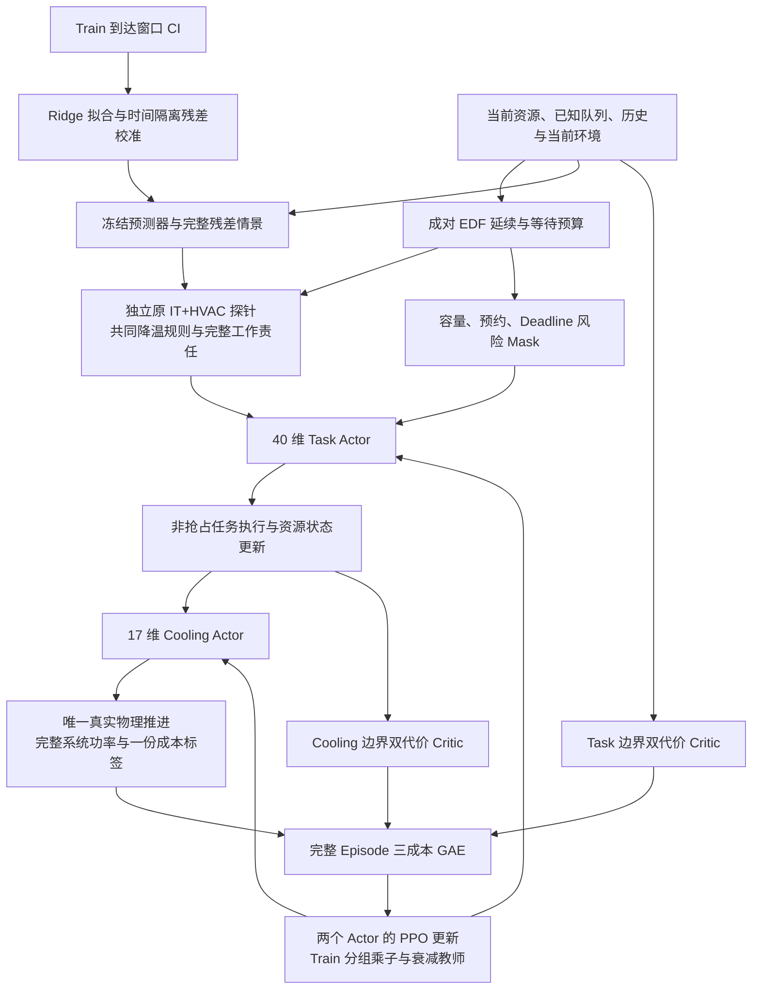

# JointRL-V3 / RAC-MAPPO：风险与系统边际碳收益引导的双智能体调度方法

本文描述 `experiments/joint_v3/` 已实现的方法及其适用边界。研究问题是：在单数据中心、动态任务到达与有限 CPU/GPU/MEM 容量下，利用当前已知队列的条件性 Deadline 风险和 IT+HVAC 反事实碳收益，引导 Task/Cooling 两个 Actor 学习固定运营窗口内的低碳控制。是否优于 JointRL-V2 或立即执行基线，需要由独立执行得到的结果回答；方法结构本身不构成性能证据。

术语与符号在全文固定如下。

| 术语 | 定义或单位 |
|---|---|
| RAC-MAPPO | Risk-Aware Carbon-Guided Multi-Agent PPO，本项目的组合方法名称 |
| CI，\(g_t\) | 电网碳强度，gCO₂e/kWh |
| DMR | Deadline miss rate，违约任务数除以完整到达任务数 |
| Task / Cooling | 任务开始/等待控制器；CRAC 温度设定值控制器 |
| \(\mathcal K_t\) | 时刻 \(t\) 已到达且仍排队或运行的已知任务集合 |
| \(B_i^{safe}\) | 已知队列、冻结延续规则下支持的等待预算，分钟 |
| \(\widehat G_i\) | 立即启动相对于等待一个时隙的预测碳成本差，kgCO₂e |
| \(G_i^{robust}\) | 预测碳收益均值减去不确定性惩罚，kgCO₂e |
| `joint_full_hvac_v1` | 与 V1/V2 相同的完整电功率核算边界 |

## 1. 问题定义与信息边界

数据中心由一个聚合资源池和一套既有 IT/HVAC 物理模型表示。任务动态到达、非抢占执行，调度与控制间隔为 15 分钟。资源池保持 CPU 核数、GPU 数量与内存容量三个维度，不引入服务器级放置、多中心迁移、电池控制或第三个 Agent。

在线信息集合 \(\mathcal F_t\) 包含已到达任务的资源需求、真实运行时长、合成 Deadline、运行任务剩余占用、当前可用容量，以及当前和历史环境观测。任何尚未到达任务、未来真实 CI 和未来真实天气均不作为 V3 新增模块的决策输入。CI 历史文件中存在未来行不改变这个边界。

预测器拟合和辅助预训练只接受 Train 角色。Development 仅用于预先规定的模型选择和对照评价，不能进入预测器拟合、归一化或残差校准。Train 场景环境包含较长排空尾部，预测器额外限制 `sample.time < scenario.workload.end`，避免把可能落入后续开发日期的环境尾部用于统计拟合。July Validation 的历史观察事实应由实验报告披露；本轮开发入口不重新开放 July 或 September Test。

## 2. 优化目标与核算单位

令 \(\Delta t=0.25\) h，系统电功率以 kW 计，则实际时隙碳排放为

\[
C_t=\frac{\Delta t}{1000}\,g_t\left(P_t^{IT}+P_t^{HVAC}\right).
\]

评价目标是在相同运营窗口 \([t_0,t_{end})\) 内降低

\[
C_{total}=\sum_{t=t_0}^{t_{end}}C_t,
\qquad
DMR=\frac{\sum_{i=1}^{N_e}\mathbf 1(f_i>d_i)}{N_e}\leq0.05.
\]

同时要求资源容量合法、任务非抢占以及机架入口温度不超过 28°C。DMR≤5% 是场景级研究目标及模型选择条件；它不是对任意未来任务到达过程的逐任务保证。模型可能在部分压力/SLA 场景下不可行，必须保留这些失败结果。

训练沿用 V2 的空闲 18°C 增量碳目标。对当前天气、当前 CI 的独立空闲参照 \(C_t^{idle18}\)，定义

\[
c_t^C=\frac{C_t-C_t^{idle18}}{1000}.
\]

分子是 kgCO₂e，训练通道进一步按 1000 kgCO₂e 的工程尺度缩放。固定窗口总碳与增量碳分别报告，不能互换减排率分母。环境排空并完成真实的逐步降温后，后续空闲 18°C 背景可在报告阶段积分补齐；这些未来报告项不进入 Actor、回报或终点奖励。

## 3. 任务、资源与非抢占执行

任务定义为 \(J_i=(a_i,p_i,d_i,\mathbf r_i)\)，其中 \(a_i,p_i,d_i\) 的时间基准一致，\(\mathbf r_i=(r_i^{cpu},r_i^{gpu},r_i^{mem})\) 保留各自物理资源单位。合成 Deadline 沿用 V2：

\[
d_i=a_i+\alpha_i p_i,\qquad \alpha_i\in\{1.5,2.0\}.
\]

任务在 \(s_i\) 开始后持续执行至真实完成时刻 \(f_i=s_i+p_i\)，不能因策略改变运行时长或中途抢占。在每个执行边界，已有 `LocalExecutor` 继续实施

\[
\sum_{i:s_i\leq t<f_i}r_i^{(k)}\leq C_k,
\qquad k\in\{cpu,gpu,mem\}.
\]

反事实规划保留真实完成时刻用于 Deadline 判断，同时把资源占用释放到不早于完成时刻的下一个 15 分钟边界。这与现有执行器的左边界负载核算及离散释放语义一致。小于一个时隙的任务不会因此被伪造为更短的资源责任。

容量和物理参数沿用冻结场景。资源压力 \(\rho\in\{0.75,1.0,1.25\}\) 是已有场景的需求增强标签，不改变实际容量；任务到达、原始任务身份和运行时长保持不变。增强场景及同一轨迹的环境重映射不能当作相互独立的实测工作负载。

## 4. 资源竞争感知的队列风险

仅考察当前可启动且尚有一个时隙自身 Slack 的候选 \(i\)。两条反事实使用完全相同的已知队列、运行任务释放表、容量与已有等待承诺。\(a=0\) 在当前启动候选，再执行确定性 EDF 回填；\(a=1\) 使候选至少一个时隙不具备启动资格，再加入同一 EDF 延续。

EDF 排序采用 `(deadline, arrival, task_id)` 稳定打破平局。每个网格边界依次检查可启动任务，不能启动的任务保留排队，后续可容纳任务允许回填。规划不接收未来到达任务，也不复制整套数据中心去执行完整环境尾部。

设两条轨迹给出已知任务的预计真实完成时刻 \(\widehat f_j^{(0)}\) 和 \(\widehat f_j^{(1)}\)，则

\[
\Delta M_i=\sum_{j\in\mathcal K_t}
\left[\mathbf 1(\widehat f_j^{(1)}>d_j)-\mathbf 1(\widehat f_j^{(0)}>d_j)\right],
\]

\[
R_i^{queue}=\sum_{j\in\mathcal K_t}
\left[\max(0,\widehat f_j^{(1)}-d_j)-\max(0,\widehat f_j^{(0)}-d_j)\right]_+.
\]

\(\Delta M_i\) 的单位是任务数，\(R_i^{queue}\) 的单位是分钟。实现分别保留候选自身和其他任务的违约变化、额外逾期时长。违约数采用净变化，因此“总违约数不增加”不等价于“每个其他任务均不受损”；额外逾期分钟仍可能为正，应结合诊断字段解释。

仅当整批已知任务在规划范围内完全结算时，估计才有效。有效确定性延续的 `risk_confidence=1` 表示快照和规则已计算完成，不是统计概率。超时、超过任务数上限、超过规划长度、未来任务混入或身份不一致均给出无效估计和明确原因。

## 5. 条件性安全等待预算

候选最晚启动时刻为 \(l_i=d_i-p_i\)。对 \(k=1,\ldots,K_w\) 的网格等待逐一构造反事实，定义

\[
B_i^{safe}=15\max\left\{k\geq0:
t+15k\leq l_i,\quad \Delta M_i^{(q)}\leq0\ \forall q=1,\ldots,k\right\}.
\]

默认 \(K_w\leq16\)，并受自身最晚启动时刻约束。前缀检查遇到第一次额外违约就停止，不允许跳过不安全的较短等待后仅采纳某个较长等待。若计算过程中出现不可靠状态，返回零预算并记录回退，而不会把已经算到的一部分伪装成完整结论。

\(k=0\) 是不主动延迟的参照。`safe_wait_budget_minutes=0` 表示未支持正等待，原因可以是没有自身 Slack、队列竞争风险或无法可靠计算，三者应区别记录。这一预算条件化于当前已知任务与冻结 EDF 延续；后续新到达任务和真实 Actor 的未来选择可能改变结果。

## 6. 因果 CI 预测与残差不确定性

预测器是小型多输出 Ridge 回归，输入为当前及过去共 8 个 15 分钟 CI 观测，加上当前小时和星期位置的正余弦周期特征。输出长度 \(H=16\)，索引 0 固定为当前已观测 CI，索引 1–15 为预测；这 16 个左边界值用于覆盖四小时的时隙能碳积分。

对输入 \(x_t\) 和多步标签 \(y_t\)，在 Train 时间前段求解

\[
\widehat W=\arg\min_W\|XW-Y\|_F^2+\eta\|W_{nonintercept}\|_F^2,
\qquad \eta=1.
\]

特征均值与尺度仅由拟合部分计算，截距不受 Ridge 惩罚。Train 到达窗口的 CI 按时间去重；同一时刻观测不一致则拒绝拟合。相同环境被不同压力/SLA 增强场景复用时，不会重复加权。构造监督窗口时不跨越观测缺口。

在有足够有效窗口时，以时间有序样本约 80% 的位置为划分点：拟合行必须满足最远标签时间严格早于校准起点；残差行的预测起点不得早于该点。由此阻断拟合标签与校准预测起点的重叠。校准虽处于 Train 的后段，仍只属于 Train，Development/Validation/Test 均不参与。

预测残差以整条向量 \(\epsilon^{(b)}\in\mathbb R^{16}\) 保存，\(\epsilon_0^{(b)}=0\)。默认从时间有序残差库均匀选取 \(K=8\) 条完整向量，并生成

\[
g_{t+h}^{(k)}=\max\left(0,\widehat g_{t+h|t}+\epsilon_h^{(b_k)}\right).
\]

这种确定性经验情景保留所选向量内相邻步的误差关系，但不保证八条情景覆盖未来尾部风险。`confidence` 采用 Train 校准 RMSE 相对于拟合标签波动的单调缩放 \(1/(1+RMSE/\max(\sigma_{Train},1))\)，它不是覆盖率保证或校准概率。

预测起点没有连续八条当前及历史观测、缺少当前边界、含非有限值或 Train 数据不足时，使用最后可得非负 CI 的持久性回退，`valid=False`、置信度为零。该回退不提供正向教师等待证据。在线预测只搜索不晚于当前边界的历史，既不读取未来 CI 字段，也不在线更新回归系数或校准残差。

Train 校准 RMSE 只描述内部残差，不能证明开发场景的预测准确率。独立预测评价需保存实际决策起点生成的预测，再与随后已经发生的 CI 按预测步长对齐；其结果不能反向用于本轮归一化、校准或挑选预测器参数。

## 7. 完整 IT+HVAC 反事实碳收益

功率估计直接调用原有 `JointPowerModel` 的独立探针，保持 `joint_full_hvac_v1`：IT 加 CRAC 风机、冷却塔风机、压缩机、冷冻水泵与冷却塔水泵。CRAC 热负荷是热量，不再次加入电功率。历史泵属性的 W/kW 差异由原有适配器处理，V3 不重设设备尺寸或修改物理系数。

调度轨迹的负载保存原始 CPU/GPU/MEM 资源量，进入物理模型前逐维除以对应容量：\(u_{t+h}^{(a,k)}=L_{t+h}^{(a,k)}/C_k\)。GPU 数量不会被直接作为 GPU 利用率。两条轨迹共享当前天气的持久性延续，以及每时隙降低 1°C、下限 18°C 的冻结设定值：

\[
\widehat z_{t+h}^{(0)}=\widehat z_{t+h}^{(1)}
=\max(18,z_t-(h+1)).
\]

这是反事实评估使用的固定控制规则，实际执行仍由 Cooling Actor 选择合法动作。该评估不预测 Cooling Actor 未来选择，也不增加原模型不存在的热惯性。物理探针与真实执行环境分离，其传感器写入不推进真实环境。

对共同评价长度 \(L\)，先将较短的已结算轨迹按空闲负载补齐，计算

\[
G_i^{(k)}=\frac{0.25}{1000}\sum_{h=0}^{L-1}
g_{t+h}^{(k)}\left[
P^{sys}(\widehat{\mathbf u}_{t+h}^{(0)},\widehat z_{t+h},w_t)
-P^{sys}(\widehat{\mathbf u}_{t+h}^{(1)},\widehat z_{t+h},w_t)\right].
\]

正值表示在这些假设下等待预计减碳。共同长度为 \(\min(192,\max(H,L_0,L_1))\)，最长 48 h；超过 CI 预测长度时，两条轨迹共同使用不低于当前 CI、预测均值及所选情景最大值的同一常数尾部 CI。这样不会通过只积分一条轨迹的部分工作制造收益。

窗口外责任还决定是否能用于等待指导。只要任一已知任务仍未结算，或任一轨迹在第 16 个时隙以后仍有非零工作，`counterfactual_valid=False`、指导置信度归零且 \(G_i^{robust}\leq0\)。完整共享窗口的计算值可以用于诊断，不能被当作可信的正收益。

对于已结算但越过 CI 范围的工作，`tail_liability_kg` 记录两条轨迹中较大的预测尾部增量碳责任。对于规划上限以外的已知剩余工作，调度器提供保守串行剩余分钟数；碳模块按满容量功率计入规划窗口和该剩余时长的责任包络。若无效快照导致剩余工作无法界定，则仅记录有限规划惩罚，并明确 `tail_liability_known=False` 和未知责任原因；此数值不是未观测尾部的有限上界。

最后用样本标准差形成

\[
\mu_i^G=\frac1K\sum_kG_i^{(k)},\qquad
\sigma_i^G=\sqrt{\frac{\sum_k(G_i^{(k)}-\mu_i^G)^2}{K-1}},\qquad
G_i^{robust}=\mu_i^G-\kappa\sigma_i^G,
\]

默认 \(\kappa=1\)，只在预设 `no_robust` 消融中取零。各值单位均为 kgCO₂e，均属于预测碳收益，不等于实际实现的减排或模型预测准确率。

## 8. 风险动作 Mask 与保守回退

Task 动作为 0=Start、1=Wait。Mask 按实际资源可行性、自身最晚启动约束、V2 因果预约保护以及 V3 队列风险依次确定。

| 当前条件 | 允许动作与解释 |
|---|---|
| 当前容量不容纳候选 | 仅 Wait；这是执行器容量等待 |
| 等待 15 分钟超过候选最晚启动 | 仅 Start；容量已通过检查 |
| V2 分析预约要求保护已有紧急任务 | 保留预约 Wait，并记录与队列风险建议的冲突 |
| 预约允许启动且风险可靠，预算≥15 分钟、\(\Delta M_i\leq0\) | Start 与 Wait 均可，由 Actor 选择 |
| 风险无效或不支持正等待，且无强制预约等待 | 仅 Start，记录不可靠或风险原因 |

因此至少保留一个物理合法动作，但不声称同时满足所有任务 Deadline。资源不足时不会为追求 Deadline 指标强行启动；预约与自身 Deadline 建议冲突时，明确计数而不伪造安全结论。

每个物理时隙最多对 32 个候选做精细估计，且共享默认 100 ms 的累计估计启动预算；单次风险估计另有 100 ms 截止检查。预算是逐候选启动前检查，单个正在进行的物理碳探针可使本时隙耗时略越过该软预算，不能据此承诺硬实时上界。

对于有自身一个时隙 Slack、但没有精细队列反事实的候选，按独立的 `carbon.max_fast_candidates=32` 计数另外最多允许 32 个快速边际功率近似。历史不足时可使用已标为无效的持久性 CI 生成可追溯近似，仍不给予可靠性。它只在当前原始资源占用与加入候选后的快照分别调用同一原物理模型，计算

\[
\Delta P_i^{local}=P^{sys}((\mathbf L_t+\mathbf r_i)/\mathbf C,z_t,w_t)
-P^{sys}(\mathbf L_t/\mathbf C,z_t,w_t).
\]

快速近似冻结当前背景负载、当前设定值与当前天气，与精细反事实的逐步降温延续区别记录。令 \(n_i=\lceil p_i/15\rceil\)，立即与等待方案分别占用 \([0,n_i-1]\) 和 \([1,n_i]\) 的完整时隙。重叠工作在代数上相消，从而对每条预测 CI 情景得到

\[
G_{i,fast}^{(k)}=\frac{0.25}{1000}\Delta P_i^{local}
\left(g_t^{(k)}-g_{t+n_i}^{(k)}\right).
\]

超出预测长度的末端 CI 采用与精细估计相同的保守常数规则，并记录候选未落在预测范围内的尾部责任。这是完整候选工作量的局部近似，不包含其他任务的资源重排；因此始终 `counterfactual_valid=False`、指导置信度为零，保留近似均值和标准差但将用于指导的鲁棒收益限制为不大于零，不能形成正向教师等待依据。

超过精细与快速两类上限的候选使用零收益、零置信度的“未估计”回退，并沿用容量、最晚启动与预约规则；这类零值不称为快速功率近似。诊断另区分精细风险尝试和实际完成的精细碳调用，避免把仅计算风险的候选计入碳预测覆盖。精细碳估计、快速近似、未估计回退、缓存、耗时以及预测安全但实际违约的任务数均应分别记录。

## 9. Task/Cooling 双 Actor

Task 保留 V2 原有 35 维观察语义，附加

\[
[B_i^{safe},R_i^{queue},\mu_i^G,\sigma_i^G,G_i^{robust}],
\qquad o_i^T\in\mathbb R^{40}.
\]

两个时间特征分别按 240 分钟工程尺度缩放，三个碳特征按 100 kgCO₂e 尺度缩放，并使用已有有界变换；原 35 维的定义和尺度不做清理或重新拟合。无效估计由明确的 Mask 和教师可靠性判据处理，不能因数值为零就解释为“已证明没有风险”。

Cooling 保留 17 维观察，包含调度后的当前资源利用率、由原模型代数式计算的当前 IT 功率、之前实际测得的功率和机架温度、当前设定值及当前环境/周期信息。Cooling 动作编码为 0/1/2，对应设定值变化 −1/0/+1°C，范围固定为 18–22°C。

每个 Actor 使用两个宽度为 64 的 Tanh 隐藏层和分类输出层。Mask 在 logits 上施加，非法动作概率为零；训练通过独立且可恢复的随机数发生器采样，确定性评价取合法最大概率动作。实际执行由学习到的 Actor 决定，`teacher_action` 仅用于辅助学习和解释。

## 10. 按决策边界保存的集中式双代价 Critic

Task 执行前与任务调度后是不同的物理决策边界。实现为 Task 边界和 Cooling 边界分别建立集中式 Critic，每个 Critic 输出碳成本价值与 Deadline 成本价值：

\[
(V_C^b(x_t^b),V_D^b(x_t^b)),\qquad b\in\{T,C\}.
\]

因此是两套边界条件化的双输出网络，共四个标量价值，而不是把同一调度前快照复制给两个 Agent。两套网络使用相同物理成本流，区别在于条件信息的时点。

集中式上下文为 26 维：三个当前资源利用率、已知排队数、当前 CI、16 个 CI 预测值、当前干球/湿球天气、设定值、之前真实测得的 IT/HVAC 功率。功率字段保持观测时点含义，不能把调度后尚未发生的实际测量填入调度前状态。

队列按 `(deadline, arrival, task_id)` 排序，最多保留前 256 个已到达排队任务；每个任务用三项资源比例、运行时长和最晚启动剩余时间共 5 维表示。小型共享 \(\phi:5\to16\to16\) 编码后分别做 mean/max pooling，空队列两种池化结果均为零，再与上下文拼接并经过两个宽度 64 的 Tanh 层输出双代价价值。队列数量上下文保留完整计数，但 256 项截断意味着 Critic 是有限摘要，不能声称完整表示任意大队列。

集中式价值网络只服务于训练，执行只需两个 Actor 和因果风险/碳模块。集中式训练与分散执行的 PPO 框架属于已有 MAPPO 方法范式，本项目不把 MAPPO 本身宣称为新算法。[Yu 等的 MAPPO 原论文](https://arxiv.org/abs/2103.01955)

## 11. 三成本通道、GAE 与 PPO 更新

每个物理时隙只产生一份成本标签。除第 2 节的碳成本，定义

\[
c_t^D=\frac{m_t^{new}}{\max(1,N_e)},\qquad
c_t^O=c_t^{wait}+c_t^{thermal}+c_t^{terminal}.
\]

违约任务只在首次确认违约时计入 \(m_t^{new}\)。\(N_e\) 使用完整 Episode 最终实际到达数，仅在整段收集结束后构建训练标签，不提供给在线 Actor。辅助成本沿用 V1/V2 的既定尺度：排队任务分钟除以 15000、入口超温乘以既定权重，以及终点未完成任务数与剩余资源工作量的归一化责任；这些物理约束没有随双 Critic 的引入被删除。

具体地，令 \(Q_t\) 为该时隙排队任务数，\(U_T\) 为终点未完成数，\(W_{T,k}^{remaining}\) 为按资源释放网格向上取整后的剩余资源分钟，则默认配置为

\[
c_t^{wait}=\frac{15Q_t}{15000},\qquad
c_t^{thermal}=10\max(0,T_t^{inlet}-28),
\]

\[
c_T^{terminal}=10\left(\frac{U_T}{1000}
+\max_k\frac{W_{T,k}^{remaining}}{120C_k}\right),
\qquad c_t^{terminal}=0\ (t<T).
\]

其中温度超量按 1°C 的既定工程尺度归一化，终点资源项按满容量 120 分钟工作量归一化。三项是保留原配置的无量纲辅助惩罚，不能解释为额外 kgCO₂e 或重复计入的实际碳。

碳和 Deadline 通道分别用相应价值输出计算 GAE，辅助通道采用零价值基线计算 GAE。对 \(q\in\{C,D,O\}\)，

\[
\delta_t^{q,b}=c_t^q+\gamma(1-d_t)V_q^b(x_{t+1}^b)-V_q^b(x_t^b),\qquad
A_t^{q,b}=\delta_t^{q,b}+\gamma\lambda_{GAE}(1-d_t)A_{t+1}^{q,b},
\]

其中 \(V_O^b\equiv0\)。默认 \(\gamma=1\)、\(\lambda_{GAE}=0.95\)，Actor 最大化的优势为

\[
A_t^b=-\left(A_t^{C,b}+\Lambda_g A_t^{D,b}+A_t^{O,b}\right).
\]

三通道和最终组合均不做独立标准化，保留约束乘子相对于工程成本尺度的含义。辅助成本不训练第三个 Critic。GAE 的方法来源应归于既有工作。[Schulman 等的 GAE 原论文](https://arxiv.org/abs/1506.02438)

同一物理时隙可能包含多个 Task 候选子决策。对自由子决策集合 \(\mathcal D_t^T\)，Task 序列的条件 log 概率为

\[
\ell_t^T=\sum_{j\in\mathcal D_t^T}\log\pi_T(a_{t,j}\mid o_{t,j},M_{t,j}),
\qquad
\ell_t^C=\log\pi_C(a_t^C\mid o_t^C,M_t^C).
\]

Task 子决策的观察和 Mask 随前面子决策更新；Cooling 概率条件化于已经完成的任务调度。完整联合动作概率按这个顺序分解为两者乘积，不能把不同候选的旧概率平均。强制单动作 Mask 的概率恒为一，log 概率贡献为零；空 Task 时隙也不制造一个虚假的 Task 决策。

实现对每个 Actor 分别计算 \(r_t^b=\exp(\ell_{t,new}^b-\ell_{t,old}^b)\)，并使用

\[
L_{PPO}^b=-\mathbb E_t\left[I_t^b\min\left(r_t^b A_t^b,
\operatorname{clip}(r_t^b,1-\epsilon,1+\epsilon)A_t^b\right)\right].
\]

这里 Task 的 ratio 是整个物理时隙自由 Task 序列的乘积 ratio；Cooling 使用其自身条件 ratio。代码不把 Task 与 Cooling 的 ratio 再相乘后统一裁剪。每个物理时隙的系统成本保持一份，不随候选决策数重复添加。裁剪代理目标来自 PPO。[Schulman 等的 PPO 原论文](https://arxiv.org/abs/1707.06347)

双代价 Critic 最小化碳和 Deadline GAE 目标的均方误差；两个边界的同类损失取均值。默认 Actor/Critic 学习率为 \(10^{-4}\)，每个完整 Episode 更新 4 个 epoch、批大小 32、\(\epsilon=0.2\)、熵系数 0.01、梯度范数上限 0.5、KL 提前停止阈值 0.03。非有限损失/梯度立即失败；极端 log ratio 亦停止该 Actor 的后续更新。

## 12. 压力/SLA 分组约束

对三个压力标签与两个 SLA 乘子形成的六组 \(g=(\rho,\alpha)\) 分别维护 \(\Lambda_g\)。只有完成的 Train Episode 能更新本组，Development 和未完成队列不能更新约束。

\[
\overline D_g\leftarrow(1-\beta)\overline D_g+\beta DMR_e,
\qquad
\Lambda_g\leftarrow\operatorname{clip}\left(
\Lambda_g+\eta_\Lambda(\overline D_g-0.05),\Lambda_{min},\Lambda_{max}\right).
\]

每组首次有效观测直接初始化 EMA。默认 \(\beta=0.1\)、\(\eta_\Lambda=20\)、\(\Lambda_g^{init}=\Lambda_{min}=10\)、\(\Lambda_{max}=5000\)。正下界避免易场景使 Deadline 惩罚降至零；它不提供约束收敛或场景可行性的理论保证。

训练继续采用 V2 的 Train 分层抽样及真实源片段重复抑制，在负载、SLA、CI 和温度类别间分配抽样概率。本实现固定在既有 stage 2 抽样，不新增可根据开发结果反复改动的课程机制。高压力代理概率受既有上限限制；代理压力标签不能作为“已证明不可行”的替代判据。

## 13. 物理辅助预训练与可靠教师

Cooling 辅助初始化从 Train 真实执行后的状态收集观测，使用原物理模型枚举 18–22°C 五个设定值，并在四个时隙的有限动态规划中保持当前实际负载、天气及 CI。Bellman 延续满足每步最多变化 1°C、合法温度范围及入口温度上限；标签取最低预测系统碳成本的第一步合法动作。

冻结负载与当前天气的四步 DP 不是未来工作负载预言器。原模型没有热惯性，若大部分有效状态中 18°C 为最低电功率设定值，应如实报告这一结构性结果。枚举某个状态的五个设定值是五个反事实标签，不是五个独立观测。默认目标上限为 4096 个去重实际状态；不足时报告实际数量及短缺，不重复伪造独立样本。

Task 教师只有在风险和碳估计均可靠、\(B_i^{safe}\geq15\)、\(\Delta M_i\leq0\)、\(G_i^{robust}>0\) 且 Wait 合法时建议等待；否则选择合法 Start 或唯一强制动作。预测不可靠的标签权重为零，单动作 Mask 不作为自由选择的克隆样本。可靠标签的权重取风险与 CI 置信度的较小值，不能把回退 Start 当成已验证的专家答案。

Task/Cooling 先分别进行有更新次数上限的行为克隆；之后 Task 辅助交叉熵加入 PPO Actor 损失：

\[
L_T=L_{PPO}^T+\omega(n)\,\mathbb E[-q_i\log\pi_T(a_i^{teacher}\mid o_i,M_i)]
-\eta_H\mathcal H_T,
\]

\[
\omega(n)=0.1\max\left(0,1-\frac{n}{0.5B}\right).
\]

\(n\) 为已提交训练物理步数，\(B\) 为冻结训练步预算。时间衰减仅由优化器的辅助系数应用一次，样本权重 \(q_i\) 只表示置信度。Cooling PPO 不在训练时直接执行 DP 教师。教师采集、初始参数与 Actor 更新后的身份分别记录，不能把演示采集的部分 Episode 当作完成的约束训练 Episode。

## 14. 训练与在线执行流程

以下示意图展示信息依赖，框中不含性能结果或未经执行的量化收益。



训练事务伪代码如下；预训练和选择均计入墙钟预算。

```text
验证配置、角色、源码字节与数据身份；只加载 Train/Development
在 Train 到达窗口拟合并冻结 CI 预测器，初始化双 Actor 与两套双代价 Critic
收集有上限的 Train Cooling DP / Task 可靠标签，执行有上限的行为克隆
保存可恢复的已提交状态（包括所有随机状态）
while 冻结的物理步与累计墙钟预算均未耗尽:
    从 Train 分层池抽取一个完整场景
    while 到达窗口、排空和真实降温尚未结束:
        更新当前 CI 历史；保存调度前 Task 全局状态
        依次处理可启动候选：廉价 Slack -> 有界风险 -> 有界碳估计 -> Mask -> Task Actor
        保存任务调度后的 Cooling 全局状态与17维观察
        Cooling Actor 选择合法动作；真实物理模型推进一次；记录一份系统成本
    使用 Episode 最终实际任务数构建 Deadline 标签
    计算两个决策边界的碳/Deadline GAE 和零基线辅助 GAE
    更新双 Critic 和两个 Actor；仅对本 Train 组更新约束乘子
    原子提交完整 Episode、模型、优化器、预测器、抽样器与随机状态
    到预设检查点时只做确定性 Development 评价并更新固定选择指针
若预算或中断落在 Episode/更新中途：回滚至最后已提交状态并报告未提交工作
```

`best_feasible` 只接受预设 Development 场景全部固定窗口完整、无未完成/删失任务、无温度违规且每场景 DMR≤5% 的模型，再按固定窗口总碳选择。`best_deadline` 另按工作责任、温度、DMR 与碳的固定排序保存诊断模型，不能把它重新命名为可行模型。

## 15. 有界开销、身份与复现

设已知任务数为 \(N\leq256\)、规划槽数 \(S\leq192\)、等待长度数 \(K_w\leq16\)。一次排序为 \(O(N\log N)\)，直接网格 EDF 扫描为 \(O(SN)\)，资源占用写入在最坏情况下也不超过同阶；一次完整风险估计的保守上界为 \(O((K_w+1)(N\log N+SN))\)，并带截止检查。这里实现的是有限网格规划，不把它描述为无条件常数时间的事件算法。

风险缓存最多保存 128 个精确快照，键包含候选、队列、运行释放信息、容量、当前时间和已有等待承诺。碳缓存只以确切归一化负载、当前干/湿球天气及设定值为键，最多保存 65536 个代数功率读数；不以四舍五入近似替换不同负载。每候选最多计算两条共同长度的功率序列，再对 \(K=8\) 个 CI 情景一次矩阵乘积，开销为 \(O(S)\) 次缓存查询/物理计算加 \(O(KS)\) 数值操作。

快速候选近似最多查询两个物理快照，并在 \(K\) 个 CI 末端差上运算，开销为两次缓存查询/物理计算加 \(O(K)\)。完整时长采用相同工作量的代数消去，不分配与任务持续时间同长的数组，因此长任务不会使该回退的运行成本无限增长。

Ridge 特征维度为 \(d=12\)，离线求解主要为 \(O(Md^2+d^3+MdH)\)。在线历史按时间定位当前边界后只使用最近八个 CI，预测开销为 \(O(\log T+dH)\)，环境实际还将历史保存在长度 9 的有界队列。以上是算法规模描述，实际每时隙耗时和回退比例须从真实运行日志统计。

Checkpoint 保存 Actor、Critic、各优化器、预测器系数与残差、六组约束及 EMA、抽样器、全局与局部随机状态、完成 Episode 与物理步计数。配置、数据身份、源码文件哈希及 checkpoint 字节哈希共同校验，恢复不能静默接受源码变化或别的场景池。预测器还保存去重输入 CI 哈希、拟合标签结束与残差校准开始时间。

评价入口在反序列化权重前核验运行目录 `config.json` 的内容哈希与训练身份；加载后再逐项比较该配置与 checkpoint 内保存的完整配置。源码身份核验为必选项。由此，风险阈值、鲁棒系数或动作约束的改动不能沿用原 checkpoint 身份静默进入正式比较。

September 一次性评价使用独立入口。生成最终冻结文件前，必须重新核验预设协议、全部 18 个任务的实际有限预算终止记录、规范路径下完整的 Development 对照清单，以及训练配置、源码和被选 checkpoint 的指针与权重字节。最终冻结同时绑定三种子完整模型、全部训练/开发产物、协议文件哈希和协议指定的 V2 第 52 轮模型。用户授权必须明确绑定该冻结文件的精确哈希；入口再次复核整份冻结及固定的 September 时间窗口元数据，全部通过后才创建一次性尝试标记，随后才允许打开 Test 原始数据。完成标记、配置上限或冻结文件中的声明不能代替这些实际产物核验。

2026-10-17 的独立审查发现并修复了上述评价配置绑定与最终冻结前置检查缺口。这次安全修订仅涉及 `evaluate.py` 和 `test_once.py`，训练算法、物理模型、数据、场景抽样、PPO 更新和预算配置均未改变。为保留已完成训练，提供一次有审计记录的身份迁移：先停止协调器和工作进程，仅接受这两个评价/封存入口的源码差异，保留原始不可变权重代次，并对迁移前后的 Actor、Critic、优化器、随机状态、抽样器、约束和训练计数计算一致性摘要。累计墙钟时间取已提交记录与协调器实际记录中的较大值，不重置已消耗预算。迁移事实及新旧源码身份以本地 `guard-migration-001/certificate.json` 为准；它不表示训练或正式评价已经完成，也不授权访问 September。

Train 预算是事先冻结的有限上限，完整 Episode 事务意味着最终已提交步数可以略低于步预算。辅助演示、未提交事务、Development 开销与正式 PPO 步数应分别报告；没有实际完成的预算不能按配置上限写成已完成训练。

截至本次安全修订，正式多种子训练、完整对照与消融结果仍未全部完成，September Test payload 未访问。最终碳排、DMR 与方法优劣只能由后续实际完成且通过身份复核的报告给出。

## 16. 与既有方法的区别、消融与适用限制

RAC-MAPPO 的研究对象是已知队列竞争、完整工作责任和预测不确定性怎样共同约束低碳等待。PPO、GAE、集中式训练和双 Actor 协同均有既有研究基础；本项目的可检验贡献在于这些领域机制的具体结合及可追溯执行，是否产生收益由对照和消融判断。

| 对象 | 已核验内容 | 本实现的具体区别及比较边界 |
|---|---|---|
| JointRL-V2 | 仓库保留的 35维 Task、17维 Cooling、独立 PPO、同一物理执行与增量碳目标 | 增加条件队列反事实、等待预算、Train Ridge/残差情景、系统碳收益、风险 Mask、两个边界的集中式双代价价值、六组正下界约束和可靠教师；未更改物理模型来制造收益 |
| MAD3C | Chi 等原文的多资源 IT/Cooling 能效联合优化，混合 AC 调度和 DDPG 连续制冷动作，并采用调度基线比较及适配分数 | 本项目控制聚合资源池的 Start/Wait 和离散温度变化，加入时间变化 CI、已知队列违约差及完整工作反事实；本轮没有复现 MAD3C，不能声称性能超过它 |
| MADDQN | 截至本文核验，尚未从可访问原始材料确定用户所指缩写的唯一对应论文 | 仅保留比较占位。Wang 等2023年原始摘要可确认混合深Q网络协同任务/Cooling的相关研究，但未据此认定其缩写、网络细节或预测信息边界；需原文身份与正文后再做逐项比较 |
| MAPPO / PPO | 已有策略梯度和集中式价值训练方法 | 沿用该学习范式，并按 Task/Cooling 的不同边界构造双成本价值和物理时隙的条件序列概率；不声称提出新的通用 MAPPO 理论 |

MAD3C 的比较依据为作者发表的 [Energies 原文，尤其摘要与§4.3](https://www.mdpi.com/1996-1073/14/8/2071)。MADDQN 占位所列相关论文仅使用其可核验的 [Wang 等原始论文摘要](https://journals.sagepub.com/doi/10.3233/JIFS-223769)；没有将综述对算法的转述当作已经核验的原算法事实。

预设消融只改动冻结的对应组件：`no_queue_risk` 去掉新增两个风险输入和队列风险等待限制，保留 V2 容量/最晚启动/预约保护，必要的成对调度仍可为碳轨迹提供计算；`no_carbon_features` 将三个新增碳特征置零并跳过精细碳估计；`no_robust` 取 \(\kappa=0\)；`independent_critic` 以各 Actor 局部观察替代集中式队列状态但仍保留双代价；`no_teacher` 关闭 Task 教师克隆与训练辅助项，Cooling 物理初始化仍保留。以上区分便于解释机制，不是自由超参数搜索入口。

方法的主要限制是：256 个已知任务上限会使大队列风险无效；预测范围以外的已知工作会失去正向等待指导；统一降低至 18°C 的反事实延续可能与学习后的实际 Cooling 不一致；仅八条经验残差情景不能提供分布鲁棒或概率覆盖保证；原模型不含热惯性，物理辅助标签可能集中于低温边界。统计增强并不增加独立轨迹数量，Development 已用于模型选择，不能据其结果声称独立最终泛化。

因此，当前方法文本能支持的是可实现、信息边界明确且带保守回退的算法定义。关于碳排、DMR、预测准确率、协同收益、收敛和跨场景泛化的判断，均应引用真实执行的训练/评价报告；September Test 只有在额外明确授权后才能一次性打开。

### 实现对应与论据状态

| 方法部分 | 实现入口 | 本文论据状态 |
|---|---|---|
| 队列轨迹、释放语义与风险预算 | `reservation.py`, `risk_estimator.py` | 已实现机制；可靠性受任务数、时长和计算预算限制 |
| 因果 CI 与不确定性 | `ci_forecaster.py`, `uncertainty.py` | Train 到达窗口拟合、时间隔离校准及整轨迹残差已实现；实际预测误差需独立执行评价 |
| 物理反事实、完整责任与尾部元数据 | `carbon_counterfactual.py` | 调用原模型、共同窗口与禁止无效正指导已实现；不是实际减排证据 |
| Mask、40维/17维观察及边界状态 | `action_shield.py`, `env.py` | 已实现；保留物理合法动作不等于所有 Deadline 可保证 |
| 双代价 MAPPO 与分组约束 | `critics.py`, `mappo.py`, `reward.py` | 已实现；可行性、收敛与性能需报告实际训练 |
| 教师、DP 与行为克隆 | `teacher.py`, `pretraining.py` | 已实现；独立状态数、标签分布与训练完成度按实际输出报告 |
| 完整事务、恢复及开发比较 | `train.py`, `checkpoint.py`, `evaluate.py` | 具体源码/配置身份由运行产物冻结；本文不填造完成情况 |

外部方法引用均为原始研究材料；本文使用的公式、输入维度、计算上限与回退条件另与本仓库实际源码对应。源码冻结后若这些机制改变，应同步更新本文并在重新训练前重新冻结身份。
