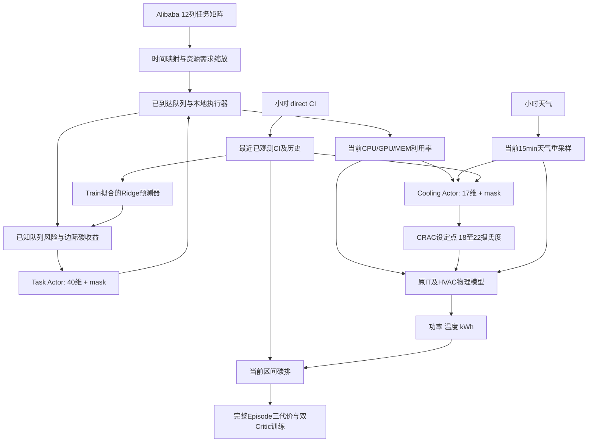

# 单数据中心研究对象、物理配置、模型参数与数据输入总说明

> 核对日期：2026-10-18（Asia/Shanghai）。本文以当前 JointRL-V3 / RAC-MAPPO 为主要说明对象，同时列出 E1、JointRL-V1、V2 的继承与差异。所有数值以实际源码、冻结配置及现有审计元数据为依据。

除核对日期外，下文场景窗口和模型日历特征的时间均按 UTC 表示；用户所在的北京时间不改变仿真数据的 UTC 时间轴。

## Material Passport

| 项目 | 本文口径 |
|---|---|
| 文档目的 | 说明“研究了什么对象、对象怎样配置、数据有哪些字段、如何进入物理模型与学习模型、模型参数是什么” |
| 源码基准 | `8a65b3aaf049e062e6030a0b7355803ccce83d5a`，分支 `research/rac-mappo-v3` |
| 仓库目录 | `D:/A-myprofile/SustainCluster/publication/sustaincluster-carbon-scheduling-001` |
| 原始数据根目录 | `D:/A-myprofile/SustainCluster/upstream` |
| 核查方式 | 源码与配置审计、既有数据身份/场景元数据核对、无数据网络实例化参数计数、手工输入下的原物理函数单点验算 |
| 数值含义 | 硬件/算法“配置上限”与训练“实际完成量”分开；本文件不更新训练成绩，不以配置上限表示已完成实验 |
| 证据边界 | 已确认软件输入与变换；无法仅凭代码证明原始传感器单位或物理模型已完成真实机房标定 |
| Test | September payload 未因本次整理而访问；本文只引用配置中的 Test 窗口元数据 |

## 阅读导航

1. [先明确研究对象与数据流](#objects)
2. [IT、机架、制冷及功率模型的实际配置](#physics)
3. [原始数据字典、处理、时间切分与场景增强](#data)
4. [Actor/Critic/预测器的逐项输入和全部主要参数](#models)
5. [一次输入到控制、物理反馈和学习的完整过程](#pipeline)
6. [有效参数速查、数据身份与复核入口](#reference)

## 0. 先明确：一个单数据中心，多个对象层次和控制算法版本

当前研究的物理场景是 **一个 `DC1 / US-CAL-CISO` 数据中心**：任务在本地 CPU/GPU/MEM 资源池中运行，IT 用电产生热负荷，再由制冷设备提供冷却。E1、JointRL-V1、V2、V3、CARB 是围绕该单中心的不同调度/控制方法或实验版本，不能按 Git 分支数把它们数成几个不同机房。

工作负载来自 Alibaba trace，电网碳强度与天气来自 California 2023 年数据；它们在模拟器中按约定时间配对。**这不是同一座实际机房同步采集的任务、功率、天气和碳排实测数据集。**

| 层次/研究对象 | 包含什么 | 当前配置或输入 | 是否学习得到 |
|---|---|---|---|
| 单 DC / 逻辑资源池 | CPU、GPU、主内存三类共享容量 | 50,000 cores、1,000 GPU 单位、80,000 内存单位；代码按 GB 解释内存 | 固定配置 |
| 任务对象与队列 | 到达、duration、三资源需求、合成 deadline、pending/running/completed 状态 | 15 min 到达桶；非抢占；每任务资源需求与 duration 固定 | trace 映射和执行器计算 |
| 机架与服务器功率对象 | CPU、GPU、服务器风机、DRAM | 资源参数经过 reader 重建为 32 个同构机架，细节见第 1 部分 | 上游经验代数模型，V3 未重新拟合 |
| IT 侧调度控制器 | Task Actor | 每候选 40 维向量 + 2 动作 mask，输出 Start / Wait | PPO 与可靠教师辅助学习 |
| 制冷设备对象 | CRAC 风机、冷却塔风机、压缩机、冷冻水泵、冷却塔水泵 | 由 IT 功率、室外干球温度和 CRAC setpoint 计算完整 HVAC 电功率 | 上游经验公式与 sizing 参数 |
| 制冷控制器 | Cooling Actor | 调度后 17 维向量 + 3 动作 mask，输出降温 / 保持 / 升温 | 先 DP 教师 BC，再 PPO |
| CI 预测器 | 多输出 Ridge | 当前与历史 8 个 CI + 4 个日历特征，输出 16 个左边界 CI 值 | 仅 Train 拟合一次，之后冻结 |
| Deadline 风险/等待预算器 | 已知队列的 Start/Wait 配对 EDF 延续 | 当前已到达任务、运行释放表、容量与已有等待承诺 | 确定性计算，无神经网络权重 |
| 系统边际碳收益估算器 | IT+完整 HVAC 反事实比较 | 风险器的负载轨迹、预测 CI 情景、当前天气、共同设定点延续 | 调用隔离的原物理函数，无另一个功率学习器 |
| 集中式价值模型 | Task/Cooling 两个双代价 Critic | 各自决策边界的 26 维 context + 最多 256×5 队列，分别输出碳/Deadline 价值 | 只在训练时更新；执行动作由 Actor 给出 |
| 事后评价对象 | 总碳、增量碳、DMR、完成率、等待/JCT、IT/HVAC 分项 | 实际物理区间与完整任务账本 | 评价量，不是在线 Actor 的未来输入 |

“参数”在本文件分三类：①物理与仿真固定参数；②学习算法超参数；③训练后权重/回归系数。前两类逐项列值；第三类列张量形状、参数量和保存位置，具体浮点权重以对应 checkpoint 为准。

天气重采样与 CI 处理规则不同：当前天气由相邻小时双端插值构造，当前 CI 取不晚于当前时刻的最近小时值。天气插值使用下一小时端点的事实及固定 UTC−7 约定在第 2 部分详细说明。

### 0.1 配置生效的优先级

实际链条是：`源参数 JSON → DC_Config reader 按逻辑资源重建 → make_dc_env 做设备 sizing → JointPowerModel 施加 Joint 冷却协议 → 场景与模型配置`。因此不能只读一个 JSON 就认定所有最终参数。

| 配置层 | 关键文件/记录 | 怎样使用 |
|---|---|---|
| 单 DC 身份、原始数据、容量 | `experiments/e1/configs/e1_5b_ppo.json` | DC1 / California、三资源容量、数据路径与源 SHA |
| 设备原始常数 | `configs/dcs/dc_config.json` | 提供温度拟合、空气、泵、原设备功率列表等 |
| 机架重建与设备 sizing | `utils/dc_config_reader.py`、`utils/make_envs.py` | 覆盖 JSON 的部分机架数、CPU/GPU 规格及冷却塔参考值 |
| Joint 物理协议 | `experiments/joint/config.yaml` | 15 min、18–22°C、初始22°C、入口28°C、归一化尺度 |
| V2/V3 场景池 | `experiments/joint_v2/scenario_config.yaml`、本地 `scenarios-001/manifest.json` | 96 Train + 2 Development + 1 July Validation 的固定元数据 |
| V3 有效学习配置 | `experiments/joint_v3/config.yaml`、`config.py` | 使用最外层 `ppo`、`forecast`、`risk`、`teacher`、`budget` 等；嵌套 `v1_protocol.ppo` 保存旧协议，不能覆盖外层有效值 |
| 正式运行快照 | 本地 `research_notes/joint_v3/formal-001/configs/full-<seed>.json`、各 `training/config.json` | 每个种子/消融的精确运行配置；本次核对 full-20261017 的相关参数与发布配置一致 |

V2 的发布 `training_config.yaml` 与本地首轮正式运行 `training/training_config.json` 已逐项比对一致。下文版本表不会把默认值、计划上限和实际训练成绩混在一起。

上游 `configs/env/sim_config.yaml` 另有 `2023-08-01 05:00`、7天、`cloud_provider=aws`、`single_action_mode=true` 等默认项。当前单DC正式入口加载冻结场景池，使用上表的独立配置；这些上游默认项不能代替本研究的到达窗口、容量或逐候选Task动作定义。

## 1. IT、机架、制冷及功率模型的实际配置

### 1.1 研究对象的实际入口和参数覆盖链

1. E1 配置 [experiments/e1/configs/e1_5b_ppo.json:23–27](D:/A-myprofile/SustainCluster/publication/sustaincluster-carbon-scheduling-001/experiments/e1/configs/e1_5b_ppo.json:23) 指定 DC1、`US-CAL-CISO`、50,000 CPU cores、1,000 GPU units、80,000 memory units、固定 HVAC 22°C；工作负载基本资源倍率5、SLA倍率1.5。其中 memory 被物理接口命名 `dc_memory_GB`，`Task` 文档也把 `mem_req` 写为GB（[rl_components/task.py:17–20](D:/A-myprofile/SustainCluster/publication/sustaincluster-carbon-scheduling-001/rl_components/task.py:17)）。**这只证明代码的解释单位，未证明原始trace `avg_mem`已经核验为GB。**
2. V2场景构建在 [experiments/joint_v2/scenarios.py:395](D:/A-myprofile/SustainCluster/publication/sustaincluster-carbon-scheduling-001/experiments/joint_v2/scenarios.py:395) 重建同样的字典，`:332–333` 强制逻辑容量 `(50000,1000,80000)`、基本资源倍率5。
3. V3 环境 [experiments/joint_v3/env.py:111–129](D:/A-myprofile/SustainCluster/publication/sustaincluster-carbon-scheduling-001/experiments/joint_v3/env.py:111) 继承 V2；V2环境 [experiments/joint_v2/env.py:119–122](D:/A-myprofile/SustainCluster/publication/sustaincluster-carbon-scheduling-001/experiments/joint_v2/env.py:119) 创建 `JointPowerModel`，复用 V1 冷却协议。V3配置 [experiments/joint_v3/config.py:39–43](D:/A-myprofile/SustainCluster/publication/sustaincluster-carbon-scheduling-001/experiments/joint_v3/config.py:39) 检查冻结的V1物理协议未变。
4. 物理适配器 [experiments/joint/power.py:110–117](D:/A-myprofile/SustainCluster/publication/sustaincluster-carbon-scheduling-001/experiments/joint/power.py:110) 调用 `make_dc_env`，输入容量标量

   \[
   (6\times50000+500\times1000+2.5\times80000)/10^6=1.0\ \mathrm{MW}.
   \]

   这里的6、500、2.5是资源容量换算系数（W/core、W/GPU、W/memory-unit的代码语义），不是运行时逐任务功率公式。没有电池或传输模型，`max_bat_cap_Mw=0`。`datacenter_capacity_mw`在 `DC_Config` 中保存（[utils/dc_config_reader.py:22–27](D:/A-myprofile/SustainCluster/publication/sustaincluster-carbon-scheduling-001/utils/dc_config_reader.py:22)），实际机架数由资源数重建；运行功率没有1MW截断。
5. [utils/make_envs.py:152–174](D:/A-myprofile/SustainCluster/publication/sustaincluster-carbon-scheduling-001/utils/make_envs.py:152) 加载JSON后重建机架配置并执行制冷设备sizing；[envs/sustaindc/dc_gym.py:74–80](D:/A-myprofile/SustainCluster/publication/sustaincluster-carbon-scheduling-001/envs/sustaindc/dc_gym.py:74) 用这些处理后的参数创建运行IT模型。
6. `LocalExecutor` 计算当期所有运行任务的资源使用，再用使用量/逻辑容量得到三资源利用率，最后一次 `measure` 推进物理计算（[experiments/e1/engine.py:245–250](D:/A-myprofile/SustainCluster/publication/sustaincluster-carbon-scheduling-001/experiments/e1/engine.py:245)）。Joint冷却桥在该次 `measure` 内先观察，再执行一次冷却动作，再测量一次功率（[experiments/joint/env.py:130–147](D:/A-myprofile/SustainCluster/publication/sustaincluster-carbon-scheduling-001/experiments/joint/env.py:130)）。

### 1.2 原始JSON与实际研究物理对象的区别

| 项目 | 原始 `configs/dcs/dc_config.json` | 研究运行实际值/规则 | 源码 |
|---|---|---|---|
| 房间布局 | 4行×每行5机架，即描述性20机架 | 不用该20作为运行机架数；资源重建为32机架 | JSON:3–4；[dc_config_reader.py:57–64](D:/A-myprofile/SustainCluster/publication/sustaincluster-carbon-scheduling-001/utils/dc_config_reader.py:57) |
| CPU/GPU每架 | `CPUS_PER_RACK=200`、`GPUS_PER_RACK=100` | 改为CPU核心数参数1,563/架、GPU配置32/架 | JSON:49–50；reader:63–64 |
| CPU每server | JSON 20组 `[full,idle]`，多为 `[130,10]`，含170/120/110等 | 原CPU列表不被用于研究配置；改为 `[384,20] W`，384=64 cores×6W | JSON:94–175；reader:29–32、76–87 |
| GPU每device | 20组full均250W；15组idle22W、5组idle25W | 取均值 `[250,22.75] W`，各架相同 | JSON:176–257；reader:79–82、90–97、168–171 |
| 供风approach | 10个5.3°C、10个5.0°C | 先均值为5.15°C后复制32次，随后clamp到[3.8,5.3]仍为5.15°C | JSON:5–26；reader:69–74；model:450–456 |
| 回风approach | 10个−3.7°C、10个−2.5°C | 均值−3.1°C后复制32次 | JSON:27–48；reader:69–74 |
| CT参考风量 | 2.8315m³/s | sizing覆盖为80.78541187742512m³/s | JSON:62；make_envs:172–174 |
| CT风机参考功率 | 1000W | sizing覆盖为3,484,456.58145007W；该变量同时作为冷机名义制冷容量输入 | JSON:61；make_envs:174；model:705、724 |
| chiller COP | JSON base5.0、K0.1、nominal25°C | 读取但运行 `calculate_chiller_power` 使用硬编码rated COP3.0；上述三项不参与该函数 | JSON:58–60；reader:148、152–153；model:629–636、673 |
| 原始动作参数 | `make_dc_env`: 初值18°C；sizing温度15°C/21.6°C | E1固定22°C；Joint初值22°C，可选18–22°C，每步±1/0°C | make_envs:133–140；e1/power:33；joint/power:20–22、103–107、151–162 |

#### 1.2.1 可复算的机架/服务器/核心/GPU链

[utils/dc_config_reader.py:29–32](D:/A-myprofile/SustainCluster/publication/sustaincluster-carbon-scheduling-001/utils/dc_config_reader.py:29)：每服务器64cores、6W/core、每GPU服务器4GPU、每机架最多25服务器。

\[
N_{CPU\ server}^{needed}=\lceil50000/64\rceil=782,\quad
N_{GPU\ server}^{needed}=\lceil1000/4\rceil=250.
\]

reader `:57–64` 取两者最大值782，并得

\[
R=\lceil782/25\rceil=32,\quad
C_{rack}=\lceil50000/32\rceil=1563,\quad
G_{rack}^{config}=\lceil1000/32\rceil=32.
\]

reader `:85–91` 为每架生成 `ceil(1563/64)=25` 个CPU server配置和32个GPU device配置。reader `:99–104` 将上限设为

\[
P_{rack,max}^{config}=25\times384+32\times250=17600\ \mathrm W.
\]

但是 `Rack.__init__` 实际只遍历CPU server列表，并在对应server上附一个GPU参数（[envs/sustaindc/datacenter_model.py:129–145](D:/A-myprofile/SustainCluster/publication/sustaincluster-carbon-scheduling-001/envs/sustaindc/datacenter_model.py:129)）；实际25个server对象/架、25个GPU对象/架，后7个GPU配置不被遍历使用（`:156–157`）。25个CPU+25个GPU的额定和15,850W低于17,600W，没有触发 `>=max_W_per_rack` 时pop的分支（`:147–154`）。因此物理等效：

- 32×25=800 CPU server；按64核/server计为51,200core等效，逻辑调度仍用50,000。
- 32×25=800 GPU device等效；逻辑调度仍用1,000GPU，利用率分母也仍是1,000。
- 研究配置中的4GPU/server只参与最初GPU服务器需求数估算，并未实现4GPU在每个server上的功率对象。
- `total_DC_full_load` 为各rack额定对象和：32×25×(384+250)=507,200W（[model.py:569–573](D:/A-myprofile/SustainCluster/publication/sustaincluster-carbon-scheduling-001/envs/sustaindc/datacenter_model.py:569)）。该值也不是IT运行功率上限，因为运行CPU温度公式可以超过额定full load。
- 80,000 memory单位物理上被作为GB输入，其DRAM常量功率=0.07×80,000=5,600W；每架175W。DRAM未建离散DIMM对象。

必须在论文里区分“逻辑资源容量”与“上游物理模型的同构离散近似”；不能宣称32机架模型精确安装了1,000个GPU，不能把GPU idle18.2kW误算成22.75kW。

### 1.3 工作负载→利用率→功率

#### 1.3.1 任务资源语义与单位边界

E1 [experiments/e1/workload.py:129–161](D:/A-myprofile/SustainCluster/publication/sustaincluster-carbon-scheduling-001/experiments/e1/workload.py:129) 使用12列矩阵，顺序在`:14–16`：`job_name,start_time,end_time,start_dt,duration_min,cpu_usage,gpu_wrk_util,avg_mem,avg_gpu_wrk_mem,bandwidth_gb,weekday_name,weekday_num`。

\[
c_i=5\,raw[5]/100,\quad g_i=5\,raw[6]/100,\quad m_i=5\,raw[7],\quad d_i=raw[4]\ \text{minutes}.
\]

CPU/GPU请求允许小数；它们是trace观测使用量映射的资源需求，不是必须整数的整机申请。内存只乘5，**没有可见的byte/MB/GB转换**；`avg_gpu_wrk_mem=raw[8]`不进入`mem_req`，也没有显存容量约束。`bandwidth_gb`保留但本地执行指标将传输能耗固定0（[experiments/e1/metrics.py:18](D:/A-myprofile/SustainCluster/publication/sustaincluster-carbon-scheduling-001/experiments/e1/metrics.py:18)）。

V2/V3 `_make_workload` 在 [experiments/joint_v2/scenarios.py:274–285](D:/A-myprofile/SustainCluster/publication/sustaincluster-carbon-scheduling-001/experiments/joint_v2/scenarios.py:274) 使用 `scale=5×pressure`，三个资源需求一并乘pressure，duration不乘pressure；代码内memo `:413`明确写“synthetic factor scales demands only”。SLA deadline=arrival+SLA倍率×duration（[workload.py:44–46](D:/A-myprofile/SustainCluster/publication/sustaincluster-carbon-scheduling-001/experiments/e1/workload.py:44)）。

#### 1.3.2 本地资源池与区间负载

只有DC1：执行器拒绝任何 `dc_id != 1`（[experiments/e1/engine.py:62–63](D:/A-myprofile/SustainCluster/publication/sustaincluster-carbon-scheduling-001/experiments/e1/engine.py:62)），pool `dc_id=1`（`:24`），启动后dest固定1（`:231`）。这里没有跨DC选择、迁移、全局网络队列。

对每项资源r：

\[
U_r(t)=\sum_{i\in running(t)}request_{i,r},\qquad
u_r(t)=U_r(t)/Capacity_r.
\]

`engine.py:26–42` 用逐维累计需求检查 `<=capacity`，不超卖；资源守恒；`:247–248`传入三个利用率。底层 [dc_gym.py:320–335](D:/A-myprofile/SustainCluster/publication/sustaincluster-carbon-scheduling-001/envs/sustaindc/dc_gym.py:320) 断言各利用率在[0,1]。

任务启动分配资源并设 `finish_time=start+duration`（[envs/sustaindc/sustaindc_env.py:214–220](D:/A-myprofile/SustainCluster/publication/sustaincluster-carbon-scheduling-001/envs/sustaindc/sustaindc_env.py:214)）；完成资源释放仅在后续15分钟边界观察时进行（`:170–183`；执行器`:160`）。任务不被抢占，不随温度/功率动作改变duration；每个区间用左边界任务集合保持15分钟。区间内结束的任务仍按整个区间负载计电，下一边界才释放。[metrics.py:35](D:/A-myprofile/SustainCluster/publication/sustaincluster-carbon-scheduling-001/experiments/e1/metrics.py:35)明确记录 `left_boundary_hold`。

`STEP=15min`（[experiments/e1/contracts.py:9](D:/A-myprofile/SustainCluster/publication/sustaincluster-carbon-scheduling-001/experiments/e1/contracts.py:9)）；[metrics.py:8–18](D:/A-myprofile/SustainCluster/publication/sustaincluster-carbon-scheduling-001/experiments/e1/metrics.py:8)：

\[
E_t=P_t\times0.25\ \mathrm{kWh},\qquad
C_t=E_t\times CI_t/1000\ \mathrm{kgCO_2e}.
\]

### 1.4 实际IT方程：必须引用向量化路径

运行路径调用 `compute_instantaneous_pwr_vecd`，而非 `Server.compute_instantaneous_cpu_pwr` 或旧版非向量化rack函数。二者的温度斜率、GPU归一化、风机公式不同。实际代码在 [envs/sustaindc/datacenter_model.py:373–423](D:/A-myprofile/SustainCluster/publication/sustaincluster-carbon-scheduling-001/envs/sustaindc/datacenter_model.py:373)；参数数组构造在`:204–265`。

每架以首rack代表，其入风温度

\[
T_{in}=T_{set}+5.15.
\]

CPU曲线基础参数来自JSON `:71–78` 和model `:43–46`：

\[
m_c=(0.03-0.01)/(28-16)=1/600,\quad b_c=0.03-28/600=-1/60,\quad s_c=1.00-0.01=0.99.
\]

但**实际向量化式额外加0.05到温度斜率**（model:386）：

\[
p_{CPU}=\max\{20,384[(1/600+0.05)T_{in}-1/60+0.99u_c]\}\ \mathrm W/server.
\]

这里没有`min(full_load_pwr,...)`上限。因此CPU名义full=384W不限制运行功率，T=27.15°C且CPU利用率0仍约532.256W/server；满载约912.416W/server。这是代码行为，不宜解释成已校准硬件泄漏功率。

GPU实际向量化公式对百分比先/100（model:393–401）：

\[
p_{GPU}=22.75+(250-22.75)\log_2(1+u_g)\ \mathrm W/device.
\]

0利用时仍算idle22.75W；1利用时250W。

IT风机JSON参数 `:79–93`：airflow lower `[0.01,0.225]`，upper `[0.225,1.0]`，full-load volume0.051m³/s，reference ratio1、reference power10W，inlet domain16–28°C。曲线（model:53–56）给

\[
m_f=(0.225-0.01)/12=0.0179166667,\quad b_f=0.225-28m_f=-0.2766666667,\quad s_f=0.225-0.01=0.215.
\]

实际rack硬编码 `m_coefficient=10,c_coefficient=5,it_slope=20`（model:221–223），有GPU时

\[
L_{eff}=100(u_c+u_g+u_m)/3,\quad
r_f=10m_fT_{in}+5b_f+0.215L_{eff}/20,
\]

\[
p_{ITfan}=10(r_f/1.0)\ \mathrm W/server,\quad
v_{server}=0.051r_f\ \mathrm{m^3/s}.
\]

这是线性功率比，未用风机立方定律；r_f未clip到1，JSON upper第二项1.0不直接进入此式。单架总风量=25个server风量之和（model:434–440）。**server fan归入IT；CRAC fan、CT fan归入HVAC。**

全DC：

\[
P_{IT}=800p_{CPU}+800p_{ITfan}+800p_{GPU}+5600\quad(\mathrm W).
\]

内存利用率仅通过风机effective load影响IT风机功率；DRAM项自身为固定0.07W/GB×容量，未按当前内存占用比例调节。以上广播/DRAM公式在model:507–566，尤其`:534–536、557–564`。

### 1.5 温度对象、热模型及动作约束

全架利用率相同被assert（[model.py:511–516](D:/A-myprofile/SustainCluster/publication/sustaincluster-carbon-scheduling-001/envs/sustaindc/datacenter_model.py:511)），首rack结果广播所有rack（`:518–521、557–564`）。实际没有32个独立热状态、机架布局优化或热点追踪。

设单架IT总电功率为q、单架server风量之和为v，则出口温度是代数经验式（[model.py:538–549](D:/A-myprofile/SustainCluster/publication/sustaincluster-carbon-scheduling-001/envs/sustaindc/datacenter_model.py:538)）：

\[
T_{out}=T_{in}+\frac{1.918q^{1.096}}{1006\times1.225\times v^{0.824}\times0.526}-14.01.
\]

回到CRAC的平均温度（model:807–817）：

\[
T_{return}=T_{out}-3.1.
\]

模型没有热容、时间常数、热惯性积分方程；“previous inlet/outlet”是前区间传感器记录，不代表方程隐含了一阶动态。出口>80°C只打印警告；若出口−入口<2°C则抛异常（model:551–555）。出口无28°C硬约束。**28°C只限制rack inlet拟合域，不是出口温度上限。**

Joint冷却协议 [experiments/joint/config.yaml:7–10](D:/A-myprofile/SustainCluster/publication/sustaincluster-carbon-scheduling-001/experiments/joint/config.yaml:7)：初值22°C，合法setpoint18–22°C，动作0降1°C、1保持、2升1°C；端点动作mask，非法动作直接拒绝（[joint/power.py:140–162](D:/A-myprofile/SustainCluster/publication/sustaincluster-carbon-scheduling-001/experiments/joint/power.py:140)）。因此可达到入口23.15–27.15°C，落在原IT拟合域16–28°C；入口限值28°C（`:81–88、123–129`）。28°C明确是模型拟合域上界，不是硬件认证或SLA保证。

[joint/power.py:192–212](D:/A-myprofile/SustainCluster/publication/sustaincluster-carbon-scheduling-001/experiments/joint/power.py:192) 冷却原始观察包括CPU/GPU/MEM利用率、旧setpoint下本期当前IT功率、上一期IT/HVAC功率、setpoint、上一期入口/出口最大温度、传感器可用标志、当期干球温度/湿球近似/CI、hour/day正余弦。初次无物理读数时previous inlet使用setpoint+approach、outlet使用0且sensor unavailable。`_current_it_kw`仅算代数IT并恢复fan cache（`:171–190`），不提前做post-action HVAC计算，不推进物理读数。

[experiments/joint/env.py:231–246](D:/A-myprofile/SustainCluster/publication/sustaincluster-carbon-scheduling-001/experiments/joint/env.py:231) 将kw用power scale1000、°C用temperature scale40、CI用1000做 `bounded(v,s)=v/(s+abs(v))`归一化；这不是原始物理量。

Joint热罚项是 `max(0,T_in,max−28)`（[joint/reward.py:53–60](D:/A-myprofile/SustainCluster/publication/sustaincluster-carbon-scheduling-001/experiments/joint/reward.py:53)），选择约束为0次温度超限（[joint/config.yaml:31](D:/A-myprofile/SustainCluster/publication/sustaincluster-carbon-scheduling-001/experiments/joint/config.yaml:31)），由于同构入口=当前合法setpoint+固定5.15，合法动作下入口本来不超过27.15°C；热安全约束在当前简化域内基本由动作范围保证，不能据此推出真实热安全。

V2/V3 drain后settling需另见环境桥；物理约束范围仍18–22°C，不要把idle reference18°C误写为所有时刻固定18°C（V2默认 [experiments/joint_v2/config.py:16–17](D:/A-myprofile/SustainCluster/publication/sustaincluster-carbon-scheduling-001/experiments/joint_v2/config.py:16)）。

### 1.6 HVAC设备参数与完整电功率边界

#### 1.6.1 JSON保留且实际使用的常数

[configs/dcs/dc_config.json:52–68](D:/A-myprofile/SustainCluster/publication/sustaincluster-carbon-scheduling-001/configs/dcs/dc_config.json:52)：

| 参数 | 值 | 代码单位/作用 |
|---|---:|---|
| C_AIR | 1006 | J/(kg·K) |
| RHO_AIR | 1.225 | kg/m³ |
| CRAC_SUPPLY_AIR_FLOW_RATE_pu | 0.00005663 | 按式为m³/(s·W)，乘当期IT W得到m³/s |
| CRAC_REFRENCE_AIR_FLOW_RATE_pu | 0.00009438 | 与上项同单位，用于风量比 |
| CRAC_FAN_REF_P | 150 | W |
| CW_PRESSURE_DROP | 300000 | Pa |
| CW_WATER_FLOW_RATE | 0.0011 | m³/s |
| CW_PUMP_EFFICIENCY | 0.87 | 无量纲，87% |
| CT_PRESSURE_DROP | 300000 | Pa |
| CT_WATER_FLOW_RATE | 0.0011 | m³/s |
| CT_PUMP_EFFICIENCY | 0.87 | 无量纲，87% |

单位注释见[utils/dc_config_reader.py:138–160](D:/A-myprofile/SustainCluster/publication/sustaincluster-carbon-scheduling-001/utils/dc_config_reader.py:138)。`CRAC_*_pu`没有明确物理单位声明，上述单位是由计算式维度推导，论文应标注代码语义。

#### 1.6.2 sizing运行实际覆盖数值

[utils/make_envs.py:134–135、163、172–174](D:/A-myprofile/SustainCluster/publication/sustaincluster-carbon-scheduling-001/utils/make_envs.py:134)：sizing输入下限15°C、上限21.6°C、最大环境温度30°C。[model.py:729–805](D:/A-myprofile/SustainCluster/publication/sustaincluster-carbon-scheduling-001/envs/sustaindc/datacenter_model.py:729) 使用CPU/GPU/MEM均100%，在setpoint21.6°C计算outlet，然后以 `Treturn−15`计算design cooling load：

\[
\dot m_{air,design}=1.225\times0.00005663\times P_{IT,design},
\quad Q_{design}=\dot m_{air,design}\times1006\times\max(T_{return,design}-15,0).
\]

\[
\Delta T_{tower,design}=\max(50-(30-15),1)=35,
\quad V_{tower,ref}=Q_{design}/(1006\times35\times1.225).
\]

复算 `Qdesign=3,484,456.58145007W`、`Vtower,ref=80.78541187742512m³/s`。赋值 `CT_FAN_REF_P=Qdesign`、`CT_REFRENCE_AIR_FLOW_RATE=Vtower,ref`。该热量被作为“塔风机参考电功率”和冷机名义冷量同时使用，是上游实现现状，不能直接表述为经工程选型的3.484MW真实风机。

初始化还用setpoint27°C、100%三资源、外温30°C做IT/HVAC范围估计（[make_envs.py:187–224](D:/A-myprofile/SustainCluster/publication/sustaincluster-carbon-scheduling-001/utils/make_envs.py:187)）。这里27°C不是运行动作，也不是min/max；该临时计算入口32.15°C超出原16–28拟合域，尽管Joint实际控制域不外推。`max_dc_power_w`算出来并未用于运行功率截断，函数最后返回`max_dc_pw=0`（`:266–268`）。因此不能据该初始化范围声称物理模型处处严格在拟合域内。

#### 1.6.3 运行公式

运行 `calculate_HVAC_power`（[model.py:681–727](D:/A-myprofile/SustainCluster/publication/sustaincluster-carbon-scheduling-001/envs/sustaindc/datacenter_model.py:681)）虽然参数名为 `data_center_full_load`，调用方实际传入当期IT总功率（[dc_gym.py:213–218](D:/A-myprofile/SustainCluster/publication/sustaincluster-carbon-scheduling-001/envs/sustaindc/dc_gym.py:213)）：

\[
\dot m_{air}=1.225\times0.00005663\times P_{IT},\quad
Q_{CRAC}=\dot m_{air}\times1006\max(T_{return}-T_{set},0).
\]

\[
P_{CRACfan}=150\left(0.00005663/0.00009438\right)^3
=32.40343305195208\ \mathrm W.
\]

两泵恒定：

\[
P_{CWpump}=P_{CTpump}=300000\times0.0011/0.87
=379.3103448275862\ \mathrm W.
\]

冷机电功率 `Pcomp=calculate_chiller_power(CT_FAN_REF_P,QCRAC,Tambient)`（`:705`）。若外温<5°C，只把塔风机置0，压缩机和两泵仍保留（`:713–714`）。否则：

\[
\Delta T_{tower}=\max[50-(T_{amb}-T_{set}),1],\quad
V_{tower}=(Q_{CRAC}+P_{comp})/(1006\Delta T_{tower}\times1.225),
\]

\[
P_{CTfan}=CT\_FAN\_REF\_P\times\min(V_{tower}/V_{tower,ref},1)^3.
\]

塔风机有比值上限1；CRAC风机和两泵不随任务量启停。`QCRAC`是热功率，**不加入电功率合计**。热回收扣减语句在`:701–703`被注释；热回收配置不参与运行电量。

冷机完整常数在[model.py:625–678](D:/A-myprofile/SustainCluster/publication/sustaincluster-carbon-scheduling-001/envs/sustaindc/datacenter_model.py:625)：capacity coefficients `[0.944836,-0.0570088,0.00185486]`；power coefficients `[2.333,-1.975,0.6121]`；PLR factor `[0.03303,0.6852,0.2818]`；minPLR0.05、maxPLR1.0、design condenser35°C、design evaporator outlet6.67°C、temp rise2.778°C、rated COP3.0。

令D=(Tamb−35)/2.778−(6.67−35)，A=0.944836−0.0570088D+0.00185486D²，available=Qdesign×A，F=2.333−1.975A+0.6121A²，r=clip(QCRAC/available,0.05,1)，G=0.03303+0.6852r+0.2818r²。当available>0时actual r用低于0.05的原始比例处理cycling，cycling=min(1,actual_r/0.05)若actual_r<0.05，否则1；Pcomp=G×F×available/3×cycling。available≤0或实际比例≤0时返回0。PLR在1处限幅，但模型没有将未满足冷量反馈为机架热累积或任务降速。

#### 1.6.4 Joint与历史E1的电量口径不同

[experiments/joint/power.py:17–19、220–238](D:/A-myprofile/SustainCluster/publication/sustaincluster-carbon-scheduling-001/experiments/joint/power.py:17) 定义`joint_full_hvac_v1`：

\[
P_{HVAC}=P_{CRACfan}+P_{CTfan}+P_{comp}+P_{CWpump}+P_{CTpump},\quad
P_{total}=P_{IT}+P_{HVAC}.
\]

6个电分项为`it,crac_fan,ct_fan,compressor,cw_pump,ct_pump`，返回kW。IT已经包括CPU、GPU、server fan和DRAM；不再把server fan重复加到HVAC。

历史E1 [experiments/e1/power.py:45–47](D:/A-myprofile/SustainCluster/publication/sustaincluster-carbon-scheduling-001/experiments/e1/power.py:45) 读取旧字段；旧HVAC只有CT风机+compressor；旧total=IT+旧HVAC（[dc_gym.py:220、250–251](D:/A-myprofile/SustainCluster/publication/sustaincluster-carbon-scheduling-001/envs/sustaindc/dc_gym.py:220)）。Joint保留`legacy_hvac_kw,legacy_total_kw`用于比较。两种口径差恰为CRAC风机+两泵=**0.7910241227071244kW**。早期旧泵字段`dc_CW_pump_power_kW/dc_CT_pump_power_kW`名为kW但值仍是W（[dc_gym.py:257–258](D:/A-myprofile/SustainCluster/publication/sustaincluster-carbon-scheduling-001/envs/sustaindc/dc_gym.py:257)）；Joint直接读取原W属性再/1000，单位正确；新显式电功率字段`:241–247`也正确。

#### 1.6.5 湿球、水耗和未计入目标的配置

[dc_gym.py:223–228](D:/A-myprofile/SustainCluster/publication/sustaincluster-carbon-scheduling-001/envs/sustaindc/dc_gym.py:223)用return/setpoint/湿球做水耗；湿球只在水耗估算使用，不在上面chiller电功率公式中。V2环境构建令湿球=0.9×干球温度（[experiments/joint_v2/scenarios.py:269–270](D:/A-myprofile/SustainCluster/publication/sustaincluster-carbon-scheduling-001/experiments/joint_v2/scenarios.py:269)），这是数值近似，不是由湿度/气压解湿球。

水耗对象参数：CT水流0.0011m³/s→3.96m³/h、cycles of concentration5、drift0.01（[model.py:500–505](D:/A-myprofile/SustainCluster/publication/sustaincluster-carbon-scheduling-001/envs/sustaindc/datacenter_model.py:500)）。水耗函数`:586–603`实际只用range=Treturn−Tset，norm=0.044×wetbulb+0.3528×range+0.101，clip非负，再乘1.01，最后×1000/4输出L/15min并round4。其公式没有实际乘tower_flow_rate；cycles_of_concentration也未参与。Joint奖励/碳核算不含水耗。

原热回收JSON `:267–273`含AVE_HLP2W/(K·m²)、office22°C、DC_AREA_PU0.00152m²/W、OFFICE_BUILDING_AREA1765（按面积命名，reader注释写m有单位不一致）、WATER_REDUCTION_P_KWH2.5。前4项在reader:162–166加载；水耗削减项未在reader载入；运行热回收调用注释，不能说本实验用了热回收减排。

### 1.7 无数据payload的物理数值例子（用于解释，不是实验结果）

只用研究硬件配置、手工设定外温25°C。u=0表示三资源利用率均0；u=1表示均1。数据均为上述当前代码直接计算，未抽取任何训练/验证/Test记录。

| Setpoint | u | IT kW | CPU kW | IT fan kW | GPU kW | DRAM kW | inlet °C | outlet °C | Joint HVAC kW | Joint total kW |
|---:|---:|---:|---:|---:|---:|---:|---:|---:|---:|---:|
| 18 | 0 | 408.231800 | 362.316800 | 22.115000 | 18.200000 | 5.600000 | 23.15 | 42.270044 | 255.247978 | 663.479778 |
| 18 | 1 | 902.759800 | 666.444800 | 30.715000 | 200.000000 | 5.600000 | 23.15 | 69.454327 | 3941.154545 | 4843.914345 |
| 22 | 0 | 477.453133 | 425.804800 | 27.848333 | 18.200000 | 5.600000 | 27.15 | 45.669974 | 287.910512 | 765.363646 |
| 22 | 1 | 971.981133 | 729.932800 | 36.448333 | 200.000000 | 5.600000 | 27.15 | 69.939008 | 3244.224067 | 4216.205200 |

例如22°C、u=1、25°C外温时：QCRAC=3041.546538kW热；CTfan=2244.150323kW电；compressor=999.282719kW电；CRACfan0.032403kW；两泵各0.379310kW。这些数值揭示研究物理模型的边界：1MW输入容量不是总功率上限，Qdesign被复用为塔风机电功率标度时HVAC可达数MW。

### 1.8 当前实现的适用范围与局限

- 这是单DC、聚合资源、同构机架、经验代数IT/HVAC模型；不是机房CFD、异构逐机架热仿真或实际设备数字孪生。
- 逻辑调度50,000cores/1,000GPU/80,000memory与离散物理对象51,200core等效/800GPU/DRAM常量存在近似；资源请求允许小数。
- JSON20rack布局、CPU power列表和CT原1000W/2.8315m³/s不是最终实验运行值；必须披露reader和sizing覆盖。
- 原trace内存单位未在本次物理审计验证；代码直接把5×avg_mem与80,000容量比较，并把80,000当GB传入功率模型。
- 任务duration固定，调度只改变何时开始；没有DVFS、温度降频、热故障、负载依赖吞吐、功率封顶或动态扩缩容。
- 向量化CPU额外温度斜率0.05可使0利用率CPU功率超过名义full；IT fan airflow/power ratio可超过1，不能按常规“idle/full”硬件标定直觉解读。
- CT_FAN_REF_P被sizing热负荷覆盖，又用于风机额定电功率和冷机容量；COP配置5.0未用于运行冷机公式。这些实现事实限制了绝对能耗/真实工程量外推，策略间相对比较也依赖该物理口径。
- inlet28°C边界由setpoint区间和固定approach几乎自动满足；出口可约70°C，出口并未受28°C限制。不能用0次inlet违规证明真实芯片/出风热安全。
- 15分钟左边界负载保持，完成释放延后到网格边界；没有区间内精确任务完成电量积分。
- 湿球近似0.9×drybulb；用电模型只依赖干球，水耗模型也为经验近似，且未纳入碳目标。无电池、网络传输、热回收收益。

## 2. 原始数据字典、处理、时间切分与场景增强

### 2.1 实际输入文件与来源

| 输入 | 当前单 DC 使用的文件（相对 `D:/A-myprofile/SustainCluster/upstream`） | 内容与用途 |
|---|---|---|
| 任务 trace | `data/workload/alibaba_2020_dataset/result_df_full_year_2020.pkl` | 已处理 Alibaba 任务；外层每行一个 15 min 桶，内层 `tasks_matrix` 每行 12 个字段。它是仿真任务的实际读取入口，原始 `pai_*.csv` 不在本地仿真时重新解析。 |
| 电网 CI | `data/carbon_intensity/US-CAL-CISO/2023/US-CAL-CISO_2023_hourly.csv` | California ISO 2023 小时 direct CI，供决策历史与物理碳核算。 |
| 天气 | `data/weather/US-CAL-CISO/2023.json` | 同地区 2023 小时气象数据；实际选 `temperature_2m`。 |
| 物理参数 | `configs/dcs/dc_config.json` | 原 IT/HVAC 物理模型参数，不是观测数据集。 |

路径与 SHA256 白名单在 [E1 配置第 11–21 行](D:/A-myprofile/SustainCluster/publication/sustaincluster-carbon-scheduling-001/experiments/e1/configs/e1_5b_ppo.json:11)；V2 复用同一组文件及白名单，见 [scenarios.py 第 340–345 行](D:/A-myprofile/SustainCluster/publication/sustaincluster-carbon-scheduling-001/experiments/joint_v2/scenarios.py:340)。数据目录说明明确原始 `pai_*` 是历史源文件，实际仿真入口只有年度 PKL，见 [workload README 第 31–56 行](D:/A-myprofile/SustainCluster/publication/sustaincluster-carbon-scheduling-001/data/workload/README.md:31)。Carbon 的仓库来源声明为 Electricity Maps；天气为 Open-Meteo Historical Weather API，见 [Carbon README 第 94 行](D:/A-myprofile/SustainCluster/publication/sustaincluster-carbon-scheduling-001/data/carbon_intensity/README.md:94)、[weather README 第 110 行](D:/A-myprofile/SustainCluster/publication/sustaincluster-carbon-scheduling-001/data/weather/README.md:110)。这些是仓库来源声明，本审计没有另行验证提供商的采集过程。

单 DC 固定为 `dc_id=1 / US-CAL-CISO`，容量 CPU 50,000 核、GPU 1,000 单位、MEM 80,000（模拟器按 GB 解释），HVAC 初值 22°C。见 [E1 配置第 23–27 行](D:/A-myprofile/SustainCluster/publication/sustaincluster-carbon-scheduling-001/experiments/e1/configs/e1_5b_ppo.json:23)、[V2 建场景第 395 行](D:/A-myprofile/SustainCluster/publication/sustaincluster-carbon-scheduling-001/experiments/joint_v2/scenarios.py:395)。电价、跨站点网络价格/延迟矩阵、其他区域 CI/天气均不在这条单 DC 数据装载链中。

### 2.2 任务字段字典：原始矩阵字段与真正使用的字段

12 列顺序由 [workload.py 第 14–16 行](D:/A-myprofile/SustainCluster/publication/sustaincluster-carbon-scheduling-001/experiments/e1/workload.py:14) 固定；实际映射在 [第 129–162 行](D:/A-myprofile/SustainCluster/publication/sustaincluster-carbon-scheduling-001/experiments/e1/workload.py:129)。V2 的同一映射见 [scenarios.py 第 274–285 行](D:/A-myprofile/SustainCluster/publication/sustaincluster-carbon-scheduling-001/experiments/joint_v2/scenarios.py:274)。

| 序号 | 原字段 | 原字段含义/单位证据 | 本地输入与实际用途 |
|---:|---|---|---|
| 0 | `job_name` | 源作业标识，字符串 | 保存在 `source_job_name` 和 `raw_fields`；新的唯一 `task_id` 由源哈希/仿真到达时刻/源行/任务下标组成。不是数值模型特征。 |
| 1 | `start_time` | 源时间数值，历史脚本按秒解释 | 保留溯源；不直接作为当前仿真 arrival。 |
| 2 | `end_time` | 源结束时间数值，历史脚本按秒解释 | 保留溯源；不重新用 `end_time-start_time` 覆盖 duration，也不当作仿真 finish。 |
| 3 | `start_dt` | 由源时间转成 UTC 的原始 timestamp；当前年度容器里仍保留 1970 日期 | E1 保留原字段；V2 用其向下取整 15 min 后识别原始桶，防止把年度平移副本当新数据。 |
| 4 | `duration_min` | 分钟 | `duration = raw[4]`，必须有限且 >0；到达时已知，是模拟器假设。 |
| 5 | `cpu_usage` | 源 CPU 使用量标度；源码约定除以 100 后是 CPU 核当量，数值可大于 100 | `cores_req = 5 * pressure_factor * raw[5] / 100`；转为固定任务 CPU 需求。它是已观测 usage，不是 `plan_cpu` reservation。 |
| 6 | `gpu_wrk_util` | 源 GPU worker 使用量标度；源码约定除以 100 后是 GPU 单位当量 | `gpu_req = 5 * pressure_factor * raw[6] / 100`；允许分数 GPU，非整卡离散分配。 |
| 7 | `avg_mem` | 源内存使用量；下游 `Task` 注释/图表按 GB 解释，但本审计没有原始 sensor 的独立单位规范 | `mem_req = 5 * pressure_factor * raw[7]`，没有额外 MB→GB 或 bytes→GB 转换。论文宜写“沿用上游内存单位约定，模拟器按 GB”。 |
| 8 | `avg_gpu_wrk_mem` | GPU worker 平均内存指标，原始物理单位未从已读源码独立确认 | 完整保存在 `raw_fields`，未进入 `mem_req`，未作为单独 GPU 显存容量约束。 |
| 9 | `bandwidth_gb` | 历史 notebook 由 `(read+write)/1024**3` 派生，源码称 GB；按换算因子更接近 GiB 数据量 | 保存在 `TaskSpec`/`Task`，不乘资源倍率。当前单 DC Joint/V2/V3 的调度/观察/本地 IT+HVAC 路径未引用它；不能称为本地网络速率或网络传输能耗输入。 |
| 10 | `weekday_name` | 源 `start_dt` 派生星期名 | 仅保留溯源；不是当前仿真日历输入。 |
| 11 | `weekday_num` | 源星期编号，Monday=0…Sunday=6 | 同上。V3 CI 预测的星期由当前仿真 UTC `now` 另行计算。 |

`Task` 的单位说明为 duration 分钟、CPU 核、GPU 单位、memory/bandwidth GB，见 [task.py 第 15–24 行](D:/A-myprofile/SustainCluster/publication/sustaincluster-carbon-scheduling-001/rl_components/task.py:15)；旧绘图脚本也把 CPU/GPU 除以 100、MEM/bandwidth 标为 GB，见 [plot_alibaba_workload_stats.py 第 49–63 行](D:/A-myprofile/SustainCluster/publication/sustaincluster-carbon-scheduling-001/data/workload/alibaba_2020_dataset/plot_alibaba_workload_stats.py:49)。这足以确认当前软件约定，但不能替代原始 Alibaba sensor 文档对 `avg_mem`/`avg_gpu_wrk_mem` 的采集单位证明。

#### 更上游存在但未直接传入模型的字段

历史 task-table 脚本列出 `job_name, task_name, inst_num, status, start_time, end_time, plan_cpu, plan_mem, plan_gpu, gpu_type`，见 [analyze_alibaba2020GPU.py 第 10–21 行](D:/A-myprofile/SustainCluster/publication/sustaincluster-carbon-scheduling-001/data/workload/alibaba_2020_dataset/analyze_alibaba2020GPU.py:10)。历史 sensor-table notebook 的列名是 `job_name, task_name, worker_name, inst_id, machine, gpu_name, cpu_usage, gpu_wrk_util, avg_mem, max_mem, avg_gpu_wrk_mem, max_gpu_wrk_mem, read, write, read_count, write_count`，见 [上游 notebook 第 5431–5437 行](D:/A-myprofile/SustainCluster/upstream/data/workload/alibaba_2020_dataset/alibaba_analysis.ipynb:5431)。`task_name`、instance/worker/machine 信息、`plan_*`、GPU 型号、max memory、I/O count 都没有进入当前 12 列矩阵/单 DC 需求映射。并未读取原始 CSV 以验证上述历史代码与所有源表逐列一致。

上游 notebook 把 worker sensor 使用量按 `(job_name,task_name)` 求和，再并入 task 表，见 [第 158–182 行](D:/A-myprofile/SustainCluster/upstream/data/workload/alibaba_2020_dataset/alibaba_analysis.ipynb:158)。`duration_min` 在工具函数中来自 instance runtime 的平均值/60，见 [alibaba_utils.py 第 55–76 行](D:/A-myprofile/SustainCluster/publication/sustaincluster-carbon-scheduling-001/data/workload/alibaba_2020_dataset/alibaba_utils.py:55)。因此不宜把当前任务 duration 直接称为某一个原始 job 的 wall-clock `end-start`。

`bandwidth_gb` 的历史生成源码按 `(job_name,task_name)` 汇总 read/write，但随后仅按 `job_name` 左连接到已抽取表，缺失值补 0，并删除 `task_name`；见 [notebook 第 5464–5468 行](D:/A-myprofile/SustainCluster/upstream/data/workload/alibaba_2020_dataset/alibaba_analysis.ipynb:5464)、[第 5521–5527 行](D:/A-myprofile/SustainCluster/upstream/data/workload/alibaba_2020_dataset/alibaba_analysis.ipynb:5521)。这里存在“按 task 汇总、按 job 连接”的粒度差异；仅凭代码不能独立确认 read/write 是网络字节还是其他 I/O 字节。当前单 DC 未使用此字段，文档应保留其溯源限制。

### 2.3 任务怎样变成每 15 分钟的仿真输入

1. **历史预处理（当前训练不重新执行）**：源码先以 `start_time` 秒数构造时间，把 naive 时间 localize 到 Asia/Shanghai 再转 UTC；产生 weekday 和 `interval_15m=floor(start_dt,15min)`。见 [extract_dataset_from_dfas.py 第 222–245 行](D:/A-myprofile/SustainCluster/publication/sustaincluster-carbon-scheduling-001/data/workload/alibaba_2020_dataset/extract_dataset_from_dfas.py:222)。notebook 曾筛 `duration_min>=15` 和 `start_time>2088000`，见 [notebook 第 1012 行](D:/A-myprofile/SustainCluster/upstream/data/workload/alibaba_2020_dataset/alibaba_analysis.ipynb:1012)、[第 1723–1731 行](D:/A-myprofile/SustainCluster/upstream/data/workload/alibaba_2020_dataset/alibaba_analysis.ipynb:1723)。
2. **历史去异常与分桶**：12 列版本脚本依次对 `duration_min,cpu_usage,avg_mem,bandwidth_gb` 应用每轮当前表的 1.5×IQR 筛选，再按 `interval_15m` 分组，存 12 列 `tasks_matrix`；见 [第 285–305 行](D:/A-myprofile/SustainCluster/publication/sustaincluster-carbon-scheduling-001/data/workload/alibaba_2020_dataset/extract_dataset_from_dfas.py:285)、[第 346–382 行](D:/A-myprofile/SustainCluster/publication/sustaincluster-carbon-scheduling-001/data/workload/alibaba_2020_dataset/extract_dataset_from_dfas.py:346)。这描述仓库历史脚本，当前审计没有重跑，也不声称已证明现存 PKL 的每一步生成日志。
3. **年度扩展**：脚本截取 `1970-01-26 00:00 UTC` 起 7 周；将桶时间平移到 2020-01-01 起，深拷贝任务矩阵、整段重复到跨入 2021。矩阵里的原始 1970 时间字段不随桶平移。见 [第 399–405 行](D:/A-myprofile/SustainCluster/publication/sustaincluster-carbon-scheduling-001/data/workload/alibaba_2020_dataset/extract_dataset_from_dfas.py:399)、[第 424–472 行](D:/A-myprofile/SustainCluster/publication/sustaincluster-carbon-scheduling-001/data/workload/alibaba_2020_dataset/extract_dataset_from_dfas.py:424)。
4. **当前仿真映射**：对每个 `arrival∈[start,end)` 的 15 min UTC 网格，查询 `arrival.replace(year=2020)`。月/日/时/分保持不变；命中的整个桶内任务同时在仿真 `arrival` 到达。原始 `start_dt` 的秒级时刻不再作为单任务 arrival，因此分桶会把桶内到达提前到该桶边界。超过源覆盖报错；覆盖内缺桶视为当拍无到达，不环绕补数据。见 [workload.py 第 137–161 行](D:/A-myprofile/SustainCluster/publication/sustaincluster-carbon-scheduling-001/experiments/e1/workload.py:137)。
5. **任务对象**：保留每行，不按 job identity 去重；唯一 stable ID 分离于原作业名。原始 `duration_min` 原样进入，不向上取整为 15 min。deadline 是合成 `arrival + sla_multiplier*duration`，不是原 trace 真实 SLA；基准 multiplier=1.5，等价容许等待余量 `0.5*duration`。见 [workload.py 第 35–58 行](D:/A-myprofile/SustainCluster/publication/sustaincluster-carbon-scheduling-001/experiments/e1/workload.py:35)。
6. **时间契约**：`STEP=15min`；所有仿真窗口/arrival 必须显式带时区并在 15 min 网格，内部转 UTC，窗口左闭右开。见 [contracts.py 第 9 行](D:/A-myprofile/SustainCluster/publication/sustaincluster-carbon-scheduling-001/experiments/e1/contracts.py:9)、[第 59–78 行](D:/A-myprofile/SustainCluster/publication/sustaincluster-carbon-scheduling-001/experiments/e1/contracts.py:59)。运行中不可抢占；精确 finish 用来判 SLA，资源到其后第一个决策边界释放；每拍 IT/HVAC kW×0.25h 得 kWh，再乘当前 direct CI/1000 得 kgCO2e。该既有执行口径见 [数据冻结协议第 45 行](D:/A-myprofile/SustainCluster/publication/sustaincluster-carbon-scheduling-001/docs/research/e1/E1-5B/E1-5B-data-freeze.md:45)。

质量处理：`duration`/SLA 必须有限正数；CPU/GPU/MEM/bandwidth 必须有限非负。缺失的其他元数据 NaN 可转 JSON null；不是对必需资源插补。schema 不是 12 列、重复外层桶、重复 stable ID、arrival 越界都拒绝。见 [contracts.py 第 47–56 行](D:/A-myprofile/SustainCluster/publication/sustaincluster-carbon-scheduling-001/experiments/e1/contracts.py:47)、[workload.py 第 87–92、117–161 行](D:/A-myprofile/SustainCluster/publication/sustaincluster-carbon-scheduling-001/experiments/e1/workload.py:87)。

### 2.4 Carbon 原始全列、选择列与质量标记

CSV 首行的真实列名如下；**没有**名为 `is_estimated` 或 `estimation_method` 的列，实际名称是 `Data Estimated` 和 `Data Estimation Method`。列定义由 [Carbon README 第 67–77 行](D:/A-myprofile/SustainCluster/publication/sustaincluster-carbon-scheduling-001/data/carbon_intensity/README.md:67) 给出。

| 原始列名 | 含义/单位 | 当前单 DC 是否使用 |
|---|---|---|
| `Datetime (UTC)` | UTC 小时 timestamp | 用作时间索引。 |
| `Country` | 国家名 | 未选入环境样本/actor。 |
| `Zone Name` | 电网区名称 | 未选入；位置由冻结 config 指定。 |
| `Zone Id` | 区域标识 | 未选入。 |
| `Carbon Intensity gCO₂eq/kWh (direct)` | 直接发电排放强度，不含全生命周期 | 唯一选中的 CI 数值；单位 gCO2eq/kWh。 |
| `Carbon Intensity gCO₂eq/kWh (LCA)` | 含燃料提取/基础设施等生命周期排放 | 未用；不能把研究结果称 LCA 核算。 |
| `Low Carbon Percentage` | 低碳电力比例，% | 未用。 |
| `Renewable Percentage` | 可再生电力比例，% | 未用。 |
| `Data Source` | 数据提供来源文字 | 未用作数值过滤或特征。 |
| `Data Estimated` | True 表示估计值，False 表示 measured（按仓库说明） | loader 不检查/排除。 |
| `Data Estimation Method` | 估算/补缺方式文字 | loader 不检查/排除。 |

选 direct 的精确常量见 [environment.py 第 13 行](D:/A-myprofile/SustainCluster/publication/sustaincluster-carbon-scheduling-001/experiments/e1/environment.py:13)。旧 E1 代码首先可生成线性插值环境，但正式 PPO/Joint/V2 使用 `TemporalEnvironment`：在每个 15 min `t` 取 timestamp≤t 的最近小时 CI，四个季度小时通常共享同一小时值，不用下一个小时实际 CI 插值。见 [selection.py 第 56–74 行](D:/A-myprofile/SustainCluster/publication/sustaincluster-carbon-scheduling-001/experiments/e1/selection.py:56)、[V2 scenarios.py 第 258–271 行](D:/A-myprofile/SustainCluster/publication/sustaincluster-carbon-scheduling-001/experiments/joint_v2/scenarios.py:258)。`future_ci=False` 固定于 V2 场景参数，见 [第 417 行](D:/A-myprofile/SustainCluster/publication/sustaincluster-carbon-scheduling-001/experiments/joint_v2/scenarios.py:417)。

质量检查需要完整 hourly endpoints、有限值；E1 `require_hourly_coverage` 和 `_interpolate` 拒绝重复/缺失 timestamp、非有限值，不外推；环境样本另要求 CI 非负，见 [selection.py 第 17–23 行](D:/A-myprofile/SustainCluster/publication/sustaincluster-carbon-scheduling-001/experiments/e1/selection.py:17)、[environment.py 第 23–27、81–94 行](D:/A-myprofile/SustainCluster/publication/sustaincluster-carbon-scheduling-001/experiments/e1/environment.py:81)。V2 安全前缀 decoder 显式检查有限数值与所需小时点集合；它没有 E1 那样显式的重复时间戳/排序检查，而是依赖固定源 SHA 与已核验的源序列，见 [scenarios.py 第 216–271 行](D:/A-myprofile/SustainCluster/publication/sustaincluster-carbon-scheduling-001/experiments/joint_v2/scenarios.py:216)。两条 loader 都没有依据估计标记做修复、降权或删除。

旧协议记录：April 校准与旧 May/July 包络无 estimated 点；全文件存在 2 个标记点，见 [E1-5B 数据冻结第 35、39 行](D:/A-myprofile/SustainCluster/publication/sustaincluster-carbon-scheduling-001/docs/research/e1/E1-5B/E1-5B-data-freeze.md:35)。**这一旧窗口结论不能证明 V2 的 January–May Train 全部无估计值**；当前 source_audit 未给新 Train 估计标记逐窗清单，本次也未扫描年度观测。文稿应明确“使用文件提供的 direct CI；estimated 标志未进入装载过滤”，不得写成所有训练 CI 都是无估计实测。

### 2.5 Weather 原始字段、对齐与插值

原 JSON 元数据核对值：`latitude=37.434093, longitude=-121.95479, utc_offset_seconds=-25200, timezone='America/Los_Angeles', timezone_abbreviation='GMT-7', elevation=7.0`；`generationtime_ms` 是 API 响应生成耗时，不是仿真时间。`hourly_units` 标明 time=iso8601、temperature_2m=°C、relative_humidity_2m=%、cloudcover=%、windspeed_10m=km/h。定义见 [weather README 第 83–96 行](D:/A-myprofile/SustainCluster/publication/sustaincluster-carbon-scheduling-001/data/weather/README.md:83)。

| 字段 | 用途 |
|---|---|
| `hourly.time` | 小时源时间；naive 时按 `utc_offset_seconds` 建固定 offset，再转 UTC。 |
| `hourly.temperature_2m` | 唯一选中的观测天气数值；按 UTC 线性插值到 15 min，作为 `temperature_c`。 |
| `utc_offset_seconds` | 参与时区转换，必须为显式整数、绝对值<1天。 |
| `timezone` | 保存来源文字；不是动态 DST 解析规则。 |
| `hourly.relative_humidity_2m` | 原始存在，当前未用；不是 wet-bulb 的输入。 |
| `hourly.cloudcover`、`hourly.windspeed_10m` | 原始存在，当前未用。 |
| `hourly_units`、经纬度、elevation、timezone_abbreviation、generationtime_ms | 未进入当前数值物理/actor 输入；单位由代码约定，读取器不动态换算单位。 |

`wet_bulb_c = 0.9 * temperature_c` 是保留上游的温度代理，不是湿度驱动的真实湿球温度求解。准确变换、offset 验证与插值见 [environment.py 第 97–116 行](D:/A-myprofile/SustainCluster/publication/sustaincluster-carbon-scheduling-001/experiments/e1/environment.py:97)；V2 见 [scenarios.py 第 228–271 行](D:/A-myprofile/SustainCluster/publication/sustaincluster-carbon-scheduling-001/experiments/joint_v2/scenarios.py:228)。这是以两个相邻真实小时端点**离线构造当前仿真天气观测**：例如 `t=10:15` 的温度使用 10:00 和 11:00 端点，因此不能称“严格只用最近已发布天气”。这与 CI 的 causal previous-observation 规则不同。

Joint Cooling Actor 确实看到当前 `sample.temperature_c/wet_bulb_c`，它们在 `COOLING_FIELDS` 中，并在 `cooling_observation()` 里归一化成 actor 输入；见 [joint/env.py 第 36–41、231–246 行](D:/A-myprofile/SustainCluster/publication/sustaincluster-carbon-scheduling-001/experiments/joint/env.py:36)。V3 继承这条冷却观察链，集中式 critic 的 context 也含当前温度/湿球代理，见 [joint_v3/env.py 第 255–260 行](D:/A-myprofile/SustainCluster/publication/sustaincluster-carbon-scheduling-001/experiments/joint_v3/env.py:255)。因此当前 Joint/V2/V3 不能沿用早期 E1“天气只进入物理积分”的表述。actor 未直接接收未来天气序列，但其当前重采样天气值已依赖下一个小时端点。

必须披露冬季时区约定：JSON 声明固定 UTC−7，当前 V2 对 January–May 也沿用该固定 offset；它不按 `America/Los_Angeles` 为冬季重算 UTC−8。因此只能说按文件元数据固定偏移对齐，不能自动声称已做全年 IANA/DST 实时时区校正。旧 May/July 夏季窗口 offset 正确的检查不能外推到 V2 冬季窗口。

### 2.6 时间切分、重复源与场景增强

#### E1/初始 Joint 的冻结切分

| split | arrival（UTC，左闭右开） | 可用环境安全终点 | 用途 |
|---|---|---|---|
| Train | 2023-05-01 05:00 → 05-03 05:00 | 2023-06-02 05:00 | 训练，基础 5,542 任务。 |
| Validation | 2023-07-08 05:00 → 07-10 05:00 | 2023-08-09 05:00 | 旧训练方案的选型/评测，基础 8,708 任务。 |
| Test（仅配置元数据） | 2023-09-09 05:00 → 09-11 05:00 | 2023-10-11 05:00 | 持续封存，`test_evaluation=false`。 |

准确配置见 [e1_5b_ppo.json 第 4–10、34 行](D:/A-myprofile/SustainCluster/publication/sustaincluster-carbon-scheduling-001/experiments/e1/configs/e1_5b_ppo.json:4)，任务计数检查见 [rl_training_utils.py 第 92–102 行](D:/A-myprofile/SustainCluster/publication/sustaincluster-carbon-scheduling-001/experiments/e1/rl_training_utils.py:92)。CI 阈值 161.075 来自 `[2023-04-01,2023-05-01)` UTC 的完整小时 direct CI 中位数；不是用 July/Test 拟合。见 [selection.py 第 26–34 行](D:/A-myprofile/SustainCluster/publication/sustaincluster-carbon-scheduling-001/experiments/e1/selection.py:26)、[配置第 4–5 行](D:/A-myprofile/SustainCluster/publication/sustaincluster-carbon-scheduling-001/experiments/e1/configs/e1_5b_ppo.json:4)。在 V2 新增 January–March 训练场景之后，April 阈值不应再称“早于所有 V2 Train 日期的历史校准”；它是从旧协议继承的常数。

E1 的 1/1.5/2×压力是**复制任务**：按 SHA256(seed,task_id) 排序，复制前 `floor(N*(factor-1))` 个父任务一次，arrival/duration/resource 不变；2×复制全部任务。见 [stress.py 第 10–32 行](D:/A-myprofile/SustainCluster/publication/sustaincluster-carbon-scheduling-001/experiments/e1/stress.py:10)。它与下述 V2 资源需求缩放是两种不同增强，不可混写。

#### V2/V3 场景池

V2 从 `[2023-01-02 05:00,2023-06-01 05:00)` 的候选日期按月轮转，选取 16 个彼此不共享原始桶、且与 June Development/July Validation 原始桶互斥的 24h 基础片段。见 [scenarios.py 第 349–387 行](D:/A-myprofile/SustainCluster/publication/sustaincluster-carbon-scheduling-001/experiments/joint_v2/scenarios.py:349)。实际起点全为 05:00 UTC：

| 月份 | 实际 Train 基础片段起始日（每个到达 24h） |
|---|---|
| January | 2023-01-02、01-03、01-04、01-05 |
| February | 2023-02-01、02-02、02-03、02-04 |
| March | 2023-03-01、03-02、03-03、03-04 |
| April | 2023-04-03、04-04 |
| May | 2023-05-01、05-03 |

实际列表见 [source_audit.json 第 7–24 行](D:/A-myprofile/SustainCluster/publication/sustaincluster-carbon-scheduling-001/research_notes/joint_v2/scenarios-001/source_audit.json:7)。两个 Development 从 2023-06-05、06-20 05:00 UTC 各到达 24h；不增强，pressure=1、SLA=1.5。July Validation 直接复用原 July 8–10 的 48h cohort。角色是 Train=gradient、Development=反复 checkpoint 选择但无 gradient、July Validation=V2池中保留的相对独立最后检查角色（V3本轮不加载July），见 [manifest.json 第 27–30 行](D:/A-myprofile/SustainCluster/publication/sustaincluster-carbon-scheduling-001/research_notes/joint_v2/scenarios-001/manifest.json:27)。这里 July 不是最终封存 Test。

每个 Train 基础片段生成 `pressure_factor∈{0.75,1,1.25}` × `sla_multiplier∈{1.5,2}` 的 6 个场景，共 96。增强只乘 CPU/GPU/MEM 需求并变更合成 SLA；全部原任务、到达、duration、bandwidth、原始字段都保留，无新增/删除任务。V2 资源倍率实际为 `5*pressure_factor`，见 [scenario_config.yaml 第 11–20 行](D:/A-myprofile/SustainCluster/publication/sustaincluster-carbon-scheduling-001/experiments/joint_v2/scenario_config.yaml:11)、[scenarios.py 第 274–285、397–417 行](D:/A-myprofile/SustainCluster/publication/sustaincluster-carbon-scheduling-001/experiments/joint_v2/scenarios.py:397)。环境延长 arrival 后 30 天以支持真实 drain；此次构建环境前缀最多解码至 2023-07-21 05:00 UTC（July Validation 独立复用原安全尾段），见 [source_audit.json 第 31、42 行](D:/A-myprofile/SustainCluster/publication/sustaincluster-carbon-scheduling-001/research_notes/joint_v2/scenarios-001/source_audit.json:31)。

场景标签按 Train 的三分位阈值划分 load/deadline/CI/temperature 档位：`pressure_proxy=max_r[(sum_j demand_jr*duration_j/60)/(capacity_r*arrival_hours)]`；`slack_median_minutes=median((SLA-1)*duration)`；CI/温度统计只用 arrival window。标签不证明任务集合可行，也不增加独立样本数。公式见 [scenarios.py 第 288–322 行](D:/A-myprofile/SustainCluster/publication/sustaincluster-carbon-scheduling-001/experiments/joint_v2/scenarios.py:288)。

已有审计发现：年度 PKL 共 37,552 个非空桶，却只有 4,694 个不同原始桶；原始范围 1970-01-26 00:00 至 03-15 23:45，周期 4,704 个可能桶=49天，其中 10 个空缺，记录到 8 次完整重复。年度 recorded bucket 重复比例 87.5%。16个 Train 片段包含 1,533 个不同原始桶；Train–Development、Train–July、Development–July 交集为 0，见 [source_audit.json 第 25–52 行](D:/A-myprofile/SustainCluster/publication/sustaincluster-carbon-scheduling-001/research_notes/joint_v2/scenarios-001/source_audit.json:25)。去重依据为原始 `start_dt` 桶与完整12字段指纹，不仅看已平移年度日期，见 [scenarios.py 第 112–156 行](D:/A-myprofile/SustainCluster/publication/sustaincluster-carbon-scheduling-001/experiments/joint_v2/scenarios.py:112)。96个增强场景不是96个独立真实工作负载；不同桶也不证明同一七周trace内部统计独立。

#### Test 保护与冻结身份

E1 bundle loader 先读取 manifest、核对 split 白名单，再读任务/环境 payload；`test` 直接拒绝。之后核对各文件哈希、准确 UTC bounds、源 SHA 和容量，见 [rl_training_utils.py 第 45–66、119–148 行](D:/A-myprofile/SustainCluster/publication/sustaincluster-carbon-scheduling-001/experiments/e1/rl_training_utils.py:119)。Joint 入口只允许 Train/Validation，见 [joint/inputs.py 第 26–45 行](D:/A-myprofile/SustainCluster/publication/sustaincluster-carbon-scheduling-001/experiments/joint/inputs.py:26)。V2 loader 只允许 Train/Development/Validation，逐场景先验 role 后验 payload hash，见 [scenarios.py 第 83–109、457–483 行](D:/A-myprofile/SustainCluster/publication/sustaincluster-carbon-scheduling-001/experiments/joint_v2/scenarios.py:83)。V2 构建环境时按授权前缀流式解析、约束最大终点不晚于 August 9，明确在 September 数值前停止，见 [第 174–255 行](D:/A-myprofile/SustainCluster/publication/sustaincluster-carbon-scheduling-001/experiments/joint_v2/scenarios.py:174)。

### 2.7 V3 CI 预测器的数据输入（不是读取未来实况）

默认 `horizon=16, lags=8, ridge=1, scenarios=8`；15 min 网格上，8个历史点覆盖当前与之前105分钟；16维输出包括当前CI和往后15步（最远225分钟）。`features=[最近8个CI倒序, hour sin/cos, week sin/cos]`；日历用当前 UTC。没有天气、资源、任务身份、未来真实 CI 特征。见 [ci_forecaster.py 第 45–70 行](D:/A-myprofile/SustainCluster/publication/sustaincluster-carbon-scheduling-001/experiments/joint_v3/ci_forecaster.py:45)。

`fit` 在访问 environment 前检查全部场景 role=train；只允许 arrival end 之前的 Train CI，**排除长 drain tail**，避免尾段越入后续 Development 日期。相同增强场景环境指纹去重，相同 timestamp 观测合并；只建连续15 min历史与label窗口，不跨 gap。见 [第 72–105 行](D:/A-myprofile/SustainCluster/publication/sustaincluster-carbon-scheduling-001/experiments/joint_v3/ci_forecaster.py:72)。因此96个增强场景不会把同一天 CI 当96次独立拟合观测。

按时序80%处设 cutoff：拟合样本的**整个预测 label 末端必须早于 cutoff**，校准样本起点≥cutoff；特征均值/std只由拟合 Train 求取，近零std改1，截距不惩罚，其余Ridge λ=1。校准残差保留整个16步向量，confidence=`1/(1+residual_RMSE/max(fit_labels_std,1))`。见 [第 119–149 行](D:/A-myprofile/SustainCluster/publication/sustaincluster-carbon-scheduling-001/experiments/joint_v3/ci_forecaster.py:119)。这一80/20是Train内部时间切分，不是June Development或July Validation。

在线 `predict` 先按 `time<=now` 截断历史，只读最近8点；历史不足/断档/未拟合时返回当前CI持久性轨迹、零残差、confidence=0、valid=false。正常输出非负均值，索引0强制为当前观测；从校准残差按固定索引抽8条完整向量，而非逐步独立噪声。见 [第 152–185 行](D:/A-myprofile/SustainCluster/publication/sustaincluster-carbon-scheduling-001/experiments/joint_v3/ci_forecaster.py:152)。

### 2.8 文稿应保留的证据边界

- 可以确认软件输入字典、字段转换、固定单位约定、源/场景哈希与角色保护；不能仅凭这些证明每个原始采集字段的物理单位或测量误差。
- `avg_mem` 的原始采集单位尚缺独立文档；`avg_gpu_wrk_mem` 未形成显存约束；`bandwidth_gb` 来源是 read/write 数据量派生及粒度不完全一致的 merge，当前本地核不使用它。
- CI 使用 direct 而非LCA；当前loader不剔除estimated值。January–May训练的估计标记分布并未在本次读取中重新验证。
- 天气是文件固定UTC−7约定；V2冬季未实施IANA/DST动态校正；wet-bulb为0.9T代理，未用真实相对湿度。
- 已知duration、固定资源需求、15min arrival分桶、非抢占、分数GPU、合成deadline/增强、共同七周源trace都是模拟假设。September Test持续封存，不能将July检查写成已完成最终Test泛化验证。

## 3. 模型逐项输入、网络结构、参数和学习过程

### 3.1 控制接口及因果边界

- 两个执行 Actor：Task 对每个资源可容纳的已到达 pending 任务依 EDF 顺序逐个决定，Cooling 在这些任务决策之后每个 15 分钟物理槽决定一次；executor 唯一拥有到达、资源分配、完成、不可抢占及实际物理时间推进。不是把所有任务压成单个定长离散动作。V1 明确没有候选任务数量上限，V3 的估算器上限不等于 Actor 的任务决策上限。证据：[experiments/joint/env.py:1-5,83-120,248-287,324-325](D:/A-myprofile/SustainCluster/publication/sustaincluster-carbon-scheduling-001/experiments/joint/env.py:1)；[experiments/joint_v3/env.py:34-41,43-102](D:/A-myprofile/SustainCluster/publication/sustaincluster-carbon-scheduling-001/experiments/joint_v3/env.py:34)。
- V3 Task 的集中状态在 `on_step_start`、当前槽到达快照已经形成后、任何本槽任务决策之前记录；Cooling 集中状态在 Task 调度完成、Cooling 动作执行之前记录。它们不是每个 Task 候选都重算一个 Critic 样本。实际 Actor 的 Task 40 维则逐候选生成、使用当时剩余资源和 pending 汇总。证据：[experiments/joint_v3/env.py:35-41,47-55,105-108](D:/A-myprofile/SustainCluster/publication/sustaincluster-carbon-scheduling-001/experiments/joint_v3/env.py:35)；[experiments/joint_v3/train.py:35-42](D:/A-myprofile/SustainCluster/publication/sustaincluster-carbon-scheduling-001/experiments/joint_v3/train.py:35)。
- V3 继承 V2/原 V1 的物理模型与原始 35/17 维观测。V3 的 `v1_protocol` 必须与 V2 defaults 中的冻结 V1 协议字典完全相等；不允许借新模型修改物理协议、老观测定义或工程归一化。证据：[experiments/joint_v3/env.py:12-13,111-129,239-242](D:/A-myprofile/SustainCluster/publication/sustaincluster-carbon-scheduling-001/experiments/joint_v3/env.py:12)；[experiments/joint_v3/config.py:39-43](D:/A-myprofile/SustainCluster/publication/sustaincluster-carbon-scheduling-001/experiments/joint_v3/config.py:39)；[experiments/joint_v2/env.py:106-122](D:/A-myprofile/SustainCluster/publication/sustaincluster-carbon-scheduling-001/experiments/joint_v2/env.py:106)。
- Actor 不能直接读真实未来 CI、未来到达任务；预测器只消费时间戳不晚于当前边界的 history。集中 Critic 的未来 CI 是同一个因果预测向量，不是真实未来观测。V1 拒绝 `future_ci=True`。证据：[experiments/joint/env.py:158-159](D:/A-myprofile/SustainCluster/publication/sustaincluster-carbon-scheduling-001/experiments/joint/env.py:158)；[experiments/joint_v3/ci_forecaster.py:152-177](D:/A-myprofile/SustainCluster/publication/sustaincluster-carbon-scheduling-001/experiments/joint_v3/ci_forecaster.py:152)；[experiments/joint_v3/env.py:159-166,250-258](D:/A-myprofile/SustainCluster/publication/sustaincluster-carbon-scheduling-001/experiments/joint_v3/env.py:159)。

### 3.2 统一归一化规则

记 `b_s(x)=x/(s+|x|)`，默认 `s=1`。这是一种连续有界压缩，**不是 hard clip，不是 z-score**。所有 Actor 及集中 context 都转为 float32；如有 NaN/Inf 或绝对值大于 1，直接报错。固定工程尺度：CI=1000 g/kWh、功率=1000 kW、温度=40°C、任务数=1000、老 Task 时间=120 min；V3 新风险时间=240 min，新碳收益=100 kg，Critic queue 时间也用240 min。原始资源利用率/空闲率直接除容量，无额外 `b`。证据：[experiments/joint/env.py:44-52,189-225,231-246](D:/A-myprofile/SustainCluster/publication/sustaincluster-carbon-scheduling-001/experiments/joint/env.py:44)；[experiments/joint_v3/env.py:227-237,255-264](D:/A-myprofile/SustainCluster/publication/sustaincluster-carbon-scheduling-001/experiments/joint_v3/env.py:227)；[experiments/joint_v3/config.yaml:121-126](D:/A-myprofile/SustainCluster/publication/sustaincluster-carbon-scheduling-001/experiments/joint_v3/config.yaml:121)。

### 3.3 Task Actor：40 维逐项输入

顺序由 [experiments/joint/env.py:25-35](D:/A-myprofile/SustainCluster/publication/sustaincluster-carbon-scheduling-001/experiments/joint/env.py:25) 定义的 35 项，拼接 [experiments/joint_v3/env.py:18-19](D:/A-myprofile/SustainCluster/publication/sustaincluster-carbon-scheduling-001/experiments/joint_v3/env.py:18) 五项，实际计算见老文件 `189-225`、V3 `227-242`。`C_cpu/C_gpu/C_mem` 为本地容量，`now` 为当前槽边界，`L=deadline-duration` 为 latest start（非 rounded duration）。

| 维号 | 字段 | 输入表达式/含义 | 精确来源 |
|---:|---|---|---|
|1|candidate_present|当前候选为1；槽边界无候选为0|joint/env.py:201-205|
|2|task_cpu|`b_Ccpu(cores_req)`|joint/env.py:204-205|
|3|task_gpu|`b_Cgpu(gpu_req)`|joint/env.py:204-205|
|4|task_mem|`b_Cmem(mem_req)`|joint/env.py:204-205|
|5|task_cpu_fraction|`b_1(cores_req/Ccpu)`|joint/env.py:206|
|6|task_gpu_fraction|`b_1(gpu_req/Cgpu)`|joint/env.py:206|
|7|task_mem_fraction|`b_1(mem_req/Cmem)`|joint/env.py:206|
|8|duration|`b_120(duration_minutes)`|joint/env.py:207|
|9|wait_minutes|`b_120((now-arrival)/minute)`|joint/env.py:208|
|10|slack_minutes|`b_120((L-now)/minute)`，可为负|joint/env.py:209|
|11|available_cpu|available cores / Ccpu|joint/env.py:210-211|
|12|available_gpu|available GPUs / Cgpu|joint/env.py:210-211|
|13|available_mem|available memory / Cmem|joint/env.py:210-211|
|14|cpu_utilization|used cores / Ccpu|joint/env.py:192,212|
|15|gpu_utilization|used GPUs / Cgpu|joint/env.py:192,212|
|16|mem_utilization|used memory / Cmem|joint/env.py:192,212|
|17|running_count|`b_1000(number running)`|joint/env.py:213|
|18|pending_count|`b_1000(number pending)`|joint/env.py:193-200,213|
|19|urgent_count|`b_1000(count(now+15min>L))`|joint/env.py:196,213|
|20|pending_cpu_demand|`b_1(sum pending cores/Ccpu)`|joint/env.py:197-200,214|
|21|pending_gpu_demand|`b_1(sum pending GPU/Cgpu)`|joint/env.py:197-200,214|
|22|pending_mem_demand|`b_1(sum pending mem/Cmem)`|joint/env.py:197-200,214|
|23|ci_current|`b_1000(current CI)`|joint/env.py:215-216|
|24|ci_lag1|`b_1000(CI one slot ago)`，短历史用最早值补齐|joint/env.py:216-218|
|25|ci_lag2|同上，两槽前|joint/env.py:216-218|
|26|ci_lag3|同上，三槽前|joint/env.py:216-218|
|27|ci_lag4|同上，四槽前|joint/env.py:216-218|
|28|ci_history_fraction|`(len(ci_history)-1)/4`，deque上限5|joint/env.py:182-183,218|
|29|hour_sin|`sin(2π*(hour*60+minute)/1440)`|joint/env.py:219,222|
|30|hour_cos|同一日内角的cos|joint/env.py:219,222|
|31|weekday_sin|`sin(2π*weekday/7)`，weekday整数，无日内小数|joint/env.py:220,222|
|32|weekday_cos|同一星期角的cos|joint/env.py:220,222|
|33|setpoint|`b_40(current CRAC setpoint)`|joint/env.py:223|
|34|previous_it_power|`b_1000(previous real IT kW)`，首槽0|joint/env.py:221,224|
|35|previous_hvac_power|`b_1000(previous real HVAC kW)`，首槽0|joint/env.py:221,225|
|36|safe_wait_budget_minutes|`b_240(conditional known-queue safe wait)`|joint_v3/env.py:227-229|
|37|extra_tardiness_minutes|`b_240(sum positive added tardiness for candidate+others for a one-slot wait)`|joint_v3/env.py:229；risk_estimator.py:108-121,146-153|
|38|mean_carbon_gain_kg|`b_100(mean gain of start minus wait)`|joint_v3/env.py:230|
|39|std_carbon_gain_kg|`b_100(sample std across CI residual scenarios)`|joint_v3/env.py:231；uncertainty.py:12-14|
|40|robust_carbon_gain_kg|`b_100(mean-kappa*std)`；失效时不能为正|joint_v3/env.py:232；carbon_counterfactual.py:165-168|

注意：维2与5、3与6、4与7在正容量条件下数学上重复，因为 `b_C(x)=b_1(x/C)`；原始字段名字不同不等于携带不同信息。这是既有观测定义，本文如实记录。槽边界没有候选时前10维为0，V3后5维也为0；独立 Critic 消融的 Task 输入用的是这个边界向量，而非任一候选的40维。真实 Task Actor 输入为逐候选40维。`no_queue_risk` 把36-37置0；`no_carbon_features` 把38-40置0。风险有效标记、置信度、miss增量、shield理由不作为额外 Actor 维度，主要用于动作mask、teacher和日志。证据：[joint/env.py:201-209](D:/A-myprofile/SustainCluster/publication/sustaincluster-carbon-scheduling-001/experiments/joint/env.py:201)；[joint_v3/env.py:49-55,81-97,233-242](D:/A-myprofile/SustainCluster/publication/sustaincluster-carbon-scheduling-001/experiments/joint_v3/env.py:49)；[joint_v3/mappo.py:134-135](D:/A-myprofile/SustainCluster/publication/sustaincluster-carbon-scheduling-001/experiments/joint_v3/mappo.py:134)；[joint_v3/train.py:37-42](D:/A-myprofile/SustainCluster/publication/sustaincluster-carbon-scheduling-001/experiments/joint_v3/train.py:37)。

### 3.4 Cooling Actor：17 维逐项输入

字段顺序 [joint/env.py:36-41](D:/A-myprofile/SustainCluster/publication/sustaincluster-carbon-scheduling-001/experiments/joint/env.py:36)，原始取值 [joint/power.py:192-212](D:/A-myprofile/SustainCluster/publication/sustaincluster-carbon-scheduling-001/experiments/joint/power.py:192)，归一化 [joint/env.py:231-246](D:/A-myprofile/SustainCluster/publication/sustaincluster-carbon-scheduling-001/experiments/joint/env.py:231)。输入发生在当前槽 Task 调度之后、Cooling动作前。当前IT功率是在**旧设定点**、当前实际资源负载下用原物理方程预览，只计算IT，不计算动作后HVAC；缓存副作用会恢复，预览不推进物理时间。证据：[joint/power.py:171-190](D:/A-myprofile/SustainCluster/publication/sustaincluster-carbon-scheduling-001/experiments/joint/power.py:171)；[joint_v2/env.py:67-90](D:/A-myprofile/SustainCluster/publication/sustaincluster-carbon-scheduling-001/experiments/joint_v2/env.py:67)。

|维号|字段|输入表达式/含义|
|---:|---|---|
|1|cpu_utilization|当前调度后CPU占用/容量|
|2|gpu_utilization|当前调度后GPU占用/容量|
|3|mem_utilization|当前调度后MEM占用/容量|
|4|current_it_kw|`b_1000(current algebraic IT power at old setpoint)`|
|5|previous_it_kw|`b_1000(last real IT power)`，首槽0|
|6|previous_hvac_kw|`b_1000(last real HVAC power)`，首槽0|
|7|setpoint_c|`b_40(current setpoint)`|
|8|previous_rack_inlet_max_c|`b_40(last real rack inlet max)`；首槽 `setpoint+supply_approach`|
|9|previous_rack_outlet_max_c|`b_40(last real rack outlet max)`；首槽0|
|10|thermal_sensor_available|是否已有上一条真实物理读数，bool转float32|
|11|temperature_c|`b_40(current ambient dry bulb)`|
|12|wet_bulb_c|`b_40(current wet bulb)`|
|13|ci_g_per_kwh|`b_1000(current observed CI)`|
|14|hour_sin|`sin(2π*(hour+minute/60)/24)`|
|15|hour_cos|同上cos|
|16|day_sin|`sin(2π*(day_of_year-1+hour_fraction/24)/365.25)`|
|17|day_cos|同上cos|

每项精确来源：1-3=[joint/power.py:198](D:/A-myprofile/SustainCluster/publication/sustaincluster-carbon-scheduling-001/experiments/joint/power.py:198)；4=`199`；5-6=`200-201`；7=`202`；8-9=`203-204`；10=`205`；11-13=`206-208`；14-17=`209-212`。Cooling输入不包含Task逐个属性、forecast向量、风险或反事实收益；它以当前调度后的实际利用率感知Task动作结果。

### 3.5 集中 Critic：global26 + 可变队列N×5

V3 full 分别有 Task/Cooling 两个独立参数的 DualCostCritic，分别在各自边界读状态；每个输出两个未限制符号的标量 `(V_carbon,V_deadline)`，不是一个共享标量价值。证据：[joint_v3/mappo.py:124-130,145-150](D:/A-myprofile/SustainCluster/publication/sustaincluster-carbon-scheduling-001/experiments/joint_v3/mappo.py:124)；[joint_v3/critics.py:6-15](D:/A-myprofile/SustainCluster/publication/sustaincluster-carbon-scheduling-001/experiments/joint_v3/critics.py:6)。

context26 逐项顺序，精确构造于 [joint_v3/env.py:244-260](D:/A-myprofile/SustainCluster/publication/sustaincluster-carbon-scheduling-001/experiments/joint_v3/env.py:244)：

|维号|输入|缩放|
|---:|---|---|
|1|当前CPU used|`used_cpu/Ccpu`|
|2|当前GPU used|`used_gpu/Cgpu`|
|3|当前MEM used|`used_mem/Cmem`|
|4|当前pending数（完整队列）|`b_1000(count)`|
|5|当前观测CI|`b_1000(CI)`|
|6|预测CI index0 =当前CI|`b_1000(mean[0])`|
|7|预测CI index1（t+15min）|`b_1000(mean[1])`|
|8|预测CI index2（t+30min）|同上|
|9|预测CI index3（t+45min）|同上|
|10|预测CI index4（t+60min）|同上|
|11|预测CI index5（t+75min）|同上|
|12|预测CI index6（t+90min）|同上|
|13|预测CI index7（t+105min）|同上|
|14|预测CI index8（t+120min）|同上|
|15|预测CI index9（t+135min）|同上|
|16|预测CI index10（t+150min）|同上|
|17|预测CI index11（t+165min）|同上|
|18|预测CI index12（t+180min）|同上|
|19|预测CI index13（t+195min）|同上|
|20|预测CI index14（t+210min）|同上|
|21|预测CI index15（t+225min）|同上|
|22|当前环境干球温度|`b_40(T)`|
|23|当前环境湿球温度|`b_40(Twet)`|
|24|当前设定点|`b_40(z)`|
|25|上一槽真实IT功率|`b_1000(last IT)`，首槽0|
|26|上一槽真实HVAC功率|`b_1000(last HVAC)`，首槽0|

尚无forecast时以当前CI重复16次；预测维度不是16直接报错。Critic第五维和第六维正常情况下重复当前CI。queue先按 `(deadline,arrival,task_id)` 排序，仅取前256条；`N≤256`，每行依次 `(cores/Ccpu,gpu/Cgpu,mem/Cmem,b_240(duration),b_240((latest_start-now)/min))`。context pending_count仍为完整队列计数；queue超256截断只是Critic表示，不删任务。队列数组是float32，形状N×5。证据：[joint_v3/env.py:246-264](D:/A-myprofile/SustainCluster/publication/sustaincluster-carbon-scheduling-001/experiments/joint_v3/env.py:246)。

编码：每个任务经过 `5→16 Tanh→16 Tanh` 的共享φ；对真实行做 masked mean(16维) 与 masked max(16维)，拼接context26得到58维，再 `58→64 Tanh→64 Tanh→2`。空队列mean/max都设0；padding不参加池化。队列排序影响截断选择，池化本身对所选任务集合的行置换不敏感。证据：[joint_v3/critics.py:13-37](D:/A-myprofile/SustainCluster/publication/sustaincluster-carbon-scheduling-001/experiments/joint_v3/critics.py:13)。

`independent_critic` 消融改为 Task边界40/Cooling边界17各自 `D→64 Tanh→64 Tanh→2`，不消费另一控制器或全局queue。两类 Actor仍与full相同。证据：[joint_v3/critics.py:40-48](D:/A-myprofile/SustainCluster/publication/sustaincluster-carbon-scheduling-001/experiments/joint_v3/critics.py:40)；[joint_v3/mappo.py:124-135](D:/A-myprofile/SustainCluster/publication/sustaincluster-carbon-scheduling-001/experiments/joint_v3/mappo.py:124)；[joint_v3/train.py:88](D:/A-myprofile/SustainCluster/publication/sustaincluster-carbon-scheduling-001/experiments/joint_v3/train.py:88)。

### 3.6 动作编码、mask、运行时选择

- Task动作0=`start now`；1=`wait one grid slot`。delay动作反馈给执行器为 `PolicyDecision(action==1,reason)`。mask先于Actor，非法logit设成 `-inf` 后构造Categorical，训练采样使用该Actor独立 torch.Generator，确定性评估取argmax。验证维度与有限值，不合法action直接报错。证据：[joint_v3/env.py:66-72,98-102](D:/A-myprofile/SustainCluster/publication/sustaincluster-carbon-scheduling-001/experiments/joint_v3/env.py:66)；[joint_v3/mappo.py:25-42](D:/A-myprofile/SustainCluster/publication/sustaincluster-carbon-scheduling-001/experiments/joint_v3/mappo.py:25)；[joint/env.py:55-66](D:/A-myprofile/SustainCluster/publication/sustaincluster-carbon-scheduling-001/experiments/joint/env.py:55)。
- shield 函数对资源不足返回`[False,True]`，属于容量强制等待；实际主执行循环会先做容量检查，放不下的任务由执行器记录 capacity_wait，一般不会调用 Actor。本人再等一槽超latest start则`[True,False]`。V2因果预约保护发现start抢占更早deadline任务资源时为`[False,True]`；即使风险估算失效也保留该强制预约等待。其余可自由选择时，full只在风险有效、confidence>0、safe_wait≥15、Δmiss≤0时放开wait。否则`[True,False]`保守start。`no_queue_risk`只移除V3风险限制，保留V2预约/本人deadline/容量规则。所有mask至少有一动作，冲突记录为诊断。证据：[joint_v3/action_shield.py:25-73](D:/A-myprofile/SustainCluster/publication/sustaincluster-carbon-scheduling-001/experiments/joint_v3/action_shield.py:25)。
- Cooling动作0=`降1°C`，1=`保持`，2=`升1°C`；设定点18…22°C，初始22°C；lower/raise在边界处屏蔽。rack inlet limit=28°C用于reward/DP教师；物理action_mask本身只限制设定点边界，不根据未来热输出屏蔽。证据：[joint/power.py:140-161](D:/A-myprofile/SustainCluster/publication/sustaincluster-carbon-scheduling-001/experiments/joint/power.py:140)；[joint_v3/config.yaml:110-115](D:/A-myprofile/SustainCluster/publication/sustaincluster-carbon-scheduling-001/experiments/joint_v3/config.yaml:110)；[joint_v3/pretraining.py:55-60,71-79](D:/A-myprofile/SustainCluster/publication/sustaincluster-carbon-scheduling-001/experiments/joint_v3/pretraining.py:55)。
- 所有到达结束且pending/running均空后，Cooling不再由Actor控制：operator每槽降1°C到18，真实能耗仍计入；任务清空且设定点18才可提前终止，否则到冻结环境终点/训练截断终点。证据：[joint_v2/env.py:69-90,162-187](D:/A-myprofile/SustainCluster/publication/sustaincluster-carbon-scheduling-001/experiments/joint_v2/env.py:69)。

### 3.7 神经网络、可训练参数量与随机性

V3 Actor是手写 PyTorch MLP；隐藏层写死64/64，**虽配置记录`net_arch=[64,64]`，实际类不读取它来构建网络**。Actor末层为logit线性输出、无Tanh；Critic末层为双cost线性输出、无Tanh。所有网络用Adam，默认 `lr=1e-4`；max_grad_norm=0.5。RACSystem CPU单线程、确定性算法；Task seed=s、Cooling seed=s+1、Critic初始化seed=s+2、mini-batch numpy RNG seed=s+3，默认s=20261017。证据：[joint_v3/mappo.py:16-25,117-131](D:/A-myprofile/SustainCluster/publication/sustaincluster-carbon-scheduling-001/experiments/joint_v3/mappo.py:16)。

以下为**实际线性层形状推得的权重+bias数**，公式 `Linear(a,b)=ab+b`；池化、Tanh、mask无可训练参数，不含Adam动量、随机状态或Ridge数组：

|模块|实际结构|各层权重+bias|总参数|
|---|---|---|---:|
|Task Actor|40→64→64→2|2624+4160+130|6914|
|Cooling Actor|17→64→64→3|1152+4160+195|5507|
|单个集中Critic φ|5→16→16|96+272|368|
|单个集中Critic value|58→64→64→2|3776+4160+130|8066|
|单个集中Critic合计|φ+value|368+8066|8434|
|两个集中Critic合计|Task/Cooling不共享|8434×2|16868|
|full全部神经网络|两Actor+两Critic|6914+5507+16868|29289|
|独立Critic消融Task|40→64→64→2|2624+4160+130|6914|
|独立Critic消融Cooling|17→64→64→2|1152+4160+130|5442|
|独立Critic消融全部|两Actor+两Local Critic|12421+12356|24777|

各层张量形状已在本地实际网络上核对，`Linear(in,out)` 的 weight 存储顺序为 `[out,in]`：

| 模块 | 第一层 W / b | 第二层 W / b | 输出层 W / b |
|---|---|---|---|
| Task Actor | `[64,40]` / `[64]` | `[64,64]` / `[64]` | `[2,64]` / `[2]` |
| Cooling Actor | `[64,17]` / `[64]` | `[64,64]` / `[64]` | `[3,64]` / `[3]` |
| 每个集中Critic的队列φ | `[16,5]` / `[16]` | `[16,16]` / `[16]` | 无独立第三层 |
| 每个集中Critic的价值头 | `[64,58]` / `[64]` | `[64,64]` / `[64]` | `[2,64]` / `[2]` |

本地核验环境 PyTorch `2.14.1+cu130`；网络实际 `device=cpu`、`dtype=float32`。Adam未在源码覆盖的有效默认值，经本地optimizer.defaults核对为：`betas=(0.9,0.999)`、`eps=1e-8`、`weight_decay=0`、`amsgrad=False`、`maximize=False`；Actor和Critic一致。Task/Cooling分别有自己的Adam，两个Critic共用一个Adam；这不是AdamW。没有额外dropout、batch normalization、RNN隐状态或GPU训练设置。

结构证据：[joint_v3/mappo.py:22-24,124-130](D:/A-myprofile/SustainCluster/publication/sustaincluster-carbon-scheduling-001/experiments/joint_v3/mappo.py:22)；[joint_v3/critics.py:13-15,44-45](D:/A-myprofile/SustainCluster/publication/sustaincluster-carbon-scheduling-001/experiments/joint_v3/critics.py:13)。计数已通过独立算术与只实例化网络的 PyTorch named_parameters() 双重核对；未执行训练或加载任务/环境数据。

V1/V2均继承SB3 ActorCriticPolicy，以Tanh和net_arch=[64,64]构建独立policy/value MLP（每控制器一个标量value），Task35→2、Cooling17→3；V2明确复用V1网络、mask、GAE、seed、采样。源码入口：[joint/ppo.py:146-168](D:/A-myprofile/SustainCluster/publication/sustaincluster-carbon-scheduling-001/experiments/joint/ppo.py:146)；[joint_v2/ppo.py:1-7,20-22,40-47](D:/A-myprofile/SustainCluster/publication/sustaincluster-carbon-scheduling-001/experiments/joint_v2/ppo.py:1)。如在正文给出V1/V2完整SB3参数量，应另外以环境中的具体SB3版本实例化核验；本底稿不把依赖版本推断写成已运行验证。

### 3.8 Ridge CI预测器：全部超参、特征、拟合与不确定性

- 配置horizon=16、lags=8、ridge=1；未显式配置的scenarios构造默认=8。horizon index0就是当前已观测CI，index1…15为未来15…225min；不能写成“预测未来16槽”。history buffer最大9，模型只取最近8个≤now样本，必须15min连续，因此输入包含当前CI及前7槽CI（追溯105min）。证据：[joint_v3/config.yaml:33-37](D:/A-myprofile/SustainCluster/publication/sustaincluster-carbon-scheduling-001/experiments/joint_v3/config.yaml:33)；[ci_forecaster.py:3-5,45-55,158-177](D:/A-myprofile/SustainCluster/publication/sustaincluster-carbon-scheduling-001/experiments/joint_v3/ci_forecaster.py:3)；[env.py:117,159-165](D:/A-myprofile/SustainCluster/publication/sustaincluster-carbon-scheduling-001/experiments/joint_v3/env.py:117)。
- 特征12维：CI当前、lag1…lag7倒序8项 + hour_sin/hour_cos + continuous-week_sin/week_cos，`hour=UTC hour+minute/60`；`week=UTC dayofweek+hour/24`。注意与Task Actor的weekday整数角不同。加截距后设计矩阵13列，输出16列CI，coefficient shape13×16=208。证据：[ci_forecaster.py:58-70,125-133](D:/A-myprofile/SustainCluster/publication/sustaincluster-carbon-scheduling-001/experiments/joint_v3/ci_forecaster.py:58)。
- 仅Train fit/calibration，先检查所有scenario.role=train，才读任何environment；仅arrival window（环境样本time<workload.end），排除长drain tail；环境记录SHA去重，按timestamp合并，不同环境相同timestamp CI不一致报错。15min历史/目标不能跨缺口。证据：[ci_forecaster.py:72-105](D:/A-myprofile/SustainCluster/publication/sustaincluster-carbon-scheduling-001/experiments/joint_v3/ci_forecaster.py:72)。
- 样本数需≥`2*horizon+4=36`，否则unfitted fallback。按有序rows的80%位置取cutoff：fit要求**标签结束时间<cutoff**，calibration要求origin≥cutoff，二者之间embargo防标签交叉；calibration至少2向量。证据：[ci_forecaster.py:115-124](D:/A-myprofile/SustainCluster/publication/sustaincluster-carbon-scheduling-001/experiments/joint_v3/ci_forecaster.py:115)。
- 仅用fit X逐列mean/std标准化，std<1e-10置1；截距不受Ridge惩罚，其余λ=1；闭式解 `(XᵀX+diag(0,1,…,1))⁻¹XᵀY`，无梯度、无epochs/lr。训练预测clip下界0（`np.maximum`），calibration与推理都把预测index0覆写为真实当前CI。证据：[ci_forecaster.py:125-139,178-180](D:/A-myprofile/SustainCluster/publication/sustaincluster-carbon-scheduling-001/experiments/joint_v3/ci_forecaster.py:125)。
- 残差保留为整段16维向量，`residual=calibration_y-prediction`。推理用 `linspace(0,n_residual-1,8).astype(int)`确定性抽取8条完整残差向量（不是每槽独立噪声），index0残差设0；绝对情景为`max(0,mean+residual)`。证据：[ci_forecaster.py:36-39,139,181-185](D:/A-myprofile/SustainCluster/publication/sustaincluster-carbon-scheduling-001/experiments/joint_v3/ci_forecaster.py:36)。
- 全局预测confidence=`1/(1+RMSE/max(std(fit_Y),1))`，RMSE只用calibration residual index1…15；不是校准概率。预测器未拟合、因果history不足8、时间不连续、CI负或非有限时输出当前CI常量16槽+8×16零残差、valid=False、confidence=0；无观测/无效当前CI按0。证据：[ci_forecaster.py:140-149,160-177](D:/A-myprofile/SustainCluster/publication/sustaincluster-carbon-scheduling-001/experiments/joint_v3/ci_forecaster.py:140)。
- 预测器只在初始化时用Train fit一次，参数导出到checkpoint并在resume复用；没有随PPO在线重新拟合。checkpoint含coef、12维均值/尺度、完整校准残差、confidence、audit和SHA身份。证据：[train.py:79-89](D:/A-myprofile/SustainCluster/publication/sustaincluster-carbon-scheduling-001/experiments/joint_v3/train.py:79)；[ci_forecaster.py:187-214](D:/A-myprofile/SustainCluster/publication/sustaincluster-carbon-scheduling-001/experiments/joint_v3/ci_forecaster.py:187)。

### 3.9 风险估算：已知队列条件延续

预算默认：`max_tasks=256`（已知pending+running+未重复candidate总数），`max_slots=192`（48h），`max_wait_slots=16`（最多240min），每次估算time_budget_ms=100，LRU cache_size=128。阈值是估算边界，不删除/截断实际任务决策。证据：[config.yaml:92-98](D:/A-myprofile/SustainCluster/publication/sustaincluster-carbon-scheduling-001/experiments/joint_v3/config.yaml:92)；[risk_estimator.py:48-55,75-78,123](D:/A-myprofile/SustainCluster/publication/sustaincluster-carbon-scheduling-001/experiments/joint_v3/risk_estimator.py:48)。

1. 检查candidate/pending都已到达、本人至少可等一槽、资源与queue大小合法；cache key包括now、capacity、候选签名、完整known pending/running签名及本槽已承诺blocked-until。cache命中复用同一因果状态，更新runtime/cache_hit。证据：[risk_estimator.py:69-98](D:/A-myprofile/SustainCluster/publication/sustaincluster-carbon-scheduling-001/experiments/joint_v3/risk_estimator.py:69)。
2. baseline强制候选现在开始，然后对其余已知队列EDF backfill延续；wait plan令候选前d槽不可用，d=1…min(16,floor(own slack/15min))，之后同样EDF延续。保留本槽之前的wait承诺，不接纳任何未来到达；实际finish保留原duration小数，资源到ceil-15min边界才释放。证据：[reservation.py:1-7,124-140,142-190](D:/A-myprofile/SustainCluster/publication/sustaincluster-carbon-scheduling-001/experiments/joint_v3/reservation.py:1)。
3. 比较每任务wait与baseline finish，Δmiss=`1(f_wait>deadline)-1(f_start>deadline)`；新增tardiness对每任务为`max(0,max(f_wait-deadline,0)-max(f_start-deadline,0))`，再求和。输出delta与extra_tardy对应**只等1槽**；safe budget要从1槽开始每一个正前缀都满足全体已知任务总Δmiss≤0，首次总Δmiss>0即停止，不把更远的可能恢复算成安全。这里检查的是总miss增量，不能写成逐任务均不新增miss。证据：[risk_estimator.py:108-153](D:/A-myprofile/SustainCluster/publication/sustaincluster-carbon-scheduling-001/experiments/joint_v3/risk_estimator.py:108)。
4. 完整有效延续时risk_confidence=1，含义是当前确定性已知队列条件计算精确，不是对未知未来到达的概率保证。超queue/规划窗/时间或非法快照时valid=False、budget=0、confidence=0，默认delta/tardiness=0但表示未算得，而不是风险为零；reason明确记录。证据：[risk_estimator.py:1-5,18-34,63-66,99-100,127-150,158-159](D:/A-myprofile/SustainCluster/publication/sustaincluster-carbon-scheduling-001/experiments/joint_v3/risk_estimator.py:1)。

### 3.10 反事实碳收益：fine、fast、fallback

fine使用隔离的canonical物理探针，不能推进真实plant；比较risk提供的同一known-work start/wait全队列负载。每槽两条路径使用相同当前天气持续、设定点每槽降1°C到18；使用IT+完整HVAC canonical total kW。各情景收益 `G_s=0.25/1000 * Σ_t CI_s,t*(P_start,t-P_wait,t)` kg，正值代表该延续下wait预计减碳；mean为情景均值，std用ddof=1，robust=mean−κstd，full κ=1，`no_robust` κ=0。证据：[carbon_counterfactual.py:1-6,63-83,94-144](D:/A-myprofile/SustainCluster/publication/sustaincluster-carbon-scheduling-001/experiments/joint_v3/carbon_counterfactual.py:1)；[uncertainty.py:5-14](D:/A-myprofile/SustainCluster/publication/sustaincluster-carbon-scheduling-001/experiments/joint_v3/uncertainty.py:5)；[config.py:17-18](D:/A-myprofile/SustainCluster/publication/sustaincluster-carbon-scheduling-001/experiments/joint_v3/config.py:17)。

计算最长192槽，独立功率LRU cache_limit默认65536，key是utilization3、dry/wet、setpoint，**不含CI**因为功率与CI无关；每fine候选最多两个≤192槽功率轨迹，若越forecast还可能测idle序列，实际cache大幅减少重复调用但不应把理论上限说成固定调用数。证据：[carbon_counterfactual.py:48-57,63-83,112-119,133-150](D:/A-myprofile/SustainCluster/publication/sustaincluster-carbon-scheduling-001/experiments/joint_v3/carbon_counterfactual.py:48)。

预测窗外CI两路统一用保守常量 `max(current_CI,max(forecast.mean),max(forecast.scenarios))`。known work落在16槽窗外、未settle、forecast/schedule invalid、工作集合不同或planning cap触发任一条件，则counterfactual_valid=False、confidence=0、robust=min(0,robust)；仍可记录mean/std诊断，不能据此正向鼓励wait。窗外已知任务liability用两路各自超idle的尾部功率取较大者；未settle还以18°C满载总功率×保守尾CI×(192槽时长+unresolved serial-duration upper bound)构成罚项；若remaining无法给有限界，标记tail_liability_known=False并记录unknown原因。证据：[carbon_counterfactual.py:119-172](D:/A-myprofile/SustainCluster/publication/sustaincluster-carbon-scheduling-001/experiments/joint_v3/carbon_counterfactual.py:119)。

每物理槽共享fine上限32、fast上限32、已耗估算总time阈值100ms（未配置`carbon.slot_time_budget_ms`，回退到risk.time_budget_ms）。检查发生在**启动下一fine估算之前**，每个risk自身也有100ms deadline；fine后续碳计算无单独deadline，fast分支也没有时间截断，所以100ms是准入阈值，不是严格物理槽总wall hard cap。fine遇risk无效/无safe wait/禁用碳特征/forecast不可用或无效时，不做碳反事实。证据：[env.py:168-209,223-225](D:/A-myprofile/SustainCluster/publication/sustaincluster-carbon-scheduling-001/experiments/joint_v3/env.py:168)。

fine配额或累计时间已耗尽时：

- 若fast尚少于32且非no_carbon_features，risk返回invalid预算0，使用two-probe当前系统边际功率proxy：当前used与used+candidate两次canonical功率，保持背景负载、旧setpoint、天气恒定；完整执行`ceil(duration/15)`槽同量任务，start与delay1的重叠部分抵消，情景gain=`marginal_kw*(CI[0]-CI[occupancy])*.25/1000`；末端越forecast用保守tail CI。fast永远counterfactual_valid=False、confidence0、robust≤0，因为不求解全队列安全。证据：[env.py:175-188](D:/A-myprofile/SustainCluster/publication/sustaincluster-carbon-scheduling-001/experiments/joint_v3/env.py:175)；[carbon_counterfactual.py:174-228](D:/A-myprofile/SustainCluster/publication/sustaincluster-carbon-scheduling-001/experiments/joint_v3/carbon_counterfactual.py:174)。
- 两配额耗尽（或禁用fast）返回所有碳收益0/confidence0与invalid风险。full shield因此禁止自由wait，保守start；V2预约强制wait仍保留。本人根本无下一槽slack时也立即同样零/invalid，不消耗fine。证据：[env.py:173-188](D:/A-myprofile/SustainCluster/publication/sustaincluster-carbon-scheduling-001/experiments/joint_v3/env.py:173)；[action_shield.py:56-72](D:/A-myprofile/SustainCluster/publication/sustaincluster-carbon-scheduling-001/experiments/joint_v3/action_shield.py:56)。

### 3.11 V3实际学习目标与PPO更新

完整物理episode是一个PPO transaction，拒绝最后一条非done或中途出现done的序列。每槽只记一次系统cost；Task槽内可有很多候选决策，联合条件log概率是所有非forced决策log概率**求和**；forced/empty序列对数概率与熵为0，不制造额外物理时间步。证据：[mappo.py:94-113,137-155](D:/A-myprofile/SustainCluster/publication/sustaincluster-carbon-scheduling-001/experiments/joint_v3/mappo.py:94)。

三个cost通道：

`cC_t=incremental_carbon_kg_t/1000`；`cD_t=new_deadline_misses_t/max(1,final_episode_arrivals)`；`cO_t=wait_cost+thermal_safety_cost+terminal_cost`。

对每个角色分别以双Critic作cC/cD的GAE，对cO以零baseline作GAE；γ=1，GAE λ=0.95。优化Actor的advantage为 `A=−(A_C+λ_group*A_D+A_O)`；**各通道与合成advantage均不标准化**，保留λ单位，不能沿用V1/V2“标准化advantage”的描述。目标 `V_C_target=A_C+V_C`、`V_D_target=A_D+V_D`。终止bootstrap为0，完整episode内递推 `δ_t=c_t+γ(1-done)V_next−V_t`，`A_t=δ_t+γ*0.95*(1-done)A_next`。证据：[reward.py:7-16](D:/A-myprofile/SustainCluster/publication/sustaincluster-carbon-scheduling-001/experiments/joint_v3/reward.py:7)；[mappo.py:140-155](D:/A-myprofile/SustainCluster/publication/sustaincluster-carbon-scheduling-001/experiments/joint_v3/mappo.py:140)；[joint/ppo.py:105-133](D:/A-myprofile/SustainCluster/publication/sustaincluster-carbon-scheduling-001/experiments/joint/ppo.py:105)。

PPO：lr=1e-4、batch_size=32 **物理槽**、epochs=4、clip=.2、ent_coef=.01、vf_coef=.5、max_grad_norm=.5、target_kl=.03；每epoch只shuffle一次。critic loss `.5*(mean_role MSE_C+mean_role MSE_D)`，两个Critic一起用一个Adam；每Actor自己的Adam。Actor ratio=`exp(sum logπnew−sum logπold)`；最大化min(ratio*A,clip(ratio,.8,1.2)*A)，熵项也按槽求和。任意active logratio绝对值>60立即停该Actor后续更新，approx KL均值 `((ratio−1)−logratio)`>.03也停该角色本次更新后续小批；forced-only batch不更新Actor，但仍可更新Critic。证据：[config.yaml:42-59](D:/A-myprofile/SustainCluster/publication/sustaincluster-carbon-scheduling-001/experiments/joint_v3/config.yaml:42)；[mappo.py:162-229](D:/A-myprofile/SustainCluster/publication/sustaincluster-carbon-scheduling-001/experiments/joint_v3/mappo.py:162)。

配置里的n_steps=256是继承的记录元数据，实际收集完整episode，不按256截断更新；V3 net_arch也仅记录（网络写死64）。单独的环境reward scalar继承V2，可用于日志；V3训练真正使用`out.terms`重建上述三cost，故不能把日志deadline_scale_tasks=1000或scalar reward中的deadline_multiplier当作V3 cD归一化分母。证据：[config.yaml:128](D:/A-myprofile/SustainCluster/publication/sustaincluster-carbon-scheduling-001/experiments/joint_v3/config.yaml:128)；[train.py:25-44,118-122](D:/A-myprofile/SustainCluster/publication/sustaincluster-carbon-scheduling-001/experiments/joint_v3/train.py:25)；[mappo.py:140](D:/A-myprofile/SustainCluster/publication/sustaincluster-carbon-scheduling-001/experiments/joint_v3/mappo.py:140)；[reward.py:10-13](D:/A-myprofile/SustainCluster/publication/sustaincluster-carbon-scheduling-001/experiments/joint_v3/reward.py:10)。

辅助cost继承V1精确定义：wait=`pending_count*15/15000`；thermal=`10*max(0,rack_inlet_max−28)/1`；terminal=`10*(unfinished/1000 + max_resource remaining_resource_minutes/(capacity*120))`。剩余work对pending取完整duration、running取剩余finish-now，再ceil到15min。每任务deadline miss仅首次被记账。增量碳实际等于同一当前天气下 `max(0,P_actual−P_idle18)*Δt*CI/1000`，若比idle18显著更低（容差1e-8*max(1,idle_kw)）则报错。证据：[joint/reward.py:31-61](D:/A-myprofile/SustainCluster/publication/sustaincluster-carbon-scheduling-001/experiments/joint/reward.py:31)；[joint_v2/reward.py:30-56](D:/A-myprofile/SustainCluster/publication/sustaincluster-carbon-scheduling-001/experiments/joint_v2/reward.py:30)；[joint_v3/config.yaml:77-90](D:/A-myprofile/SustainCluster/publication/sustaincluster-carbon-scheduling-001/experiments/joint_v3/config.yaml:77)。

### 3.12 分组λ、teacher、预训练和总预算

六个λ_group：resource_pressure_factor∈{.75,1,1.25} × sla_multiplier∈{1.5,2}，组key为`pressure|sla`。初值10，min10，max5000，η20，EMA β=.1，目标DMR=.05。首个该组episode EMA直接取dmr，以后EMA=.9old+.1dmr；`λ←clip(λ+20*(EMA−.05),10,5000)`；只Train且complete cohort可更新，不完整不更新。区别于V2单λ，无“高压力>1.2跳过”规则。证据：[reward.py:19-52](D:/A-myprofile/SustainCluster/publication/sustaincluster-carbon-scheduling-001/experiments/joint_v3/reward.py:19)；[train.py:116-126](D:/A-myprofile/SustainCluster/publication/sustaincluster-carbon-scheduling-001/experiments/joint_v3/train.py:116)；[joint_v2/selection.py:34-48](D:/A-myprofile/SustainCluster/publication/sustaincluster-carbon-scheduling-001/experiments/joint_v2/selection.py:34)。

在线teacher可靠条件：risk有效且confidence>0、fine carbon counterfactual有效且forecast_confidence>0、robust gain有限。仅robust_gain>0kg、safe_wait≥15、Δmiss≤0才标注wait，否则start；始终落在legal mask。每条标签weight=min(risk_confidence,forecast_confidence)，forced或不可靠weight0；教师不替换PPO中的执行Actor。Task辅助项只消费可靠且mask双合法的标签，加权cross entropy；总损失 `PPO + w_progress*CE − .01*entropy`，w_progress=.1*max(0,1−committed_physical_steps/(.5*65536))，32768步归零；标签confidence与时间衰减分开、不会双重衰减。证据：[teacher.py:11-49](D:/A-myprofile/SustainCluster/publication/sustaincluster-carbon-scheduling-001/experiments/joint_v3/teacher.py:11)；[mappo.py:209-228](D:/A-myprofile/SustainCluster/publication/sustaincluster-carbon-scheduling-001/experiments/joint_v3/mappo.py:209)；[train.py:118-122](D:/A-myprofile/SustainCluster/publication/sustaincluster-carbon-scheduling-001/experiments/joint_v3/train.py:118)。

预训练先Cooling再Task，均Train-only，采集可在样本数上限提前终止，不记成功训练episode、不更新λ。Train场景按source fragment round-robin排序，避免只选同一原始片段。证据：[pretraining.py:1-6,100-115,131-139](D:/A-myprofile/SustainCluster/publication/sustaincluster-carbon-scheduling-001/experiments/joint_v3/pretraining.py:1)。

|阶段|采集与标签|配置预算|精确来源|
|---|---|---|---|
|Cooling|真实V2轨迹中Task用mask允许的start，否则wait；每实际调度后状态以隔离原物理模型探测18、19、20、21、22五点，DP4槽、固定实际load/当前weather/currentCI、满足≤28°C及每槽±1约束；相同状态输入hash去重；最优第一步为label|至多96 scenario、4096真实不同states、BC4 epochs、最多256 updates|pretraining.py:35-97,118-124,135-191；config.yaml:61-68|
|Task|在V3中执行当前teacher动作收集可靠标签，Cooling使用已预训练Actor deterministic；不可靠/forced不保留|至多4 scenario、4096samples、BC2epochs、最多64updates|pretraining.py:193-232；config.yaml:69-75|

BC实际每batch最多64条（不是PPO32），保留weight>0且mask合法动作数>1，用加权负logπ均值，只更新Actor，无Critic预训练；Adam与PPO Actor optimizer同一个，裁剪grad norm=.5，截止global wall deadline。Cooling DP对同cost时优先hold（排序键包含action!=1），再action较小；无safe延续则退到降温（若可），否则hold，记录failure。证据：[mappo.py:53-78](D:/A-myprofile/SustainCluster/publication/sustaincluster-carbon-scheduling-001/experiments/joint_v3/mappo.py:53)；[pretraining.py:71-81,162-179](D:/A-myprofile/SustainCluster/publication/sustaincluster-carbon-scheduling-001/experiments/joint_v3/pretraining.py:71)。

默认PPO已提交物理步预算65536、总wall21600s=6h、max_episodes=null。wall从run最开始计，覆盖setup/forecaster/pretrain/收集/update/development；预训练采集有独立报告physical_steps，不累加到65536的已提交PPO步计数，但计wall。只提交完整episode及完整更新；remaining步数不足或wall中断会丢弃当前不完整事务并从latest恢复，包含采样器、随机数、optimizer等。每首episode及每16episode用最多2个按scenario_id排序development场景deterministic评估，best_deadline按可行性优先序，best_feasible仅可行后按碳最小；July heldout_final_check=False，Test=False。证据：[config.yaml:3-7,174-180](D:/A-myprofile/SustainCluster/publication/sustaincluster-carbon-scheduling-001/experiments/joint_v3/config.yaml:3)；[train.py:25-44,62-71,91-127,133-175](D:/A-myprofile/SustainCluster/publication/sustaincluster-carbon-scheduling-001/experiments/joint_v3/train.py:25)。

**V3配置虽保留curriculum字段（max_stage2、连续成功2升级），实际训练直接state.stage=2且每次sampler.sample(stage=2)，没有调用V2 advance_curriculum。** 不应描述为V3仍从易到难自动晋级。sampler仍采用load/deadline/CI/temp分层、避免连续同source、高压力probability cap=.15/threshold1.0；stage0权重.1/.2只属于被继承但V3不使用的阶段。证据：[config.yaml:23-27](D:/A-myprofile/SustainCluster/publication/sustaincluster-carbon-scheduling-001/experiments/joint_v3/config.yaml:23)；[train.py:93,112](D:/A-myprofile/SustainCluster/publication/sustaincluster-carbon-scheduling-001/experiments/joint_v3/train.py:93)；[joint_v2/scenario_sampler.py:35-91](D:/A-myprofile/SustainCluster/publication/sustaincluster-carbon-scheduling-001/experiments/joint_v2/scenario_sampler.py:35)；[joint_v2/scenario_config.yaml:17-18](D:/A-myprofile/SustainCluster/publication/sustaincluster-carbon-scheduling-001/experiments/joint_v2/scenario_config.yaml:17)。

### 3.13 V1、V2、V3配置差异速查

|项目|V1 joint|V2 joint_v2|V3 joint_v3|
|---|---|---|---|
|算法|两独立IPPO ActorCriticPolicy|同V1网络/宏槽PPO，更多诊断与断点|两Actor+两集中双cost Critic RAC-MAPPO|
|Task/Cooling输入|35/17|35/17|40/17；Critic26+queueNx5|
|Task/Cooling动作|2/3|2/3|2/3，V3追加风险shield|
|γ|.99|1|1|
|GAEλ|.95|.95|.95|
|lr|3e-4|3e-4|1e-4|
|epochs|10|4|4|
|batch物理槽|64|64|32|
|advantage normalize|true|true|false（三cost保留单位）|
|n_steps元数据|256|256|256|
|hidden|64,64 Tanh|64,64 Tanh|Actor64,64 Tanh；Critic有φ16,16+value64,64|
|clip/entropy/vf/grad/KL|.2/.01/.5/.5/.03|相同|相同|
|碳训练目标|actual total carbon|actual−idle18 incremental|incremental cost channel，cost Critic|
|deadline权重|固定gamma10，按1000归一|单λ，完整Train outcome，floor0，η20|max5000且floor10的六组λ+EMA.1，按episode cohort归一|
|预算|100episodes、1episode/update|32768 PPOsteps、7200s|65536 PPOsteps、21600s|
|teacher/pretrain|无V3机制|小规模初始化；Cooling PPO32step×1|Cooling DP4槽BC4096state；Task可靠反事实BC；在线teacher前半budget衰减|
|curriculum|无V2机制|从stage0，连续2个eligible成功晋级，最高2|实际直接stage2，遗留配置未用|
|development频率|依V1流程|每4episode，最多2|首episode+每16，最多2|
|heldout final check|无V2字段|true|false（July unused）|
|tensorboard|无此V2字段|true|false|
|seed|20261015|20261016|20261017|

表中V1参数证据 [joint/config.yaml:6-33](D:/A-myprofile/SustainCluster/publication/sustaincluster-carbon-scheduling-001/experiments/joint/config.yaml:6)；V2参数证据 [joint_v2/training_config.yaml:3-84,151-156](D:/A-myprofile/SustainCluster/publication/sustaincluster-carbon-scheduling-001/experiments/joint_v2/training_config.yaml:3)，V2实际curriculum更新 [joint_v2/train_v2.py:142,163,193-195](D:/A-myprofile/SustainCluster/publication/sustaincluster-carbon-scheduling-001/experiments/joint_v2/train_v2.py:142)，V2单λ规则 [joint_v2/selection.py:34-58](D:/A-myprofile/SustainCluster/publication/sustaincluster-carbon-scheduling-001/experiments/joint_v2/selection.py:34)；V3参数证据 [joint_v3/config.yaml:3-105,174-180](D:/A-myprofile/SustainCluster/publication/sustaincluster-carbon-scheduling-001/experiments/joint_v3/config.yaml:3)、[mappo.py:117-155](D:/A-myprofile/SustainCluster/publication/sustaincluster-carbon-scheduling-001/experiments/joint_v3/mappo.py:117)、[train.py:93,112,118-126](D:/A-myprofile/SustainCluster/publication/sustaincluster-carbon-scheduling-001/experiments/joint_v3/train.py:93)。

消融六种：full、no_queue_risk、no_carbon_features、no_robust、independent_critic、no_teacher；no_teacher禁Task预训练与在线辅助但保留Cooling预训练，no_robust只把κ变0，no_queue_risk只移除V3队列风险特征/自由wait限制（保留V2安全规则）。证据：[joint_v3/config.py:9,17-28](D:/A-myprofile/SustainCluster/publication/sustaincluster-carbon-scheduling-001/experiments/joint_v3/config.py:9)；[env.py:52,58-62,233-236](D:/A-myprofile/SustainCluster/publication/sustaincluster-carbon-scheduling-001/experiments/joint_v3/env.py:52)。

## 4. 一次输入到控制、物理反馈与学习的完整过程

### 4.1 单个 15 分钟物理时隙的执行顺序

1. 根据当前 UTC 边界 `t`，读取本场景到达桶和当前环境样本。只登记到达时间已到的任务；释放在当前边界可观察为完成的运行任务，再把新任务加入 pending。
2. 构造 Task 决策边界的全局状态。EDF 按 `(deadline,arrival,task_id)` 排序遍历；容量不足的任务强制等待，允许继续考虑后续能容纳的任务，不把任务删除。
3. 对可容纳候选，使用当前剩余资源、已知队列和当前/历史 CI 构造风险与边际碳特征；得到 40 维向量和 Start/Wait mask。Actor 选动作后，实际启动立即占用资源，后续候选看到更新后的容量。
4. 本槽任务决策完成后，构造 Cooling 边界全局状态与 17 维观测。`current_it_kw` 是当前负载、旧设定点的代数 IT 预览；该预览不提前计算动作后 HVAC，也不推进物理时间。
5. Cooling Actor 在合法 mask 内降1°C/保持/升1°C。将调度后的三个利用率、动作后 setpoint、当前干球温度等注入原物理模型，得到 IT、五项 HVAC 电功率及机架入口/出口温度。
6. 用当前区间功率保持 0.25h 积分电量，再乘当前 direct CI/1000 得 kgCO₂e。记录本槽一次系统代价、等待、首次违约和动作概率；多个 Task 候选不额外创造物理时间步或系统奖励。
7. 推进到下一 15 min 边界。完整 Episode 后才用最终到达总数归一化 Deadline cost、计算 GAE、更新两 Actor/两 Critic 及本场景组的 λ。最终总任务数不作为早期 Actor 的输入。
8. 到达窗口结束后仍保留未完成任务并继续排空；排空后按原规则逐拍降至18°C，之后固定窗口的空闲尾段仅在 Episode 结束后做报告积分。它不把未来真实 CI/天气注入之前的在线动作或回报。

### 4.2 资源与 Deadline 变换例子

下面是**说明公式的手工数值例子，不是某条真实数据样本，也不是实验成绩**。

假定一个原始矩阵行有 `duration_min=30`、`cpu_usage=200`、`gpu_wrk_util=50`、`avg_mem=2`；资源基础倍率5、pressure=1、SLA倍率1.5，在仿真 `00:00 UTC` 到达，则：

| 项目 | 计算 | 进入仿真的数值 |
|---|---|---:|
| CPU 需求 | `5×200/100` | 10 cores 当量 |
| GPU 需求 | `5×50/100` | 2.5 GPU 单位 |
| 主内存需求 | `5×2` | 10 个上游内存单位；代码按 GB 解释 |
| 运行时长 | 直接使用 `duration_min` | 30 min |
| 合成 Deadline | 到达 + `1.5×30min` | 00:45 |
| 最晚启动 | Deadline − duration | 00:15 |
| 自身最大网格等待 | `floor((00:15−00:00)/15min)` | 1 槽，即15 min；仍须通过已知队列风险检查 |

若 `pressure=1.25`，三项需求变为12.5、3.125、12.5，duration仍30min；若SLA倍率改2，Deadline改01:00。增强不增加任务、不缩短任务，也不改变硬件容量。

该任务对 Task Actor 的 `task_cpu` 输入是 `10/(50000+10)`，约0.00019996，而不是原始200。`task_cpu_fraction` 对 `10/50000` 再做 `b_1`，数值恰与它重复。Actor 其余输入来自当时队列、资源、历史、物理读数及反事实估算，不能仅凭这一个原始行构成完整40维。

### 4.3 环境时序例子

若当前仿真时刻为10:15，CI源在10:00有100、11:00有140 g/kWh，当前实际核算和在线CI观察取100，不用140插值。Ridge可以预测11:00附近的CI，但预测值与文件中的真实140是两个不同对象。

若气温10:00为20°C、11:00为24°C，当前实现将10:15天气重采样为21°C，湿球代理为18.9°C。Cooling Actor和物理模型都可见该当前样本。这里的当前天气使用了下一个小时端点构造，不能把它描述成只读取过去已发布的小时天气。

### 4.4 数据、状态、标签与权重分别保存在哪里

| 对象 | 本地位置/形式 | 作用 |
|---|---|---|
| 原始输入文件 | 上文 `upstream/data/...` 与物理参数JSON | 固定原始身份；按角色和窗口装载 |
| 冻结场景元数据 | `research_notes/joint_v2/scenarios-001/manifest.json`、`source_audit.json` | role、时间窗、源身份、增强关系、场景文件哈希 |
| 场景任务与环境 | 场景 manifest 指向的 workload/environment payload | loader先检查角色，再校验并装载；不直接把整个文件作为Actor输入 |
| 当前环境状态 | `LocalExecutor` 的资源池、ledger、pending/running与当前sample | 只把当前已知部分转换为Actor/Critic向量 |
| 训练标签 | 每槽 `out.terms`；完整Episode后的cost/GAE/目标值 | 训练期间计算，不是外部CSV预先提供的动作答案 |
| 教师标签 | 预训练DP/风险与鲁棒碳收益产生的可靠动作和置信权重 | BC或辅助损失；不是原始trace自带标签 |
| 网络学习权重 | 每个作业 `training/checkpoints/<sha256>.pt` | 两Actor、两Critic、优化器等完整状态 |
| 模型别名 | 同目录 `latest.json`、`best_feasible.json`、`best_deadline.json` | 原子指向具体不可变权重代次；同一“模型名字”可随训练更新 |
| CI学习参数 | checkpoint中的 `forecaster` | 13×16回归系数、12维均值/尺度、残差库、confidence和Train审计身份 |
| 精确恢复状态 | checkpoint中的RNG、sampler、六组λ/EMA、计数及预训练进度 | 避免只恢复网络权重却改变训练轨迹 |

以上是保存协议与路径说明；具体某代权重的浮点值和成绩必须对应它的 SHA，不应在本说明中把不同代次拼成一个固定模型。

## 5. 有效参数速查、数据身份与源码入口

### 5.1 当前 V3 的主要有效值

| 参数类别 | 当前值 | 需要区别的概念 |
|---|---|---|
| 仿真步长 | 15 min = 0.25h | 不是每个候选任务都推进15min |
| 逻辑容量 | CPU 50,000 / GPU 1,000 / MEM 80,000 | 不等同于物理对象离散化后的51,200core等效/800GPU |
| 冷却 | 初始22°C、18–22°C、每槽±1/0°C | sizing的15/21.6°C以及初始化探针27°C不是运行action范围 |
| Task/Cooling输入与动作 | 40→2 / 17→3 | E1普通PPO的40维是另一套观测，不能混用权重 |
| 集中Critic | 两个独立 `26 + N×5 → 2`，每个8,434参数 | 双cost输出，不是两个控制器共享单scalar value |
| 全部神经网络参数 | 29,289 | 不含Ridge、Adam动量及RNG状态 |
| PPO | Adam lr1e−4、γ1、GAEλ0.95、4epochs、batch32物理槽 | 不是嵌套V1协议中的lr3e−4/γ0.99/10epochs |
| PPO其余 | clip0.2、entropy0.01、vf0.5、grad0.5、KL0.03 | advantage不标准化 |
| Ridge | lags8、horizon16、penalty1、8残差情景 | 16输出包含当前值，只有15个未来点 |
| 风险 | 256已知任务、192槽、最多等16槽、100ms、cache128 | 估算上限不删实际任务；100ms不是整个物理槽严格总耗时硬上限 |
| 碳收益 | fine32候选/槽、fast32候选/槽、最长192槽、κ1 | 只有有效fine结果可给可靠正向等待教师证据 |
| Deadline约束 | 6组λ；初值/下限10、上限5000、步长20、EMA0.1、目标DMR0.05 | λ不是Actor学习率；PPO γ也不是旧reward的gamma10 |
| 在线教师 | 初权0.1，前50%物理步线性衰减 | 32,768已提交步后为0，不接管正式PPO执行动作 |
| Cooling BC | 4槽DP、4,096不同状态上限、4epochs、256updates上限 | 采集/DP计算计入wall；不计作已提交PPO训练步 |
| Task BC | 最多4scenario、4,096可靠samples、2epochs、64updates | 这是上限，实际可靠样本可能远少于4,096 |
| 场景池 | 16基础Train片段×6=96；2 Development；另存1 July Validation | 同源增强不是独立实测；V3不加载July |
| 正式预算 | 每作业65,536已提交物理步目标、21,600秒上限 | 配置目标不代表已完成/已收敛；只提交完整Episode |
| 种子/版本 | 20261017/18/19 × full及五消融，共18项 | 最多3路并发、每路CPU1线程，无自动增预算/调参 |
| 开发选择 | 首Episode及每16Episode，两个June场景，deterministic | 最终Development敏感性矩阵是2×3压力×2SLA=12，不是12个独立真实cohort |

V3消融保留其各自配置身份：`no_queue_risk`、`no_carbon_features`、`no_robust`、`independent_critic`、`no_teacher`。它们分别重新训练，不能用评价时临时关闭一个开关替代。评价B0–B5的编号以V3协议为准：Immediate+22、Immediate+18、Immediate+V3Cooling、冻结V2、V3Task+18、完整V3。旧版B编号有不同语义，不能跨文档只按编号认方法。

### 5.2 早期 E1 与当前模型的区别

早期 E1 普通 PPO-v0 的40维是 **全局模式选择观测**，动作3个：EDF立即、EDF+Carbon、EDF+RiskOnly；它只选择该槽采用哪个规则，不是V3逐候选的40维Start/Wait接口。后期CGD-RL接口为旧40维+14维碳收益摘要=54维，动作仍是全局阈值模式；对应配置 `formal_ppo_training=false`，接口存在不能自动解释为已经完成该算法的正式PPO训练。

CGD-RL旧功率代理使用 `IT=b0+b_cpu×used_cpu+b_gpu×used_gpu+b_mem×used_mem` 的OLS，以及以`(1,IT/1000,(IT/1000)^2,T/40,(IT/1000)×T/40)`为特征的二次HVAC回归；旧alpha=0表示静态响应。旧CI预测可用24h季节持久性修正。**这些旧代理不是当前V3反事实功率模型或Ridge预测器。** V3直接调用原IT/HVAC物理函数，不能把旧代理系数混入V3设备参数。

### 5.3 必须保留的解释边界

1. 数据中心地区和硬件容量是实验设定；Alibaba任务与California环境是组合仿真输入。
2. 内存原始单位、部分sensor含义和历史合并粒度尚缺独立数据规范证明；本文明确软件怎样解释它们，不补造物理单位。
3. Deadline为合成；任务duration到达时已知、固定运行资源和非抢占、分数GPU均属模拟假设。
4. 物理模型同构且代数化；没有热容/热惯性、服务器级放置、DVFS、热降频、设备故障或功率封顶。
5. 原始JSON与实际sizing后参数不同；CPU温度公式和CT参考量复用限制绝对功率的工程外推。合法入口温度不代表所有出口/芯片温度都安全。
6. CI是direct口径，loader不剔除estimated；不是全生命周期碳排，也未证明新Train的每点均非估计。
7. 当前天气是双端插值且固定UTC−7；不把它写成全年已校正DST或严格过去小时单端天气观测。
8. 年度任务容器有重复源，96增强场景不是96次独立采集；Development被重复用于选择，也不等于最终独立Test。
9. 估算失效返回零预算/零置信度时，零特征不等于已证明零风险/零收益；须结合valid/reason字段。
10. September Test仍保持封存。本文件不产生新的训练、测试、调参或物理修正。

### 5.4 原始输入身份

以下哈希来自冻结配置与既有审计，本次没有为更新文档重新扫描年度Test观测：

| 原始输入 | SHA256 |
|---|---|
| `data/workload/alibaba_2020_dataset/result_df_full_year_2020.pkl` | `3ba8a8e0067288f8d2542752a292f7da04cb79305689ba145cc6060e96cb7f2e` |
| `data/carbon_intensity/US-CAL-CISO/2023/US-CAL-CISO_2023_hourly.csv` | `44bafab775c6b0d4762b1dc971eb293cfea154f80799a5230f9268d32e1ad55b` |
| `data/weather/US-CAL-CISO/2023.json` | `090bddc8a5f4e9edb5f3f193c6c147ed03841337b4bb17c7740f3b63a03cdaf5` |
| `configs/dcs/dc_config.json` | `bbe439176605512523a3a0ecd2bd22f18fdb9abf6ae6e782217157beedbf705b` |

### 5.5 关键源码与配置入口

| 说明 | 文件与首要定位 |
|---|---|
| 单DC容量与原始路径 | [experiments/e1/configs/e1_5b_ppo.json:11](D:/A-myprofile/SustainCluster/publication/sustaincluster-carbon-scheduling-001/experiments/e1/configs/e1_5b_ppo.json:11) |
| 任务字段与映射 | [experiments/e1/workload.py:14](D:/A-myprofile/SustainCluster/publication/sustaincluster-carbon-scheduling-001/experiments/e1/workload.py:14) |
| 唯一推进时间的本地执行器 | [experiments/e1/engine.py:57](D:/A-myprofile/SustainCluster/publication/sustaincluster-carbon-scheduling-001/experiments/e1/engine.py:57) |
| 逻辑容量到机架/设备参数 | [utils/dc_config_reader.py:29](D:/A-myprofile/SustainCluster/publication/sustaincluster-carbon-scheduling-001/utils/dc_config_reader.py:29) |
| 设备sizing | [utils/make_envs.py:152](D:/A-myprofile/SustainCluster/publication/sustaincluster-carbon-scheduling-001/utils/make_envs.py:152) |
| 实际IT向量化功率 | [envs/sustaindc/datacenter_model.py:373](D:/A-myprofile/SustainCluster/publication/sustaincluster-carbon-scheduling-001/envs/sustaindc/datacenter_model.py:373) |
| 冷机和HVAC公式 | [envs/sustaindc/datacenter_model.py:625](D:/A-myprofile/SustainCluster/publication/sustaincluster-carbon-scheduling-001/envs/sustaindc/datacenter_model.py:625) |
| 完整Joint电功率适配 | [experiments/joint/power.py:17](D:/A-myprofile/SustainCluster/publication/sustaincluster-carbon-scheduling-001/experiments/joint/power.py:17) |
| V1物理/归一化协议 | [experiments/joint/config.yaml:1](D:/A-myprofile/SustainCluster/publication/sustaincluster-carbon-scheduling-001/experiments/joint/config.yaml:1) |
| 35/17维基础观测 | [experiments/joint/env.py:25](D:/A-myprofile/SustainCluster/publication/sustaincluster-carbon-scheduling-001/experiments/joint/env.py:25) |
| V2实际发布配置 | [experiments/joint_v2/training_config.yaml:1](D:/A-myprofile/SustainCluster/publication/sustaincluster-carbon-scheduling-001/experiments/joint_v2/training_config.yaml:1) |
| V2/V3场景定义与源映射 | [experiments/joint_v2/scenarios.py:258](D:/A-myprofile/SustainCluster/publication/sustaincluster-carbon-scheduling-001/experiments/joint_v2/scenarios.py:258) |
| 场景参数 | [experiments/joint_v2/scenario_config.yaml:1](D:/A-myprofile/SustainCluster/publication/sustaincluster-carbon-scheduling-001/experiments/joint_v2/scenario_config.yaml:1) |
| V3完整配置 | [experiments/joint_v3/config.yaml:1](D:/A-myprofile/SustainCluster/publication/sustaincluster-carbon-scheduling-001/experiments/joint_v3/config.yaml:1) |
| V3新增观察与集中状态 | [experiments/joint_v3/env.py:227](D:/A-myprofile/SustainCluster/publication/sustaincluster-carbon-scheduling-001/experiments/joint_v3/env.py:227) |
| Ridge预测与Train残差校准 | [experiments/joint_v3/ci_forecaster.py:45](D:/A-myprofile/SustainCluster/publication/sustaincluster-carbon-scheduling-001/experiments/joint_v3/ci_forecaster.py:45) |
| RAC-MAPPO实际网络和更新 | [experiments/joint_v3/mappo.py:117](D:/A-myprofile/SustainCluster/publication/sustaincluster-carbon-scheduling-001/experiments/joint_v3/mappo.py:117) |
| 双代价Critic结构 | [experiments/joint_v3/critics.py:6](D:/A-myprofile/SustainCluster/publication/sustaincluster-carbon-scheduling-001/experiments/joint_v3/critics.py:6) |
| 风险估算 | [experiments/joint_v3/risk_estimator.py:48](D:/A-myprofile/SustainCluster/publication/sustaincluster-carbon-scheduling-001/experiments/joint_v3/risk_estimator.py:48) |
| 系统边际碳收益 | [experiments/joint_v3/carbon_counterfactual.py:48](D:/A-myprofile/SustainCluster/publication/sustaincluster-carbon-scheduling-001/experiments/joint_v3/carbon_counterfactual.py:48) |
| 教师与衰减 | [experiments/joint_v3/teacher.py:11](D:/A-myprofile/SustainCluster/publication/sustaincluster-carbon-scheduling-001/experiments/joint_v3/teacher.py:11) |
| 预训练 | [experiments/joint_v3/pretraining.py:118](D:/A-myprofile/SustainCluster/publication/sustaincluster-carbon-scheduling-001/experiments/joint_v3/pretraining.py:118) |
| 实际三代价与分组约束 | [experiments/joint_v3/reward.py:7](D:/A-myprofile/SustainCluster/publication/sustaincluster-carbon-scheduling-001/experiments/joint_v3/reward.py:7) |
| 正式训练及checkpoint事务 | [experiments/joint_v3/train.py:62](D:/A-myprofile/SustainCluster/publication/sustaincluster-carbon-scheduling-001/experiments/joint_v3/train.py:62) |
| 18作业冻结协议 | [experiments/joint_v3/pipeline.py:52](D:/A-myprofile/SustainCluster/publication/sustaincluster-carbon-scheduling-001/experiments/joint_v3/pipeline.py:52) |
| E1普通PPO观察字典 | [experiments/e1/rl_env.py:53](D:/A-myprofile/SustainCluster/publication/sustaincluster-carbon-scheduling-001/experiments/e1/rl_env.py:53) |
| E1-CGD54维接口 | [experiments/e1/carbon_gain_rl_env.py:12](D:/A-myprofile/SustainCluster/publication/sustaincluster-carbon-scheduling-001/experiments/e1/carbon_gain_rl_env.py:12) |
| 旧功率代理 | [experiments/e1/online_power_surrogate.py:12](D:/A-myprofile/SustainCluster/publication/sustaincluster-carbon-scheduling-001/experiments/e1/online_power_surrogate.py:12) |

本文的所有源码行号对应前述源码基准。审计底稿仅用于整理，不作为新增实验结果。后续若改变容量、物理公式、输入字段顺序或数据预处理，应同步更新配置身份、说明文档与相应实验协议。
