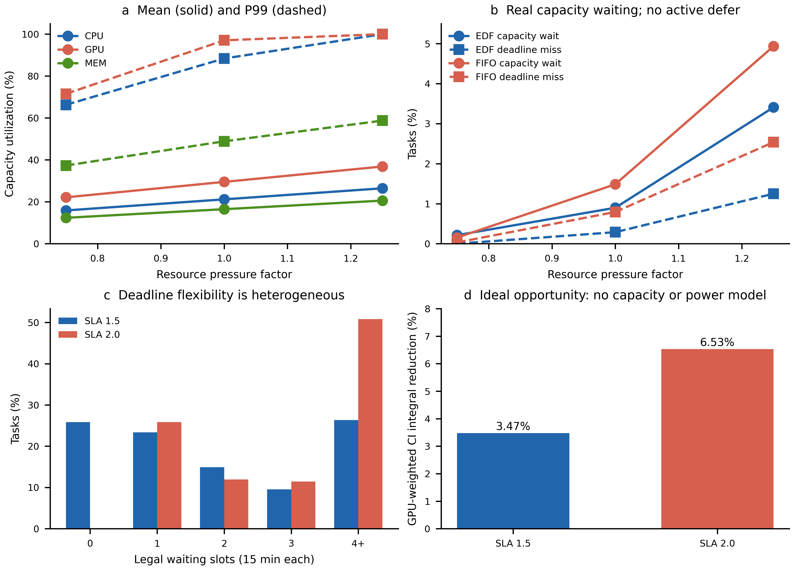
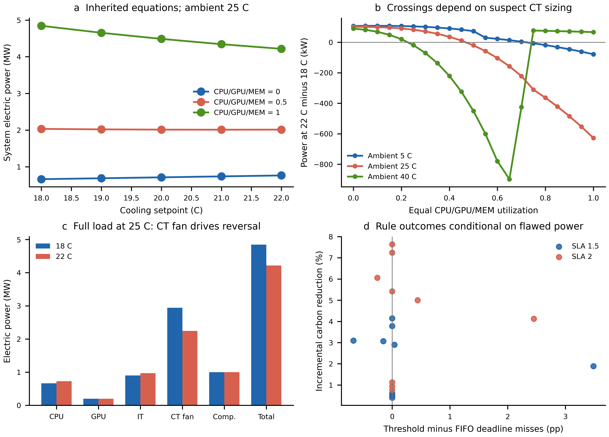

# A0：单数据中心研究对象有效性诊断

**结论：任务调度问题局部成立；当前配置存在短峰资源竞争、异质 Deadline 柔性和有限但非零的时间迁移碳机会。现有功率模型不足以支撑可信的 IT–Cooling 联合优化效果结论。** 本轮没有验证任何学习算法能否解决问题，也没有训练、修改仿真器或采用下文候选配置。

基线：`research/joint-v2-training`，源码 SHA `bf8a35ef647f19b5ef10ce1b99f723370b7a0732`。审计分支：`research/object-validity-audit`。统计结果和复现脚本随该分支保存，旧分支保留。

## 1. 直接回答 A–E

| 问题 | 本轮判断 | 主要证据与适用边界 |
| --- | --- | --- |
| A. 是否足以产生明显资源竞争？ | **有局部、短时且随压力增强的竞争；不能称为普遍持续拥塞。** | SLA1.5 下 EDF 容量等待比例随压力0.75/1/1.25为0.214%/0.898%/3.409%；FIFO为0.153%/1.485%/4.935%。GPU为首要瓶颈，CPU次之，MEM无阻塞。基础压力 CPU/GPU 的峰值均接近100%，尽管均值仅21.16%/29.50%。 |
| B. Deadline是否限制时间迁移？ | **是，但群体差异大。** | SLA1.5有25.83%任务连1个15分钟槽都不能合法等待；26.36%可等至少1小时。SLA2所有任务可等至少1槽，50.81%可等至少1小时。高压力下 Immediate 也出现违约，因此不能把全部Slack用于低碳等待。 |
| C. 是否有有意义的潜在碳收益？ | **有适合研究的有限机会；尚无可信系统节碳量结论。** | 完整运行槽积分、未来CI已知且无资源约束时，GPU资源加权CI积分可降低3.474%/6.528%（SLA1.5/2）。实际容量规则的匹配FIFO比较，总碳降低仅0.00539%–0.13669%，相对同温度空闲基准的增量碳降低0.401%–7.639%，部分高压力片段DMR上升。后者依赖有缺陷的功率模型。 |
| D. 功率模型足以支持可信联合优化研究？ | **目前不足。** | 逻辑1000 GPU仅实例化800 GPU功率对象；CPU零负载功率已超过声明满载额定功率；冷却塔热容量被复用作风机电功率；入口28°C约束天然满足；MEM增加可使总功率下降。能执行不等于已通过物理验证。 |
| E. 最应修改哪些对象配置？ | **先核实任务用量单位与资源预留含义、统一逻辑容量和物理设备清单、独立修正并校准功率/热模型及核算基准。** | 不应先任意收紧Deadline或缩小GPU以制造失败。原配置已有局部竞争，应先保留为对照；候选容量只能来自并发需求分布，并同步建立可验证的设备映射。 |

## 2. 审计范围、身份和预算

本轮读取冻结池 **96个 Train 场景**：16个原到达片段 × 3个资源压力 × 2个SLA。每个压力/SLA组合均为52,339任务；没有删除任务、缩短Duration或更改到达。16个片段仍来自同一49天原始Alibaba轨迹，年度映射和增强不是独立实测样本。本报告使用描述统计，不作独立样本置信区间或算法显著性推断。

原片段起点均为UTC 05:00：1月2/3/4/5日、2月1/2/3/4日、3月1/2/3/4日、4月3/4日、5月1/3日（2023）。逐场景ID、场景身份、任务快照SHA见[逐场景结果](data/resources/scenario-summary.csv)与[元数据](data/resources/metadata.json)。CI分布只统计16段各自24小时到达窗口，共1536槽；排空和完整责任窗口另外核算。

仅装载 `role=train`。未读取September Test、July Validation或June Development的payload。冻结Train环境含原有30天安全尾段，最晚截至6月3日，早于首个6月5日Development场景；这不是读取开发场景。没有重新生成场景池或扫描年度原始容器。原始数据哈希继承冻结身份，不能声称本轮重新验证了全部原始数据。

| 身份 | SHA256 |
| --- | --- |
| 冻结池manifest | `327e941eaa715aa9d25a30601502183cae27c1e7a83b0da7f31e2c0e251775ca` |
| 原工作负载 | `3ba8a8e0067288f8d2542752a292f7da04cb79305689ba145cc6060e96cb7f2e` |
| 原CI | `44bafab775c6b0d4762b1dc971eb293cfea154f80799a5230f9268d32e1ad55b` |
| 原天气 | `090bddc8a5f4e9edb5f3f193c6c147ed03841337b4bb17c7740f3b63a03cdaf5` |
| 物理配置JSON | `bbe439176605512523a3a0ecd2bd22f18fdb9abf6ae6e782217157beedbf705b` |

预算原定从2026-10-18 13:03:54 UTC开始30分钟。所有资源/碳/物理实验在首次执行阶段完成，资源核心192次仿真耗时176.86秒。随后会话遇到额度中断，用户于客户端2026-10-19要求继续。恢复后只整理已有结果、生成图表和运行合成验证，没有追加场景实验或训练。**跨中断的日历wall时间已超过30分钟，因此不声称整个交付wall≤30分钟；已完成实验未因恢复而扩大。** 碳metadata中的 `last_invocation_elapsed_seconds` 只描述最后一次补齐调用，不能冒充全部54次仿真耗时。详见[执行协议](A0-protocol.json)。

## 3. 实际生效配置与覆盖链

证据分级：**S**=源码确认；**R**=本轮加载/运行证实；**U**=仍缺独立数据或物理依据。S/R不自动代表物理可信。

| 对象 | 实际生效值、单位与覆盖关系 | 等级 / 源码证据 |
| --- | --- | --- |
| 单DC逻辑资源池 | CPU50,000，GPU1,000，MEM80,000；CPU/GPU允许小数需求，MEM软件按GB命名但来源单位未独立证实 | S/R；U=真实单位。`e1_5b_ppo.json:24`、`scenario_config.yaml:14`、`scenarios.py:332,395` |
| 调度时间 | 15分钟离散决策，原Duration保持分钟精度；到达桶统一为网格边界 | S/R；`e1/workload.py:129`、`e1/engine.py:151` |
| 基础资源倍率 | `resource_multiplier=5`；CPU=5×raw_cpu_usage/100，GPU=5×raw_gpu_wrk_util/100，MEM=5×raw_avg_mem | S/R；`e1/workload.py:158`、`joint_v2/scenarios.py:274` |
| V2压力 | 0.75/1/1.25再乘上述三项资源需求，任务数/到达/Duration不变；不修改资源总容量 | S/R；`scenario_config.yaml:11`、`scenarios.py:274` |
| E1工作负载强度 | 旧E1负载因子通过stress任务增广改变到达任务量，与V2资源压力不是同一参数；A0使用现有V2冻结任务，不重做stress | S；`experiments/e1/stress.py:21` 的同到达复制；U=用量倍率的实物解释 |
| SLA | Train使用1.5/2.0，Deadline=arrival+SLA×Duration；均为合成SLA，不是原始用户承诺 | S/R；`workload.py:46`、`scenario_config.yaml:12` |
| IT/制冷接口 | 固定22°C用于A0规则比较；物理扫描手工18/19/20/21/22°C；原Cooling动作域18–22°C、入口上限28°C | S/R；`joint/power.py:22,108`；`training_config.yaml:86` |
| 服务器和机架设计常数 | 64核/服务器、4 GPU/服务器（仅用于初始数量设计）、25服务器/机架 | S/R；`dc_config_reader.py:29` |
| 初始数量推导 | CPU服务器ceil(50000/64)=782，GPU服务器ceil(1000/4)=250，取max=782，机架ceil(782/25)=32 | S/R；`dc_config_reader.py:57` |
| 配置列表 | 每架CPU核心目标1563→25服务器配置；GPU每架32→全DC1024条GPU配置 | S/R；`dc_config_reader.py:63,85` |
| 实例化设备 | 实际800 CPU服务器对象，代表51,200核；每服务器仅接1个GPU功率对象，共800 GPU；GPU逻辑容量1000与功率对象不一致 | S/R；`datacenter_model.py:113`；[加载配置表](data/physics/effective-physical-configuration.csv) |
| 内存功率 | 固定0.07×80000=5600W；MEM利用率不改变DRAM电功率，而参与服务器风量 | S/R；`datacenter_model.py`、`joint/power.py:190`；U=真实内存容量和功耗 |
| DC标称容量 | (6W×50000+500W×1000+2.5W×80000)/1e6=1MW；传给构造器，不是运行功率约束 | S/R；`joint/power.py:110` |
| CPU额定值覆盖 | reader改为full384W/idle20W每服务器，覆盖原JSON服务器均值；实际向量化公式又产生不同端点 | S/R；`dc_config_reader.py:78`、`datacenter_model.py:386` |
| 冷却塔风机额定功率 | JSON1000W被sizing返回的3,484,456.58W热负荷覆盖；后续同时作CT风机电功率参考和chiller容量 | S/R；`make_envs.py:174`、`datacenter_model.py:705,724`；U=维度与标定 |
| 冷却塔参考风量 | JSON2.8315 m³/s被sizing覆盖为80.7854 m³/s | S/R；`make_envs.py`；U=实设备依据 |
| COP | 配置读取5，实际chiller函数内部rated COP=3 | S/R；`dc_config_reader.py:148`、`datacenter_model.py:616` |
| HVAC全量口径 | CRAC风机+CT风机+压缩机+冷冻水泵+冷却塔泵，IT另加；CRAC移热量不是电功率 | S/R；`joint/power.py:224` |
| V2训练参数（只读） | 顶层PPO γ=1、epochs4、lr0.0003、batch64、[64,64]；嵌套v1记录γ0.99/epochs10。Reward incremental_idle18，idle参考18°C、deadline guard开启、drain后settle；目标DMR0.05 | S；`training_config.yaml` 顶层配置优先于嵌套历史协议；A0未调用PPO/Reward，规则不受训练目标影响 |

以上源码路径相对仓库；可在固定SHA核验：[workload](https://github.com/cout-he/sustaincluster-carbon-scheduling/blob/bf8a35ef647f19b5ef10ce1b99f723370b7a0732/experiments/e1/workload.py)、[engine](https://github.com/cout-he/sustaincluster-carbon-scheduling/blob/bf8a35ef647f19b5ef10ce1b99f723370b7a0732/experiments/e1/engine.py)、[scenarios](https://github.com/cout-he/sustaincluster-carbon-scheduling/blob/bf8a35ef647f19b5ef10ce1b99f723370b7a0732/experiments/joint_v2/scenarios.py)、[reader](https://github.com/cout-he/sustaincluster-carbon-scheduling/blob/bf8a35ef647f19b5ef10ce1b99f723370b7a0732/utils/dc_config_reader.py)、[make_envs](https://github.com/cout-he/sustaincluster-carbon-scheduling/blob/bf8a35ef647f19b5ef10ce1b99f723370b7a0732/utils/make_envs.py)、[物理方程](https://github.com/cout-he/sustaincluster-carbon-scheduling/blob/bf8a35ef647f19b5ef10ce1b99f723370b7a0732/envs/sustaindc/datacenter_model.py)、[Joint接口](https://github.com/cout-he/sustaincluster-carbon-scheduling/blob/bf8a35ef647f19b5ef10ce1b99f723370b7a0732/experiments/joint/power.py)。

### 3.1 原任务变量、输入与处理

冻结任务保留12个原字段：`job_name,start_time,end_time,start_dt,duration_min,cpu_usage,gpu_wrk_util,avg_mem,avg_gpu_wrk_mem,bandwidth_gb,weekday_name,weekday_num`。任务身份包括原源哈希、来源row、task index和映射到达时间，支持回溯。实际计算/调度输入为到达桶、Duration、上述映射CPU/GPU/MEM、SLA；`bandwidth_gb`保留但单DC没有网络容量约束，`avg_gpu_wrk_mem`未进入独立显存容量模型。原start/end字段保留作身份，调度采用冻结到达桶，不能把它描述成精确原始逐秒到达仿真。

CPU/GPU字段是原始**观测用量**；源码把其缩放成任务运行期间固定资源占用。`/100`和倍率5能被源码与快照确认，但“百分比的分母究竟是多少核/GPU”“avg_mem究竟是GB、归一化量还是其他尺度”“观测使用量是否能代表资源预留需求”尚缺原数据字典/预处理依据。故当前竞争结论严格属于**现有逻辑资源模型**，不能直接外推到某台真实AI集群。

### 3.2 容量、结束和积分语义

三个资源分别检查 `math.fsum(运行任务需求+候选需求) <= 总容量`，**启动判定不使用超售epsilon**；账本守恒检查才使用1e-9数值容差。任务单体需求必须可装入总容量；不支持抢占、迁移、多DC路由或真实设备放置。FIFO/EDF均在一个决策槽按顺序遍历队列，大任务装不下时可回填后续小任务；FIFO不是严格队首阻塞。

`latest_start=deadline−duration`，初始Slack=`(SLA−1)×duration`。实际finish=`start+原Duration`，Deadline比较用实际finish；资源在首个 `t≥finish` 网格边界释放。每槽先记录到达并释放已完成资源，再调度，最后将当前功率左持有15分钟积分。16分钟任务可有精确16分钟JCT，但占用/功率责任覆盖两个15分钟槽。A0没有改动这一离散语义。

容量不足事件记作capacity wait；容量足够但策略拒绝启动记作policy defer，两者独立。即时FIFO/EDF的主动推迟均为0。阈值规则二者分别保存在 `rule_comparison.csv`，不能把总等待都称为容量拥塞；资源优先检查的事件归因也不代表唯一因果分解。

### 3.3 CI与天气变量及未来信息

环境输入为UTC时间、CI（gCO₂e/kWh）、室外干球温度（°C）、近似湿球温度（0.9×干球）。V2 CI用 `searchsorted(...,side=right)−1` 取不晚于当前时刻的最近小时观测，再左持有至15分钟槽，**当前CI输入不使用未来端点**。原CI字段为direct口径，原估计标记未作为本轮过滤条件，不能称全量生命周期碳因子或纯实测CI。

| 既有原始容器（本轮未重扫） | 用到的原变量 | 冻结环境/任务的实际输入 |
| --- | --- | --- |
| `data/workload/alibaba_2020_dataset/result_df_full_year_2020.pkl` | `interval_15m`、`tasks_matrix`内12字段 | 保留原字段与来源身份，按固定来源桶映射到冻结2023 Train到达；需求采用倍率5×压力映射，Duration不变 |
| `data/carbon_intensity/US-CAL-CISO/2023/US-CAL-CISO_2023_hourly.csv` | `Datetime (UTC)`、`Carbon Intensity gCO₂eq/kWh (direct)` | 冻结 `time,ci_g_per_kwh`，V2上一小时观测左持有；估计标记没有用于筛除 |
| `data/weather/US-CAL-CISO/2023.json` | `time,temperature_2m,utc_offset_seconds,timezone` | 时区元数据转UTC，再离线线性插值得干球；湿球派生为0.9×干球，没有使用湿度观测 |

本轮直接装载冻结Train workload/environment快照并验证身份；上表原字段和预处理链来自源码交叉检查，不意味着为审计重新打开年度数据。

天气则通过小时干球温度线性插值；小时中间的当前温度会依赖下一小时端点，这是离线环境构造中的未来信息。原天气固定UTC−7，未按季节DST校正；湿球0.9×干球也不是湿空气学计算。即使当前CI因果，也不能据此宣称整个制冷观测严格在线因果。A0保留原环境，只标记此问题。未来CI机会诊断显式使用预知未来，不包装成在线策略。

## 4. 资源竞争：全96场景的确定性结果

直接复用原 `LocalExecutor` 执行192次FIFO/EDF仿真，完整排空全部任务；用于这一统计的零功率适配器只隔离资源账本，不输出能耗结论。完成率全部100%，不存在单体不可容纳任务或未分类容量等待。逐场景统计含到达24h、排空期和完整31天环境期三个分母；不能利用长空闲尾段稀释平均利用率，再声称没有竞争。

| 压力 | EDF容量等待 % | FIFO容量等待 % | EDF DMR，SLA1.5 % | FIFO DMR，SLA1.5 % | EDF DMR，SLA2 % | FIFO DMR，SLA2 % |
| --- | --- | --- | --- | --- | --- | --- |
| 0.75 | 0.214 | 0.153 | 0 | 0.0325 | 0 | 0 |
| 1.0 | 0.898 | 1.485 | 0.2885 | 0.7929 | 0.0134 | 0.3324 |
| 1.25 | 3.409 | 4.935 | 1.2495 | 2.5392 | 0.2235 | 1.0871 |

表中容量等待为SLA1.5；SLA2的全部数值、JCT、等待分位数和队列持续时间见[统计附表2–8](A0-statistical-evidence.md)。每行DMR分母52,339；不要将各增强组合累加成更多独立任务。

基础压力EDF/SLA1.5实际利用率：CPU Mean/P50/P90/P95/P99/Peak=21.16/16.78/40.04/59.18/88.37/100.00%；GPU=29.50/25.11/54.81/67.36/97.06/100.00%；MEM=16.47/14.35/28.71/37.68/48.86/59.87%。压力1.25时CPU/GPU P99均约100%，MEM峰74.84%。全部压力、逐资源六项分布见[附表1](A0-statistical-evidence.md)。

**瓶颈排名GPU > CPU > MEM。** EDF/SLA1.5三个压力下GPU阻塞尝试123/733/2301次，CPU0/220/1819次，MEM全为0；同一任务多次尝试与不同资源同时阻塞均分别记录，不把次数冒充人数。基础压力的最大单任务占CPU0.5192%、GPU9.0541%、MEM0.2783%，GPU的单任务颗粒更大。MEM明显宽松；CPU总量虽大，仍能在强并发峰时成为瓶颈。

基础压力、无容量约束立即到达并发的P95/P99/Peak为CPU29,380/44,187/57,761，GPU657.67/953.70/1,541.29，MEM29,995/39,802/47,897。1536槽中CPU/GPU超当前容量5/13槽；压力1.25为27/44槽，MEM仍0。该诊断只是“若全部立即运行所需容量”，不是可执行调度。它解释了平均工作量不高为何仍排队。

EDF/SLA1.5队列峰值随压力为54/123/208任务，最长任务容量等待30/60/135分钟；FIFO为37/131/229任务和15/60/90分钟。P99等待也可能为0，因为受阻任务比例小，故同时报告受阻人数、等待者均值、极值、连续高峰时间。全部队列时长按原场景连续槽计算，没有拼接不同日期制造“持续高峰”。



图1：a为16段到达窗口pooled均值/P99；b为保留所有任务的规则结果；c按初始Slack离散化；d仅是资源加权CI积分理想机会，不含功率、容量和队列。没有统计显著性标记。

## 5. Deadline与时间柔性

Duration Mean/P50/P90/P95/P99/Max=94.807/61.167/233.200/301.068/373.514/393.667分钟。SLA1.5初始Slack为Duration的一半，均值47.404、中位30.583分钟；SLA2的Slack等于Duration。合法可等槽数为 `floor(Slack/15)`，不是先将Duration取整再任意加宽Deadline。

| SLA | 0槽 | 1槽 | 2槽 | 3槽 | ≥4槽 |
| --- | --- | --- | --- | --- | --- |
| 1.5 | 25.83% | 23.36% | 14.91% | 9.54% | 26.36% |
| 2.0 | 0% | 25.83% | 11.93% | 11.43% | 50.81% |

结论既非“全部过宽”也非“全部过紧”：SLA1.5短任务缺少网格等待机会，中长任务存在柔性。实际等待会消耗此余量；当 `actual_wait > initial_slack` 时，即使任务后来完成也已违约。逐任务关系经本地明细计算，公开[任务分布表](data/resources/task-distribution-pooled.csv)包含 `wait_over_initial_slack_*`、`deadline_start_margin_minutes_*` 与超过Slack人数，不公开任务明细。

同一原任务在0.75→1.25压力下Duration、Slack不变，DMR却上升，支持资源竞争与Deadline之间存在实际耦合。汇总DMR会掩盖高峰片段：4月4日压力1.25/SLA1.5，立即FIFO DMR已经9.708%。因此没有理由为了制造失败再收紧SLA；也不能仅凭汇总DMR低于5%断言Deadline无效。

## 6. 低碳时间迁移机会

### 6.1 Train CI变化

16段到达窗口1536槽的CI均值206.067、总体标准差61.234 g/kWh，Min80.47、P5 96.60、P25 156.63、P50 223.86、P75 260.51、P90 275.42、P95 282.56、P99 296.50、Max298.40，峰谷差217.93。不同片段拼接后不计算跨边界自相关；仅用段内成对槽，15分钟/1小时/4小时/8小时ACF分别0.9895/0.9572/0.6075/0.1846。23小时相关值虽较高但只有64对，不作周期证据。CI变化存在，但15分钟至1小时高度平滑，短Slack未必遇到有效下降。见[CI汇总](data/carbon/ci_summary.json)。

### 6.2 完整运行时段的理想诊断

对每任务枚举从到达到最晚合法启动的15分钟网格，令 `n=ceil(Duration/15)`，比较 `0.25×sum(CI[start:start+n])`，而不是只看启动时刻CI。每任务选择自身最小积分；与立即运行比较后，分别以CPU/GPU/MEM需求加权。SLA两组均52,339任务完整覆盖，窗口删失为0。

SLA1.5可等38,821任务，其中18,133有下降机会，占全部34.65%、可等者46.71%；SLA2有23,768有机会，占全部45.41%。可等者节省百分比中位数两组均0，均值1.804%/2.920%，P90为5.497%/9.763%。CPU/GPU/MEM加权积分下降分别2.209/3.474/2.165%和4.234/6.528/4.699%。按Duration分组的完整结果见[机会CSV](data/carbon/opportunity_groups.csv)。

该理想诊断预知未来CI，**忽略CPU/GPU/MEM容量、队列竞争、非线性IT/HVAC和固定背景**。它仅说明时间窗口中存在机会；不称为可实现最优、不报物理kg减排，也不把各任务独立最佳启动组合成可行排程。

### 6.3 资源可执行规则探针

按既有场景元数据的到达工作量压力，在基础压力/SLA1.5的16片段排序中取第0/7/15位：5月1日、3月2日、4月4日。每片段保留3压力×2SLA，18场景各跑ImmediateFIFO、ImmediateEDF、CarbonThresholdFIFO，共54次。没有按碳结果筛选。全部固定22°C，使用相同任务和完整冻结31天责任窗口，包含任务排空及同22°C空闲尾段。

阈值161.075 g/kWh继承旧E1常量，本轮未调参；旧配置记载其来源为4月1日至5月1日校准，故应用于1月/3月Train时，**不能称阈值来源在日历上严格历史因果**。规则决策本身只看当前CI：CI低于阈值即启动；高于阈值且再等一槽仍不超过最晚启动才主动等待，否则尝试启动。此单任务guard不预留未来资源，仍可能因容量竞争违约。主比较是相同FIFO排序的ImmediateFIFO对ThresholdFIFO；与EDF比较还混入排序差异，单列为次要对照。

18组主配对均完成全部任务：总碳降低0.00539%–0.13669%，相对同22°C空闲基准的增量碳降低0.401%–7.639%。空闲背景占总碳97.17%–98.91%，与24h到达+30天尾段、较高模型空闲功率共同有关。这些完整责任窗口结果没有裁掉尾段，也不能把增量百分比当成总碳百分比。原V2训练使用idle18参考，A0规则分解使用**同温度idle22**，两者不可混用。

高压力4月4日/SLA1.5，FIFO→阈值DMR为9.708%→13.194%，SLA2为4.828%→7.281%；部分中低压力片段DMR不变或下降。因此简单低碳等待并非免费；同样，不能把这些现有方程的输出当作实设备节碳量。完整18组数值见[附表11](A0-statistical-evidence.md)，完整电能、碳、容量等待与主动推迟见[规则CSV](data/carbon/rule_comparison.csv)。

碳收益受多个因素限制：CI在短窗口内平滑；SLA1.5约四分之一任务无等待槽；多数任务资源颗粒小；高峰时期的GPU/CPU竞争进一步压缩可用Slack；总量指标又被固定背景稀释。不能单归因于“CI变化不足”或“资源太空”。

## 7. IT/HVAC物理可信度审计

手工输入CPU/GPU/MEM各0/0.5/1全因子、设定18–22°C逐1°C、室外−5/5/15/25/35/40°C，共810次；另加三资源同负载0至1步长0.05的630次，共1440次函数求值（两组重叠90个条件，唯一条件1350）。湿球沿用0.9×干球，仅用于水量估计，不是天气观测或湿空气学验证。不读任务、CI、天气payload，不修改公式。

### 7.1 CPU/GPU/MEM端点与设备清单

实际向量化CPU公式每服务器为 `max(20,384×((1/600+0.05)×Tin−1/60+0.99×u_cpu))` W。Tin为设定+5.15°C。设定18°C时零/满负载452.896/833.056W；22°C时532.256/912.416W。它随负载递增，但**零负载已经大于声明full384W**，实际满载为额定2.17–2.38倍。不能误写“零负载比实际满负载更高”；真正问题是公式端点与额定物理解释不一致。

GPU对象单体0/100%为22.75/250W，`log2(1+u)`端点合理不等于整DC正确，因为只有800对象，逻辑池却是1000。CPU对象又代表51200核，显示逻辑与物理均非一一对应。MEM固定5600W，缺少使用量到DRAM活动功耗的独立关系。所有服务器使用统一利用率，不能验证放置热点或机架级负载差异。

### 7.2 HVAC单位、容量和能量平衡

冷却塔sizing的3.484MW**热容量**被写入`CT_FAN_REF_P`，既用于冷却塔风机 `P_ref×min(airflow/ref_airflow,1)^3` 的**电功率**，又作为chiller冷却容量；即使数值单位都写W，物理量不同。配置COP5未进入实际rated COP3。每个水泵固定0.3793kW、全DC CRAC风机固定约0.0324kW，均需设备规格/实测依据。

扫描系统功率0.626–5.557MW，1440次中1228次超过名义1MW；这说明1MW不是功率约束，不能单凭越界认定代码违反容量上限。更严重的是CRAC移热/IT电功率比1.27–3.71，无校准能量平衡；25°C室外、满载18°C时IT902.760kW却计算CRAC移热3046.409kW。没有设备独立依据不能把HVAC输出作为可信优化目标。

### 7.3 18°C/22°C交叉现象

25°C室外、CPU/GPU/MEM均满载：18°C IT/HVAC/总功率902.760/3941.155/4843.914kW；22°C为971.981/3244.224/4216.205kW。升温4°C总功率下降627.709kW，其中IT增加69.221kW、CT风机下降696.930kW、压缩机基本饱和不变。交叉主要被可疑的CT风机基数驱动，不能视作真实协同收益证据。

同负载扫描交叉随天气变化：−5°C无交叉（18°C更省）；5°C在负载0.70–0.75，15°C在0.55–0.60，25°C在0.45–0.50；35°C在0.30–0.35及0.85–0.90出现反向再交叉，40°C在0.20–0.25及0.70–0.75再交叉。它是可复现的现有方程现象，但真实解释尚不成立。每个负载/天气下5种温度的最佳值、相对22°C差异见[温度比较CSV](data/physics/setpoint-comparisons.csv)。

### 7.4 入口约束、反常增量与固定背景

入口温度恒为设定+5.15°C，即23.15–27.15°C，与负载和天气无关，1440次全部低于28°C。28°C约束在整个动作域内结构性满足；不能用“零热违约”证明学会安全控制。没有经过验证的热容/惯性或局部热点模型。

另有60次求值低于同温度零负载背景，19次相对idle18增量为负。例：25°C室外、18°C设定、CPU=GPU=0，MEM从0增至1，IT408.232→411.098kW，总功率却663.480→629.478kW。内存热功率固定而风量改变出风/CRAC计算，形成反常“工作负载增大、系统功率下降”。这不是内存工作节电的证据。



图2：前三面板都是手工条件下现有方程输出，标明CT问题；d为18组匹配FIFO规则的增量碳变化与DMR变化，全部条件于未校准功率模型。负载、温度与电功率单位见CSV；热移除量单独标为kW thermal，未混加到电功率。

**物理结论：现有接口、资源账本和分项加总可作为软件研究基础；CPU端点、GPU数量、CT功率、热平衡与天气观测必须有独立依据修正/校准后，才能宣称IT–Cooling联合节碳。** GPU单体函数、泵/风机模型等均只能作为待标定候选，不能因程序通过测试就认可其真实有效性。

## 8. 科学问题是否成立，问题出在哪里

任务层的“动态到达—有限多资源—Deadline—变化CI”四要素在现有逻辑模型中均有实际表现。最有依据的研究主线仍是任务调度；当前证据不支持“对象完全无问题”，也不支持“资源竞争完全不存在”。

资源规模和需求映射共同导致大部分时段宽松、少数GPU/CPU峰值拥塞；MEM明显低压。Deadline是合成的、具有异质柔性，有必要报告分群而不是单一平均。CI总体变化足够，但短任务窗口内变化有限。最大的联合优化证据缺口来自**用量到预留需求的语义不确定、逻辑与物理清单错位，以及功率/热模型可信度不足**。单独缩小GPU或收紧Deadline无法修复后两者。

## 9. 最多三套候选对象：本轮不实施

候选以基础倍率5、压力1对应的全部原任务为共同需求基准；保留所有到达和Duration，SLA1.5/2均保留为合成柔性分组。它们是**数据推导的逻辑容量候选，不是已验证硬件配置**。64核/4GPU的整机粒度仅继承当前reader设计假设，真实型号/机架清单尚需独立来源。不能用现有错误构造器自动生成设备后宣称物理一致。

| 候选 | CPU / GPU / MEM逻辑容量 | 数据依据、预计瓶颈与限制 |
| --- | --- | --- |
| L：覆盖本轮立即并发峰值 | 57,792 / 1,544 / 80,000 | 取基础压力无容量立即并发CPU峰57,761.39向64取整、GPU峰1541.29向4取整；MEM保留现有值，峰47,897.06。预期减少本轮已观测峰的容量等待，适合作为低竞争对照。只保证覆盖这16段独立立即启动需求包络，不保证其他时间或低碳任务聚集后无竞争。 |
| M：保留当前竞争结构 | 50,000 / 1,000 / 80,000 | 实际192次规则已证明GPU为主、CPU次要的短峰竞争，无需先改变容量制造失败。作为保守中压力候选；修复硬件映射后重测功率，不沿用800GPU对象冒充1000。 |
| H：按并发P95形成较强竞争敏感性 | 29,440 / 660 / 80,000 | 基础CPU P95=29,380.21向64取整，GPU P95=657.67向4取整。原任务单体最大CPU约259.62、GPU90.54均可单体装入；预计GPU/CPU峰排队增加、MEM仍宽松，但未运行可行性/DMR，不保证服务目标可达。P95是透明的压力分层规则，不是按某算法得分挑容量。 |

三者CI使用同一冻结Train数据，比较的时间迁移机会来自相同任务窗口，不修改CI制造收益。需求映射需先取得Alibaba字段字典和预处理链，确认百分比的分母、MEM单位及使用量与预留量关系；若依据要求改变映射，以上容量数值必须重新推导，不能冻结错误单位的数值。

物理映射依据必须包括可核对的服务器CPU核数、GPU型号/数量、DRAM容量、机架清单、活动/空闲功率和制冷设备热容量/电功率。容量不能仅靠GPU分母替换：改变GPU总量时，须重新确定GPU功率对象数、每服务器GPU配置、服务器/CPU共置与机架数、内存容量分配，并依据IT热负荷重新校核风机/泵/chiller的容量和功率。增减资源应反映在完整系统空闲/活动能耗，而不是只改变利用率归一化。

若下一轮暂只改逻辑GPU容量，必须命名为**物理不一致的逻辑容量敏感性诊断**，固定功率输出不能被当作最终节碳实验。L/M/H未在A0实施，也没有据此选择正确GPU容量。最终采用前需冻结配置、模型版本、来源、场景ID和SHA，统一CPU/GPU/MEM账本、功率对象和碳积分；所有规则/算法共用完整任务及责任窗口，预先规定指标，避免按RL胜负选对象。

## 10. 需要用户批准后才执行的下一阶段

1. **数据语义核验与冻结方案**：取得原任务字段/预处理依据，决定用量是否可作需求、MEM单位及倍率来源；保留原数据，生成有来源的新映射版本和独立冻结池。先交付映射差异表，不以算法优劣选倍率。
2. **独立物理修正方案**：修复CPU端点与GPU对象清单，拆分CT热容量与风机额定电功率，统一COP和热平衡，校正天气时间处理；用设备规格/公开校准依据验证单点及响应曲线。原模型保留作历史基线，不将“更有利的曲线”作为修正目标。
3. **对象候选确认**：由用户选择L/M/H或保留任务调度主线，先做相同任务的FIFO/EDF可行性和碳机会复核，再冻结正式比较协议。是否加入Cooling必须由物理验证结果决定；本报告不授权新训练、V3恢复或下一阶段实验。

## 11. 复现、交付与未解决项

新增独立代码在 `experiments/object_validity/`，合成测试在 `tests/object_validity/`。Windows Git管理worktree；Linux科学运行时使用Python3.10、原依赖和CPU单线程。新脚本的 `--source-sha` 用于Windows worktree在WSL下不能解析D盘gitdir的情况；来源SHA另由Windows Git和逐文件字节比较核实，不靠参数自证。

```powershell
# 工作目录：研究审计worktree；POOL指向现有冻结池，不重新生成
python -m experiments.object_validity.a0_provenance --pool $POOL --output docs/research/object-validity/data/input-provenance.json
python -m experiments.object_validity.a0_resources --pool $POOL --output research_notes/object-validity/A0-001/resources --max-seconds 900 --source-sha bf8a35ef647f19b5ef10ce1b99f723370b7a0732
python -m experiments.object_validity.a0_resources --pool $POOL --output research_notes/object-validity/A0-001/resources --demand-only --source-sha bf8a35ef647f19b5ef10ce1b99f723370b7a0732
python -m experiments.object_validity.a0_carbon --pool $POOL --output research_notes/object-validity/A0-001/carbon --max-seconds 900
python -m experiments.object_validity.a0_physics --output research_notes/object-validity/A0-001/physics --max-seconds 120 --source-sha bf8a35ef647f19b5ef10ce1b99f723370b7a0732
# 以下两步仅用已导出的聚合CSV，不读场景payload
python -m experiments.object_validity.a0_tables
python -m experiments.object_validity.a0_figures
python -m pytest tests/object_validity tests/joint/test_power.py tests/joint_v2/test_scenarios.py -q
```

上列是单模块重现命令，不应把各自max-seconds相加当作本轮总预算授权。冻结池未提交Git；公开结果由相同命名的本地聚合文件复制至 `data/`，任务明细/长日志仍仅本地保留。资源/utilization与任务分布metadata记录精确分组、单位和身份；图的输入SHA见[figure-provenance](figures/figure-provenance.json)。资源主运行metadata保留当时脚本SHA，随后只追加了从本地明细汇总pooled统计的功能，因此最终脚本SHA不同；没有改写历史SHA冒充同一版本。最终交付源码和结果的逐文件SHA另见[artifact manifest](A0-artifact-manifest.json)。

验证：14个新增合成测试+12个既有功率/场景测试，**26 passed in 3.33s**。覆盖容量等待/回填、释放边界、Slack离散化、完整CI积分与启动CI排序反例、常量CI、窗口删失、角色/身份、物理对象与汇总。生产145个受保护源码/配置文件逐字节等于基线，0处变化，池manifest SHA不变。资源192/192、规则54/54、物理1440/1440均完成。

图表提供PDF/SVG/600dpi PNG。静态源检查无FAIL，PNG非投稿TIFF产生一条格式WARN，适用于本轮Markdown诊断；PDF最小字形和PNG目检另见[QA记录](A0-verification.md)。

尚未解决且不能补造的依据：原始资源字段真实单位/预留语义、设备型号与实测功率/热平衡、真实用户Deadline来源、因果天气预测能力、候选容量正式服务质量。没有进行硬件校准、候选容量实验或算法有效性比较。所有本轮规定的确定性统计/小量规则/单点扫描已完成；这些外部依据缺口仍阻止物理联合优化结论。

**A0在此结束，等待用户选择研究对象。**
