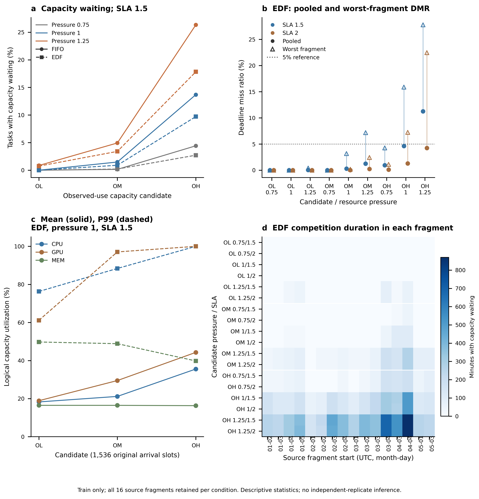
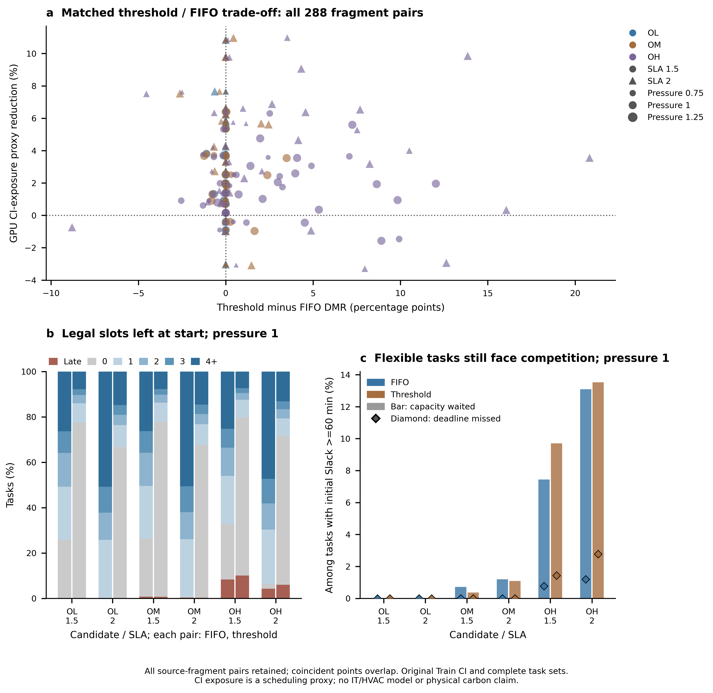

# A1：面向资源竞争—Deadline—低碳调度的研究对象重建

## Material Passport

| 项目 | 本轮口径 |
| --- | --- |
| 研究问题 | 动态到达、有限CPU/GPU/MEM下，利用时间柔性改变任务执行CI，同时控制Deadline违约 |
| 基准 | A0 `a754c5ee4bd3922cecd6993d9abb6bfbacdda7e0`；新分支 `research/object-model-a1` |
| 实际回放实现 | `1620060cac1590047221614c761b79ff1e0a588d`；最终交付另含身份核验（修复0行）、元数据命名加固和报告，运行时SHA保留 |
| 数据权限 | 仅现有冻结Train；不加载June Development、July Validation、September Test payload |
| 对象性质 | trace派生、固定用量、流体GPU等价容量的逻辑调度模型；不等于真实设备预留/放置模型 |
| 禁止项 | 无PPO/MAPPO训练，无V3续跑，无IT/HVAC功率调用，无kWh或kgCO₂e效果结论 |
| 对象状态 | 可执行、版本化的候选；未宣布最终研究对象冻结，未进入A2 |

本报告先将“字段有物理单位”与“任务具有真实预留需求”分开，再以实际规则实验判断场景的竞争和Deadline冲突。读过A0报告、统计附表及本地单DC对象说明；第三份文档为旧V3路线的解释材料，不用其中的功率或训练结果为A1背书。

## 1. A–G回答与推荐

| 问题 | A1结论 | 证据与边界 |
| --- | --- | --- |
| A. 能否支持明确物理含义的需求？ | **支持有来源单位的观测使用量代理，不支持已恢复的真实预留需求。** | CPU/100、GPU/100、MEM GB已由官方字典确认；plan字段和完整实例身份在当前Train中丢失，不能usage反推。 |
| B. 1000 GPU是否值得作主场景？ | **只保留Legacy M作为历史对照；不把原1000数值当硬件真值。** | ×5没有独立依据。若改用×1却保留原50000/1000/80000容量，最强1.25压力的无容量立即并发峰仅14440.35/385.32/11974.27，分别低于原容量；即时调度无容量冲突，不能表达目标竞争。 |
| C. 哪个候选更合适？ | **推荐Observed OM（10000 vCPU等价/200 GPU等价/16000GB）作为待用户确认的主候选，基础压力1，SLA1.5与2均保留。** | FIFO/EDF容量等待1.485%/0.898%（SLA1.5），存在GPU主、CPU次的局部竞争；两种SLA下各16片段均满足规则DMR≤5%。OL是无竞争对照；OH更适合高压力敏感性。 |
| D. 简单规则是否达标？ | **OM基础压力可以；高压力或OH会发生明确冲突。** | OH压力1/SLA1.5 FIFO总体DMR8.313%，EDF4.616%但最坏片段15.879%；Threshold总体10.069%。不能只用总体<5%隐藏部分片段失败，也未证明所有算法数学上不可达。 |
| E. GPU与设备清单怎样一致？ | **先确认GPU等价服务能否映射至选定硬件共享/显存模型，再逐卡、逐服务器建清单。** | OM在条件64核/4GPU布局下157服务器、50 GPU服务器、200 GPU对象、7架只是算术草案；不能将新分母接入旧800 GPU对象。系统预留、vCPU/物理核关系和真实设备规格仍缺依据。 |
| F. 哪些依据充分？ | **字段单位、派生公式、SLA/CI时间轴、来源身份及本轮逻辑规则结果可复现；硬件与真实预留尚不足。** | 当前用量聚合/均值Duration块执行近似未逐原CSV验证；真实用户SLA、放置/显存、系统开销、电功率与热模型不由本轮补造。 |
| G. A2要改什么？ | **先取得设备和校准依据，再修正清单、CPU端点、CT热/电参数、COP、风机泵尺度及热平衡。** | 独立核验温度约束/动态响应与天气时间处理，禁止根据想要的制冷收益调公式；详见第8节。 |

推荐不以学习算法成绩为依据：A1没有运行学习算法。OM的理由是来源单位更明确、原压力结构可解释、即时规则已有竞争且不掩盖逐片段失败。敏感性对象推荐OH，保留其全部压力/SLA及违约任务；不把过载条件删掉。OL保留为低竞争机制对照。**这是一项可撤回的研究设计推荐，最终对象尚待用户确认。**

## 2. Alibaba资源需求：已解决什么，仍缺什么

Alibaba官方[传感器字段字典](https://github.com/alibaba/clusterdata/blob/master/cluster-trace-gpu-v2020/README.md#pai_sensor_table)确认：`cpu_usage/100`对应已使用vCPU当量，`gpu_wrk_util/100`对应已使用GPU当量，`avg_mem`以GB表示。它们属于观测使用量。官方[任务字段字典](https://github.com/alibaba/clusterdata/blob/master/cluster-trace-gpu-v2020/README.md#pai_task_table)另列 `plan_cpu/plan_gpu/plan_mem`，与使用量不能互换。

本地处理链先以task/instance身份聚合，后在导出过程中丢弃plan字段及部分连接键。最终12字段保留 `job_name,start_time,end_time,start_dt,duration_min,cpu_usage,gpu_wrk_util,avg_mem,avg_gpu_wrk_mem,bandwidth_gb,weekday_name,weekday_num`；没有plan或完整instance/worker键。一个先验证role的Train快照已核实全部2785任务均为12字段。不能写“Alibaba没有申请量”，也不能从使用率、向上取整GPU或job名猜出原始请求。

原年度PKL本轮仅核对文件metadata及既有冻结身份，**未整包unpickle**，因为那会同时装入禁止的月份。结论是“当前可用冻结Train缺失请求字段”，不是声称逐项检查过年度容器的全部内容。原始pai任务/实例CSV及中间文件在本地未找到，故Requested映射保持禁用。字段、来源SHA和证据边界见[字段证据附录](A1-field-evidence.md)及[机器可读清单](../../../experiments/object_model_a1/field_evidence.json)。

倍率5的本地说明只是模拟更大的任务，未找到独立测量/设备依据；它不是单位转换。A1保留Legacy作历史压力对照，并新增Observed×1，以消除“放大系数就是物理单位”的混淆。

| 需求映射版本 | 三资源变换（p为原压力） | 状态与解释 |
| --- | --- | --- |
| `legacy_usage_x5_pressure_v1` | CPU=5p×cpu_usage/100，GPU=5p×gpu_wrk_util/100，MEM=5p×avg_mem | 可执行Legacy对照；合成放大，不是原始申请 |
| `observed_usage_x1_pressure_v1` | CPU=p×cpu_usage/100，GPU=p×gpu_wrk_util/100，MEM=p×avg_mem | 本轮新对象；传感器字段派生的用量代理，假设在派生Duration内恒定占用 |
| `requested_plan_v1` | 待正确的Train task/instance连接后决定 | **不可执行**；映射值及缺失参数为null，不由usage补齐 |

完整方案见[mapping-schemes.json](../../../experiments/object_model_a1/configs/mapping-schemes.json)。分数GPU被明确解释为**可分割GPU-equivalent服务容量**；不意味着该任务申请半张独占卡，也不证明现实部署支持特定MIG/MPS/显存隔离机制。

还需保留两项原处理近似：Duration来自实例runtime均值，而当前资源为聚合的sensor均值；原实例并发、启动偏移、设备异构及随时间的资源峰值并未重建。旧数据历史存在筛选与49天轨迹重复，本轮不重洗、不再删任务。A1保持全部冻结到达及Duration，不将其称为原始逐秒运行实况。

## 3. 重推容量：六个可执行候选

旧L/M/H来自×5映射，不能直接在×1需求下沿用数值。A1将A0基础压力的无容量立即并发分布除以5，再重新推导Observed容量。该分布是所需容量诊断，不是可执行排程：

| Observed×1，基础压力 | P50 | P90 | P95 | P99 | 并发峰值 |
| --- | --- | --- | --- | --- | --- |
| CPU使用vCPU当量 | 1681.50 | 4004.36 | 5876.04 | 8837.31 | 11552.28 |
| GPU使用等价量 | 49.88 | 109.01 | 131.53 | 190.74 | 308.26 |
| 平均使用内存GB | 2295.24 | 4593.82 | 5998.91 | 7960.38 | 9579.41 |

这些是原A0全部16片段、1536到达槽的统计在新单位下的确定性变换；没有因算法得分改变分位点。64/4只作为透明的设计取整粒度，不是原Alibaba机型证明。内存16,000继承一致的÷5比例，约为基础并发峰的1.67倍，仍是待设备依据确认的逻辑上限；本轮不让MEM人为成为瓶颈。

| 候选 | 映射 | CPU / GPU / MEM | 推导理由 | 配置 |
| --- | --- | --- | --- | --- |
| L | Legacy×5 | 57792 / 1544 / 80000 | A0立即并发峰按64/4上取整 | [L.json](../../../experiments/object_model_a1/configs/L.json) |
| M | Legacy×5 | 50000 / 1000 / 80000 | 原逻辑容量对照 | [M.json](../../../experiments/object_model_a1/configs/M.json) |
| H | Legacy×5 | 29440 / 660 / 80000 | A0并发P95按64/4上取整 | [H.json](../../../experiments/object_model_a1/configs/H.json) |
| OL | Observed×1 | 11584 / 312 / 16000 | 新尺度峰11552.28/308.26重新按64/4上取整；并非原L机械除5 | [OL.json](../../../experiments/object_model_a1/configs/OL.json) |
| OM | Observed×1 | 10000 / 200 / 16000 | M需求和三容量同时÷5，保留同一归一化压力结构 | [OM.json](../../../experiments/object_model_a1/configs/OM.json) |
| OH | Observed×1 | 5888 / 132 / 16000 | 新尺度P95 5876.04/131.53按64/4上取整 | [OH.json](../../../experiments/object_model_a1/configs/OH.json) |

需求与容量同时÷5是压力核对，不是节能措施；其绝对CI暴露代理也同时缩放，不能用Observed较小的数值宣称减碳。OL取整产生少量额外容量，需重新实跑，不能声称与旧L完全相同。OH与H数值恰好维持÷5关系，仍按独立候选实跑。

系统CPU/内存保留量尚无依据，配置保存null；这些容量是**可调度逻辑上限**，不是含零系统开销的整机安装结论。所有设备功率、制冷容量等参数也为null，`power_model=disabled`、`physical_carbon_output=false`。对单体超容不允许删任务；实际结果另核对结构不可容纳计数。

## 4. 实验设计与统计分母

同一冻结池16个原Train到达片段×压力0.75/1/1.25×SLA1.5/2，共96场景；每个压力/SLA组合52,339任务。Observed三候选分别跑FIFO、EDF、CarbonThresholdFIFO，864次；Legacy三候选跑FIFO/EDF，576次；固定总计划1440次。原到达、Duration、任务ID、SLA和CI不变，只由映射版本改变资源尺度、由容量版本改变账本上限。

FIFO/EDF资源允许即启动，装不下正常排队并回填；二者主动推迟为0。阈值规则固定沿用161.075 g/kWh，当前CI低则启动，高则只在个人Slack允许再等一槽时推迟，没有未来容量预留。旧阈值来源为April，不能称对January/March严格历史先验；A1不拟合阈值、不读取保留集。它只用于诊断低碳等待与容量竞争的冲突。

15分钟网格上资源释放为ceil(Duration/15)槽，实际finish和JCT保留原Duration；Deadline=`arrival+SLA×Duration`。所有任务完整排空，无因DMR高而剔除或延长Deadline。利用率分位数按各段到达24h的1536个等时长槽精确pool；排空期另列，竞争时长为至少一个容量等待事件的槽并集，不把主动推迟的长队列称为拥塞。高峰持续按各片段原连续时间计算，不跨不同日期拼接。

每个场景报告总体DMR、完成率、JCT、等待、队列、各资源瓶颈与竞争时长；每个分组另报最坏片段DMR及超5%片段数。若FIFO/EDF某片段超5%，只说明这些规则在该对象上未达目标；除非有容量工作量下界证明，不把它升级为“所有算法都不可能满足”。

## 5. 实际资源竞争与服务质量

Observed候选在基础压力1的主要结果如下。每行均为16片段、52,339任务；等待比例是发生过容量等待的任务比例，CT主动推迟另列完整附表。

| 候选 | SLA | 规则 | 容量等待% | 总体DMR% | 最坏片段DMR% | 超5%片段数/16 |
| --- | --- | --- | --- | --- | --- | --- |
| OL | 1.5 / 2 | FIFO / EDF / CT | 0 | 0 | 0 | 0 |
| OM | 1.5 | FIFO | 1.485 | 0.793 | 4.314 | 0 |
| OM | 1.5 | EDF | 0.898 | 0.289 | 3.176 | 0 |
| OM | 1.5 | CT | 1.217 | 0.684 | 4.314 | 0 |
| OM | 2 | FIFO | 1.485 | 0.332 | 2.167 | 0 |
| OM | 2 | EDF | 0.883 | 0.013 | 0.181 | 0 |
| OM | 2 | CT | 1.521 | 0.289 | 2.167 | 0 |
| OH | 1.5 | FIFO | 13.692 | 8.313 | 21.430 | 8 |
| OH | 1.5 | EDF | 9.719 | 4.616 | 15.879 | 4 |
| OH | 1.5 | CT | 14.274 | 10.069 | 26.336 | 11 |
| OH | 2 | FIFO | 13.692 | 4.297 | 13.968 | 4 |
| OH | 2 | EDF | 9.224 | 1.293 | 7.230 | 2 |
| OH | 2 | CT | 14.341 | 5.980 | 24.477 | 6 |

OL在压力≤1时完全不出现容量等待；CT仍可有大队列，全部来自主动延迟，不能作为竞争证据。压力1.25时OL FIFO/EDF SLA1.5容量等待0.858%/0.745%、DMR0.247%/0.038%，所有片段仍≤5%。这验证OL的低竞争对照角色。

OM的基础压力提供可控的局部竞争；在压力1.25/SLA1.5，FIFO/EDF/CT总体DMR虽仅2.539%/1.250%/2.925%，却分别有3/1/2片段超过5%，最坏9.708%/7.178%/13.194%。SLA2下即时规则最坏4.828%/2.427%，CT最坏7.281%，说明柔性放大并不能消除资源聚集风险。

OH压力1已明显竞争，SLA1.5的FIFO及CT总体超5%；压力1.25时EDF/SLA1.5总体11.261%，12/16片段超5%，不适合作为“普通即时规则在各片段可控制到5%”的默认场景。OH只推荐作压力敏感性，保留失败条件。未做不可行性下界证明，不把基线失败写成任何算法都无解。

OM基础压力/SLA1.5，EDF CPU/GPU/MEM平均利用率21.16%/29.50%/16.47%，队列峰123、平均JCT95.081分钟、单片段最长连续竞争75分钟；GPU/CPU阻塞尝试733/220次，MEM为0。OH相同条件平均35.56%/44.30%/16.32%，队列峰310、平均JCT99.404分钟、最长竞争375分钟；CPU/GPU阻塞9538/6502次，CPU成为更频繁的瓶颈，MEM仍为0。这说明容量阶梯改变了真实的竞争机制，不能把OH简单称GPU单瓶颈。

完整六候选/压力/SLA/规则表、CPU/GPU/MEM Mean/P50/P90/P95/P99/峰值、JCT、等待分布、队列与竞争持续时间见[统计附表](A1-statistical-evidence.md)及[逐场景CSV](data/a1/rules/scenario-summary.csv)。结构不可容纳数及完成率由最终执行记录核对；不以平均低利用率否认局部峰值。



图1：16来源片段的描述统计与逐片段结果；所有压力/SLA增强非独立观测，不添加推断性置信区间。图的精确变量和输入SHA见图形provenance。

口径校正：A0主文曾将压力1.25的无容量立即并发MEM峰74.84%写进实际利用率说明；A0附表中EDF实际峰为64.36%。A1按新候选实际资源曲线统计，不沿用该混用。

## 6. Deadline、时间柔性与CI决策空间

SLA1.5/2是可复现的合成服务约束，尚无真实用户承诺来源；本轮证明它们形成不同时间柔性与竞争风险，不宣称实测SLA已验证合理。初始合法等待槽数 `floor((SLA−1)×Duration/15)`，不随容量变化；容量会改变等待后剩余余量。SLA1.5下不能等待一槽的任务25.83%，可等至少15/30/60分钟为74.17%/50.81%/26.36%；SLA2分别为100%/74.17%/50.81%。不能把这些初始个人机会相加当成容量可执行计划。

记录 `remaining_slack=initial_slack−actual_wait`，负值单列违约，不与“还有0槽”合并。长Slack群体固定为初始Slack≥60分钟，报告其中容量等待人数和“容量等待且违约”交集。该交集是风险描述，不是独立因果归因；阈值规则过去的主动等待会影响后来容量状态。

CI保留同一Train记录；当前值沿用上一小时观测左持有。A0的未来CI理想诊断在时间窗口不变时仍说明个人机会存在，但它忽略所有容量和队列，不能作为A1候选的可实现最优。A1实际配对主要计算**资源CI暴露代理**：对每任务完整实际Duration积分CI，再分别乘CPU/GPU/MEM用量；另列ceil资源占用槽口径。各资源的代理不能相加成电能；无设备功率标定不能转换成g/kg碳排。

任务类型只按 `gpu_positive/cpu_only` 和Duration `<60、60–240、≥240分钟` 作可复现分组。原始training/inference或模型类型标签未保留，不能补造。类型表按运行时长加权CI，与整个资源小时加权CI口径分开。

基础压力1的匹配FIFO→CT，GPU资源CI暴露代理下降：OL为2.104%/3.605%，OM为2.107%/3.602%，OH为1.964%/3.387%（SLA1.5/2）。这些百分比是同候选、同任务、同CI、完整实际Duration下的配对代理变化，不是物理碳减排率，也不能与A0的ceil运行槽理想机会直接混称。

OM基础压力下，CT总体DMR反而略低于FIFO，故不能声称主动等待必然增加违约；但OH的CT在保持约2–3%代理机会的同时，相对FIFO使总体DMR增加约1.756/1.683个百分点。更集中的启动会争夺GPU/CPU并消耗剩余Slack，个人“一槽安全”的guard不能预留集群未来容量。

SLA1.5长Slack≥60分钟群体为13,795任务：OM/EDF有87个发生容量等待、其中0违约；OH/EDF有1313个容量等待、其中245个违约。SLA2的同类群体为26,592任务，OH/EDF有3654个容量等待、其中446个违约。说明个人Slack充足也不能单独保证安全。OM/SLA1.5的CT启动后零合法等待槽任务达40,393，而FIFO为13,365，表示其大量消耗个人余量；该事后剩余量不是还可同时执行的未来方案。

OM基础压力/SLA1.5的EDF违约151个均属于GPU-positive且Duration<240分钟；无GPU观测用量的15,815任务均0违约，GPU-positive≥240分钟的3617任务仅7个容量等待、0违约。说明短/中任务Deadline风险与长任务的CI迁移空间具有不同结构；分组不能替代真实training/inference标签。

[匹配阈值配对CSV](data/a1/matched-threshold-pairs.csv)、[类型比较](data/a1/matched-task-type-ci.csv)保留同源配对与代理单位。所有288个Observed逐片段配对保留，不按节碳或DMR结果筛选。



图2：同源FIFO/CT配对的CI代理和Deadline变化，结合剩余Slack及长Slack争用交集；不使用IT/HVAC功率，不把资源CI暴露代理换算成碳排。

## 7. 逻辑GPU与设备清单必须怎样一致

以旧64核心常数条件解释为64可用vCPU单位/服务器、每GPU服务器4GPU、每架25服务器为**条件设计假设**，下表给出不补齐机架空位的计数草案。vCPU/物理核/SMT对应仍无型号依据。

| 候选 | 服务器总数下界 | GPU服务器 | CPU-only | GPU对象数（条件映射） | 最少机架 |
| --- | --- | --- | --- | --- | --- |
| OL | 181 | 78 | 103 | 312 | 8 |
| OM | 157 | 50 | 107 | 200 | 7 |
| OH | 92 | 33 | 59 | 132 | 4 |

这只证明整数清单可构造，不证明GPU流体等价容量已能由相同数量实体卡提供，亦不证明vCPU/物理核对应。OM整机CPU算术有10048单位、逻辑可分配10000，差48只是取整，不是已核实系统预留。内存GB单位已明确，但每台DRAM、显存、操作系统/驱动保留、共享与干扰、CPU/GPU共置均待依据。

改变GPU容量必须同步设计逐卡对象、服务器类型/数量、CPU和主存可分配量、机架空位及安装功率，再独立校核配电、热负荷和制冷设备。不能把新分母接进旧800 GPU功率对象，或把每台服务器都装4GPU后仍宣称上述总量。Legacy条件算术与完整资料缺口见[设备附录](A1-inventory-and-A2-gaps.md)。本轮没有调用这份草案生成设备或计算功率。

## 8. A2需要的修改及先决资料

| 对象 | 必须取得的依据 | 获得依据后才实施的A2修改/验证 |
| --- | --- | --- |
| 任务预留与设备放置 | Train对应task/instance请求字段、唯一连接、GPU型号/显存、共享机制及vCPU定义 | 若采用Requested，应重新推导容量、冻结新映射并重新跑规则；不由usage取整造request |
| 设备清单 | 选定服务器CPU/DRAM/GPU配置、可调度/安装/系统保留量 | 按逐台逐卡构造，消除1000逻辑GPU对800功率对象；不复制满架制造设备 |
| CPU/DRAM/GPU电功率 | 型号与空闲/活动/温度功率实测或适用规格 | 校正CPU零负载超过额定端点；分别验证GPU/DRAM活动关系，不用当前异常曲线推收益 |
| 冷却塔/冷机 | 风机额定电功率、冷却能力、风量曲线、冷机COP/部分负载资料 | 拆开W electric与W thermal，移除参数复用，统一实际COP来源 |
| 风机/泵与热平衡 | 流量、压降、效率、空气/水参数与能源边界 | 核查CRAC/CT风机及泵尺度，闭合IT产热/移热/环境换热，核查饱和与单位 |
| 温度与天气 | 入口传感器/热阻热容/热点、时区和天气发布或预测依据 | 替代入口恒等于设定+5.15°C导致28°C天然满足的约束，验证动态响应与天气因果处理 |
| 碳核算 | 校准能耗模型、固定背景/增量/责任窗口定义 | 同时报告总量与增量，不能用削除空闲尾段或分母变化制造节碳 |

A2应先建立独立单点、边界与能量守恒验证，再接入任务负载，最后检查同负载下可解释的制冷收益。所有修正根据独立依据，不以让某个算法或某个设定温度占优为标准。A1不实施该表任何物理修正，不授权新训练。

## 9. 可复现体系、身份和真实执行记录

`experiments/object_model_a1/config.py` 在载入时验证schema、映射、Train角色、SLA/压力/CI版本和禁用物理标记；适配器先对每任务raw字段复核旧5×p映射，再生成新不可变逻辑场景。源任务ID/到达/Duration及环境对象不变，派生工作负载有独立SHA。逻辑场景不提供旧V2的物理模型路径或save接口，避免将新容量与旧设备配置混存。

配置含明确mapping/capacity/SLA/CI版本、三维容量、来源SHA与待校准null。版本化表示结果可重现，**不表示用户已经批准最终对象**。新旧checkpoint目录没有复用；没有创建学习模型。原年度数据与冻结场景池保留原处，公开只提交配置、代码、轻量聚合及图。

固定计划 **1440/1440** 次已完成，核心回放含装载耗时 **650.587710秒**，起止时间与组合清单保存在[规则metadata](data/a1/rules/metadata.json)。包含576个派生候选场景、96个原场景、16个来源片段，共4,710,510次任务执行；后者是重复组合的执行计数，不是独立观测任务数。每个压力/SLA/规则/容量组合仍为52,339任务。

全量核对：所有任务完成，未完成0、单体超容0、未分类容量等待0；FIFO/EDF主动推迟0；capacity wait+policy defer等于总等待。各资源小时在同候选/压力/SLA的策略之间保持一致。结果没有物理功率、电能或kg碳列。M↔OM与H↔OH各192对回放的违约数、容量等待人数/时长、JCT、队列峰与竞争时长均0差异，验证同步缩放没有制造策略优势。

来源身份复核发现V2同时存有两个等价fragment键，原1440行身份已完整，**实际修复0行**，源CSV前后字节SHA均 `68a9267e3d21bd30236771bdc3b9494d6369201d3e98e14084e9bccbd2ea0532`；没有为核验重算或修改仿真指标。最终代码统一规范键并增加身份校验函数；适配器将旧统计显式封装为 `source_statistics`，防止误读为新候选统计。实际运行版本在1620060保留，原rules/adapter SHA与该提交逐字节对应，后处理不冒充同一源码版本。

A0基线的 **653个已跟踪文件无修改**，旧场景池manifest身份不变；详见[A1来源与全量断言](A1-provenance.json)、[独立审查](A1-independent-review.md)及[最终验证](A1-verification.md)。无年度PKL整包读取，无禁用角色payload，无新模型训练。最终文件身份见[A1 artifact manifest](A1-artifact-manifest.json)。

来源池manifest SHA仍为 `327e941eaa715aa9d25a30601502183cae27c1e7a83b0da7f31e2c0e251775ca`；原workload/CI/weather身份继承A0并经Train快照核对，不声称本轮重新扫描年度原容器。冻结Train安全尾最晚6月3日，未访问6月5日起的Development场景。

复现示例（Python科学运行环境；POOL为既有冻结池，禁止重新生成整个池）：

```text
python -m pytest tests/object_model_a1 tests/object_validity tests/joint/test_power.py tests/joint_v2/test_scenarios.py -q
python -m experiments.object_model_a1.rules --pool POOL --configs experiments/object_model_a1/configs/OL.json experiments/object_model_a1/configs/OM.json experiments/object_model_a1/configs/OH.json experiments/object_model_a1/configs/L.json experiments/object_model_a1/configs/M.json experiments/object_model_a1/configs/H.json --output research_notes/object-model-a1/A1-001/rules --workers 2 --max-seconds 1200 --source-sha a754c5ee4bd3922cecd6993d9abb6bfbacdda7e0
```

该source-sha描述冻结A0基础实现，不替代新增实验代码身份；实际运行代码的提交与逐文件SHA另列执行记录。统计/绘图脚本只读完整聚合结果，不重新打开任务数据。原始大明细、原数据、checkpoint和长日志不上传GitHub。

**A1交付后停止，等待用户选择研究对象；不自行进入A2。**
