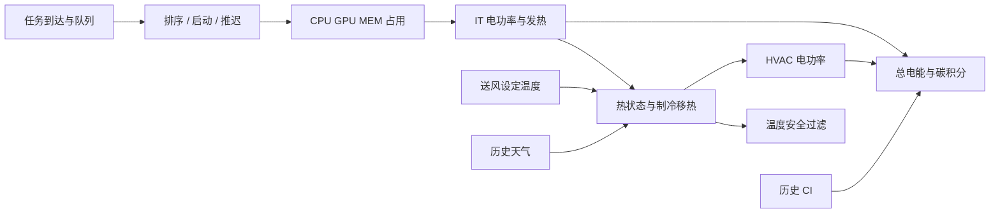

# P1：单数据中心平台 V1 重建与一次性验收

**结论：V1 已实际实现，并通过预先冻结的工程与机制验收，可以进入算法方案选择。** 它是设备数量一致、遵守能量平衡的简化研究模型，仍未经过真实机房校准；本报告中的 kWh、kgCO₂e 是声明假设下的仿真结果，不能作为真实设施减排率。问题一已有明显的同排序风险证据；问题二具备可检查的热负荷、制冷控制和温度约束，但本次冷天气样本的制冷收益较小，不支持预设“联合算法必然大幅获益”。

## Material Passport

| 项目 | 身份与边界 |
|---|---|
| 日期、分支 | 2026-10-19；`research/platform-v1-rebuild` |
| 基准 | A1.3 `b18e2ba8af587e4f79ae45a63afe6632926dc954` |
| 唯一验收实际运行提交 | `96127b7e93bf1b50810f3388750f3f00bd356a3c` |
| 冻结协议 | [acceptance-protocol.json](acceptance-protocol.json)，SHA256 `3e36ac99db68f9def15d414b7796e926dcfd3773e5c27e3c593ddf731091fc52` |
| 原始工作负载身份 | 年度来源 SHA256 `3ba8a8e0067288f8d2542752a292f7da04cb79305689ba145cc6060e96cb7f2e`；通过既有冻结 Train 引用，未整包读取 PKL |
| 数据权限 | 仅三段明确 Train；未读封存 Development/Validation/Test，未追查原始 CSV，未去重、恢复申请量或训练模型 |
| 验证状态 | 一批 144 个任务组合 +18 个空闲背景组合，23.791 秒；全部完成、核心检查通过；之后只复核已保存结果，没有重跑集成实验 |

读过 [A0](../object-validity/A0-research-object-diagnosis.md)、[A1](../object-validity/A1-research-object-design.md)、[A1.1](../object-validity/A1-1-resource-request-recovery.md)、[A1.2](../object-validity/A1-2-request-match-pilot.md)、[A1.3](../object-validity/A1-3-duplicate-task-audit.md)。DCcluster-Opt 本地原论文含补充材料，共 102 页，文件 SHA256 `a29de4a3f1cd4a1cc8a3e0906e7a8aa1d59b5f649ff0a510d2d3d45f5f7a1f72`；重点核对 B.1–B.3、D.2、G.1.1–G.1.2。公开入口：[原论文](https://arxiv.org/abs/2511.00117)。

## 1. 修改前后与两个科学问题

| 对象 | 旧 V2 / 审计发现 | V1 |
|---|---|---|
| 任务资源 | 使用量 ×5，曾与申请量表述混用 | Observed ×1；Legacy ×5 单独保留；均明确不是申请量 |
| 资源与功率对象 | 50,000 CPU /1,000 GPU /80,000 MEM；GPU 功率对象仅 800 | OM/OH/OL 各有独立、逐设备可计数的完整清单 |
| CPU 功率 | 零负载功率超过声明额定端点 | 有界线性端点；CPU TDP 仅作为设计参考，不冒充实测 |
| 制冷 | 冷却塔热容量与风机电功率混用，COP 配置与实际公式不一致 | 空冷冷机 +送风风机 +水泵 +冷凝风机，热容量和电功率分别定义 |
| 入口温度 | 设定温度加固定偏移，与负载脱钩 | 随 IT 热量、移热量、室外传热和历史热状态变化 |
| 天气 | 15 分钟线性插值使用下一小时端点 | 只取历史整点值，小时内左持有；保留源时标元数据 |
| 评价 | 不同尾段或背景可能掩盖比较 | 同一 24 h 到达队列、固定 72 h 责任窗口、相同设备常开背景与末端控制 |

问题一的机制为“推迟 → 累积待启动工作 → 未来 CPU/GPU 冲突 → 容量等待消耗剩余 Slack → Deadline 风险”。问题二的机制为“调度改变 IT 功率和发热 → 入口热状态/制冷需求改变 → 安全温度与电耗耦合”。两者共用同一任务账本和全系统碳积分，不通过改变任务数量或人为制造功率交叉来比较策略。



## 2. 数据中心到底有多大，为什么这样配？

**逻辑容量保持用户提出的 OM/OH/OL，不根据任何算法结果再调。** A1 的 Observed ×1 并发 P95 为 CPU 5,876.04、GPU 131.53，峰值 11,552.28 /308.26，内存峰值 9,579.41 GB。OM 保留既有中等压力结构；OH 接近 P95，作为可能过载的敏感性对象；OL 覆盖已见立即并发峰，作为低竞争对照。

| 对象 | OM 主场景 | OH 高竞争 | OL 低竞争 |
|---|---:|---:|---:|
| 可调度 CPU 当量 | 10,000 | 5,888 | 11,584 |
| 可调度 GPU 当量 /实体参考功率对象 | 200 /200 | 132 /132 | 312 /312 |
| 可调度 MEM（GB） | 16,000 | 16,000 | 16,000 |
| 服务器总数 | 167 | 99 | 194 |
| GPU 服务器 /CPU-only 服务器 | 50 /117 | 33 /66 | 78 /116 |
| CPU 插槽对象数 /安装核心数 | 334 /10,688 | 198 /6,336 | 388 /12,416 |
| 系统保留 CPU 核 /额外不开放核 | 668 /20 | 396 /52 | 776 /56 |
| 安装内存（十进制 GB） | 45,904.610 | 27,212.913 | 53,326.314 |
| 系统保留内存（GB） | 2,869.038 | 1,700.807 | 3,332.895 |
| 配额以外未开放内存（GB） | 27,035.572 | 9,512.106 | 33,993.419 |
| DIMM 数量 /机架数 | 2,672 /9 | 1,584 /5 | 3,104 /10 |

每台双路、每 CPU 32 核、16×16 GiB 内存；每 GPU 服务器 4 卡，每架至多 20 台 2U 服务器。主机数按 `ceil(CPU配额/(64−4))` 与 GPU 机位需求共同确定，每台保留 4 核、16 GiB；多出的安装能力作为不开放配额保留，不假装被任务使用。所有安装设备始终计入空闲功耗，不按“可调度内存只有 16 TB”漏算其余 DIMM。

公开依据：[Intel Gold 6338](https://www.intel.com/content/www/us/en/products/sku/212285/intel-xeon-gold-6338-processor-48m-cache-2-00-ghz/specifications.html)为 32 核、205 W TDP；[Dell R750](https://i.dell.com/sites/csdocuments/product_docs/en/poweredge-r750-spec-sheet.pdf)及 [R750xa](https://i.dell.com/sites/csdocuments/Product_Docs/en/poweredge-R750xa-spec-sheet.pdf)支持双路、相应 DDR4 配置，后者提供四个双宽 GPU 位；[V100 参考规格](https://images.nvidia.com/content/pdf/vgpu/data-sheet/nvidia-v100.pdf)给出 PCIe 250 W。它们是**代表性参考架构**，不宣称整份清单是 OEM 认证 SKU、Alibaba 原集群重建或已验证的具体卡型兼容配置。

CPU 使用单位在本模型中按一个物理核服务当量解释，不建模 SMT 增益。GPU 为理想、可分割且均匀分布的 GPU-equivalent 服务；不模拟独占卡放置、MIG、MPS、显存、拓扑或多卡性能变化。逻辑与功率对象数量一致，不等于这些执行机制已经实现。

Legacy 对照通过 `build_inventory(config,'OM-legacy')` 等接口得到：任务需求和容量同时 ×5，OM 为 50,000 /1,000 /80,000，重新建立 834 台服务器、1,000 个 GPU 对象。它保留旧合成倍率语义，而不是复用旧 800 卡物理模型。本次固定矩阵不额外运行 Legacy；不能用跨设备规模的绝对碳差异宣称算法减碳。

## 3. IT 功率、热量和 HVAC 公式

配置唯一来源：[config.json](../../../experiments/platform_v1/config.json)；清单：[inventory.py](../../../experiments/platform_v1/inventory.py)；物理实现：[physics.py](../../../experiments/platform_v1/physics.py)。以下电功率为 kW、热流为 kW_th、时间为秒、热容为 kJ/K。

### IT 电功率

对 CPU、GPU、DIMM 分别采用 `N×[P_idle+(P_ref−P_idle)×u]/1000`，`u` 用已占用资源除以相应**安装容量**，限制在 0–1。内存分母使用实际安装 GB，不用 16,000 GB 配额冒充安装量。

| 参数 | V1 取值 | 依据等级 |
|---|---|---|
| CPU 每插槽空闲 /参考满载 | 45 /205 W | 205 为 Intel TDP 参考；45 为工程假设，未实测 |
| GPU 每卡空闲 /参考满载 | 25 /250 W | 250 为规格；25 为原论文建模先例，未独立测量 |
| 每 DIMM 空闲 /参考满载 | 3 /5 W | 有界研究假设，使用容量仅作活动代理，非访存测量模型 |
| 每主机其余耗电 | 50 W | 主板、盘、NIC、主机风扇合并的常量假设；不重复加入机房送风风机 |
| 每架交换设备 | 100 W | 工程假设，常开 |
| 主机供电效率 | 0.94 | 常量工程假设，未拟合 PSU 曲线 |

主机部件直流功率除以 0.94，再加机架交换功率得到 `P_IT`；供电损耗显式单列。`Q_IT=P_IT`，因为此电能最终都在机房边界内成为热量。未加入缺少依据的温度漏电曲线；没有增加负载反而降低 IT 功率的机制。

| 设备尺度 | 零任务 IT kW | 安装全负载参考 IT kW | 盘管热容量 kW_th | 送风风机 kW |
|---|---:|---:|---:|---:|
| OM | 39.619 | 150.028 | 195.036 | 12.428 |
| OH | 23.811 | 92.479 | 120.222 | 7.661 |
| OL | 48.098 | 195.426 | 254.053 | 16.188 |

“安装全负载”用于设备设计尺度，不等于任务可用配额，也不是强加的总设施电功率上限。旧名义 1 MW 不再决定任何电功率对象。

### 热状态与移热

采用单个有效入口/机房混合温度节点 `T`：

`C·dT/dt = P_IT + P_supply_fan + UA·(T_out−T) − Q_coil`。

`C=500×主机数 kJ/K`，`UA=0.002×主机数 kW/K`；都是待校准的有效研究参数，不是建筑实测。盘管容量 `Q_max=1.3×安装全负载IT参考功率`，设计空气温升 10 K，`K_air=Q_max/10`；`Q_coil=clip(K_air·(T−T_supply),0,Q_max)`。60 秒子步积分，任务决策仍为 15 分钟。

空气取密度 1.2 kg/m³、比热 1.006 kJ/(kg·K)。送风量由 `K_air/(rho·cp)` 推导，送风风机功率为 `500 Pa×流量/0.65/1000`，本 V1 保持其设计流量常开。室温现在有负载和历史依赖；它仍是混合温度代理，不代表每个真实机架的热点。

### 冷机、水泵与排热

采用空冷冷机，**没有冷却塔和冷却塔水泵**，因此直接消除热容量复用为 CT 风机电功率的问题。闭式水环路比热 4.186 kJ/(kg·K)、温差 5 K、密度 1,000 kg/m³；由盘管移热反推流量，泵功率 `P_pump=100000 Pa×流量/0.6/1000`。水泵电功率全部成为蒸发器侧热量：`Q_evap=Q_coil+P_pump`。

`T_evap=T_supply−5°C`；`T_cond=max(T_out+10°C,T_evap+10 K)`；

`COP=clip[0.35×(T_evap+273.15)/(T_cond−T_evap),2,8]`；`P_comp=Q_evap/COP`。

这是 [Carnot 制冷系数](https://openstax.org/books/university-physics-volume-2/pages/4-5-the-carnot-cycle)乘效率的简化研究模型；0.35、换热逼近温差和上下界均是工程假设，不称为厂家标定或 EnergyPlus 性能曲线。冷凝风机额定**电功率**独立取 `0.02×Q_max`，开启时速度比例在 0.2–1 内按负载变化，电功率按速度立方变化；对应 [DOE 风机规律](https://www.energy.gov/sites/default/files/2013/10/f3/dc_fancasestudy.pdf)的简化应用。

`P_HVAC=P_supply_fan+P_pump+P_comp+P_cond_fan`；室外排热 `Q_reject=Q_evap+P_comp+P_cond_fan`。因而设施边界闭合：

`(P_IT+P_HVAC+Q_envelope)·dt = Q_reject·dt + C·ΔT`。

这保留了原论文 B.2/B.3 的能量平衡思想，未沿用其在当前代码中失真的参数。原论文引用的 [Sun 等，2021](https://eta-publications.lbl.gov/sites/default/files/prototype_energy_models_for_data_centers.pdf)为 CFD/approach-temperature 和 EnergyPlus 原型模型；没有本设施对应 CFD/实测曲线，V1 因此采用显式单节点假设。[EnergyPlus 工程参考](https://energyplus.net/assets/nrel_custom/pdfs/pdfs_v24.2.0/EngineeringReference.pdf)也将冷机热流、压缩机电功率及其他设备区分核算；本实现不宣称就是完整 EnergyPlus 模型。

### 制冷动作和热安全

动作是 18–26°C 送风设定。固定基线请求 20°C；可变基线请求最高 26°C。二者共用安全过滤：只用本槽已经接纳的负载、当前天气和当前热状态预测后续 15 分钟，必要时降低设定，保证代理入口峰值≤27°C；无安全动作则报错，不掩盖失败。28°C 是研究硬失败线，27°C 留 1 K 裕量，参考 [ASHRAE 推荐温度范围](https://resourcecenter.ashrae.org/File%20Library/Technical%20Resources/Bookstore/ASHRAE_TC0909_Power_White_Paper_22_June_2016_REVISED.pdf)。该裕量不等于有真实热点安全保证。

工程测试证明，高负载下始终请求 26°C 而不加过滤，温度会超过 28°C；加入过滤后≤27°C。因此温度约束不再结构性恒真，也没有为控制器制造某个负载下的功率交叉。

## 4. 数据、时间轴、Deadline 和接口

读取既有 Train 冻结任务快照，先检查角色、`test_access=false`、manifest 与内容哈希。保留全部输入位置和稳定 ID，包括已知重复；不访问年度容器其他月份或 A1.2 下载的原始申请表。

- CPU=`cpu_usage/100`，GPU=`gpu_wrk_util/100`，MEM=`avg_mem` GB。原始起止时间用于谱系；调度到达使用冻结场景原有到达桶，Duration 保持 `duration_min`。
- **这些是完整生命周期观测画像**，不是提交时请求/峰值需求。在线接口假设已知固定画像和 Duration，不研究未知运行时长预测；旧预处理的实例均值 Duration、任务重复和历史筛选局限继续存在。
- Deadline=`arrival+SLA×原Duration`，SLA=1.5/2 为合成假设；最晚启动=`deadline−Duration`，Slack 不另行收紧。
- 15 分钟边界接纳任务。不可抢占；整槽保留资源，在原始 finish 之后的首个边界释放；JCT/Deadline 用原始 finish。这是明确保留的离散近似，功率按整槽占用核算，不假装逐秒执行。
- CI 与干球温度取冻结环境中整点记录，小时内左持有，弃用插值后的季度小时温度与 `0.9×干球` 湿球近似。假设整点标记值届时可观测；未取得原数据发布延迟，不能宣称真实 API 零延迟。
- 来源天气仍按其固定 UTC−7 元数据解释，保留 `America/Los_Angeles` 标签冲突作为限制，不假装已重建季节 DST。全系统内部使用冻结 UTC 时间轴；没有用未来一小时端点生成当前动作输入。

[environment.py](../../../experiments/platform_v1/environment.py) 提供 `PlatformEnv.reset()/step(Action)`；`Action` 含全部待启动任务的排序、主动推迟集合和送风温度。资源不足优先记为容量等待，只有当轮可放入时的推迟才记为主动等待；两个等待计数互斥。观察仅含当前/过去 CI、天气、队列、运行任务和热状态，不向控制器提供未来任务或未来环境数组。没有 PPO/Gym/旧功率模型依赖，后续可包裹单 Agent 或多 Agent 接口。

## 5. 唯一一次集成验收：固定方案和工程证据

方案在运行前提交并冻结；输入为 A0 已按工作量压力预选的三个片段，未按本轮碳收益挑选：

| Train 来源（UTC 05:00 开始，24 h 到达） | 任务数 | 72 h CI 范围 g/kWh | 72 h 干球范围 °C |
|---|---:|---:|---:|
| 2023-05-01 | 2,727 | 80.47–205.28 | 9.2–15.9 |
| 2023-03-02 | 2,498 | 110.17–264.28 | 2.1–13.6 |
| 2023-04-04 | 3,873 | 105.80–233.68 | 2.2–16.0 |

每个固定方法/容量/SLA 组合总计 9,098 个输入记录。矩阵为 3 片段×3 容量×2 SLA×4 规则×2 制冷=144；四规则为 FIFO、EDF、Threshold-FIFO、Threshold-EDF。阈值是过去最多 24 h CI 的中位数，前 4 h 不推迟；高于阈值且再等一槽仍合法才推迟，不拟合未来 CI，不沿用旧 April 阈值。

每个到达队列都评价满 72 h，不随排空时间停止。72 h 是执行前确定的 V1 新协议，不与 A0 的完整 31 天碳数值直接比较，也不是看到排空后裁切尾段。设备保持通电；末 6 h 两种制冷统一请求 20°C，以减少末端热状态差异；同窗口另有 18 个无任务背景，用于同时报告总量和增量。没有删除不达标任务，没有按策略改变背景或结束时间。

| 检查 | 实际结果 |
|---|---|
| 合成软件/物理测试 | 验收前 18/18 通过；包括拒绝非 Train、无未来小时插值、重复位置保留、回填/释放、容量与主动等待分离、非法输入、一次性标记；保存结果复核另加 1 项碳积分回归，最终 19/19 |
| 手工物理单点 | 972 个；另有 972 组逐资源单调性检查，无失败 |
| 独立运行前代码审查 | 已补齐任务推迟配对的末端温差校验；审查未读取真实载荷或运行集成实验 |
| 一次批次完成 | 144/144 任务组合、18/18 背景；23.791 s，无异常记录 |
| 完成/资源守恒 | 所有任务完成，无资源超用；436,704 次组合内执行记录，非 436,704 个独立原始任务 |
| 保存结果独立复核 | 重算 144 组、41,472 个步骤；电能/碳汇总重算误差 0 |
| 设施热平衡最大残差 | 1.5134×10⁻⁹ kJ，低于预定 10⁻⁵ kJ |
| 热安全 | 入口最大 26.999999992°C；安全过滤修改次数每组 0–260 |
| 末端公平性 | 任务推迟/制冷配对最大末端差 0.025895 K，低于 0.05 K |
| 同任务电能公平性 | 同容量/同任务集的所有配对 IT 电能一致，未通过少执行任务降低能耗 |

末端仍有有限热储量差异，未宣称严格相同：按 COP_min 换算的最大**压缩机等价电能**为 0.30031 kWh；这不是包含风机/泵的严格 HVAC 债务上界。公开保存原始热储量差，不隐藏这一余量。

工程点及独立复核见 [engineering-checks](evidence/engineering-checks.json)、[physical-probes.csv](evidence/physical-probes.csv)、[saved-result-verification](evidence/saved-result-verification.json)。一次性标记仍在本地，未删除或重置。

## 6. 实验实际观察到了什么？

### 问题一：小幅总碳机会与 Deadline 风险并存

下表为固定 HVAC、SLA1.5、三个来源片段的任务加权结果，每行分母 9,098。其他 SLA 与制冷组合全部保留在 CSV，未筛掉失败场景。

| 容量 | 规则 | 容量等待任务 % | DMR % | 平均 JCT min | 队列峰 |
|---|---|---:|---:|---:|---:|
| OM | FIFO | 3.539 | 1.759 | 94.431 | 104 |
| OM | Threshold-FIFO | 2.638 | 1.462 | 103.670 | 387 |
| OM | EDF | 2.924 | 1.352 | 94.512 | 123 |
| OM | Threshold-EDF | 2.847 | 1.429 | 103.710 | 387 |
| OH | FIFO | 19.631 | 12.596 | 102.927 | 296 |
| OH | Threshold-FIFO | 19.279 | 13.047 | 111.614 | 387 |
| OH | EDF | 14.772 | 8.694 | 101.850 | 291 |
| OH | Threshold-EDF | 15.707 | 9.574 | 110.047 | 387 |
| OL | FIFO /EDF | 0 | 0 | 93.513 | 0 |
| OL | Threshold-FIFO /Threshold-EDF | 0 | 0 | 103.121 | 387 |

OL 的大待启动队列全部可以来自主动推迟，不能称为资源拥塞。本次 OM/OH 的 EDF 容量阻塞尝试分别为 GPU 606/3,746、CPU 0/1,311，MEM 均为 0；本次子集 GPU 为首要瓶颈，不能据此替代 A1 全 16 片段的瓶颈排名。

最清楚的同排序案例为 **April 4、OH、SLA2、固定 HVAC、EDF→Threshold-EDF**：

| 指标 | Immediate EDF | Threshold EDF |
|---|---:|---:|
| DMR | 7.230% | 7.849% |
| 容量等待总任务分钟 | 48,405 | 52,725 |
| 主动等待总任务分钟 | 0 | 80,535 |
| 平均 JCT | 100.685 min | 122.594 min |
| 最大单槽启动 GPU 当量 | 71.533 | 120.820 |
| 发生容量竞争的槽总时长 | 510 min | 555 min |
| 全系统总碳 | 582.746 kg | 579.753 kg |

总碳约降低 0.514%，却增加等待、启动集中度和违约。另一些条件 DMR 不变或下降，例如 OM/FIFO；**不能将“推迟必然恶化”写成普遍结论，也不能将 EDF/FIFO 差异冒充推迟效应**。

72 个同排序配对（含两种 HVAC 的重复控制条件）中，24 个 DMR 增加、12 个容量等待总量增加、20 个 GPU 启动峰增加。阈值相对立即规则的总碳下降 0.0506%–0.6473%，相对同控制空闲基准的增量碳下降 0.5060%–3.2810%。空闲背景占总碳 75.74%–90.08%，因此必须同时报告总量，不能只展示较大的增量百分比。

OH 并不满足所有片段 DMR≤5%：SLA1.5 的 EDF 总体 8.694%，最坏片段 15.879%；SLA2 EDF 总体 3.100%，最坏仍 7.230%。它保留为压力对象，不能宣称服务目标已达标，更不能删除这些任务。OM 的既有压力结构可作为主对象；OL 保留低竞争对照。

### 问题二：热耦合成立，当前天气下收益温和

72 个固定/可变 HVAC 配对的任务启动时间和 IT 能耗完全一致。可变安全控制使 HVAC 能耗降低 **0.633%–0.838%**，总碳降低 **0.262%–0.377%**；每对 HVAC 电能差至少 6.000 kWh，不能只用末端残留储热解释全部差异。

**实际 COP 全程为 8.0，上限生效。** 三片段干球最高只有 16°C，因此这次实验没有验证夏季 COP 改善收益；差异主要来自较暖节点增加向冷室外的被动散热，以及可追踪的有限热状态差异。高温下 COP、负载和温度动作的作用由非数据依赖工程检查覆盖，不能伪装为真实热天 Train 证据。

这说明当前模型存在可解释且较小的制冷控制作用，不需要制造 18/22°C 功率交叉。它也意味着后续必须先检验联合优化相对简单安全规则是否还有价值，不能为了“Cooling Agent 有收益”放大热阻、压降或修改气温。

### 完整结果与统计方法

[case-summary.csv](evidence/case-summary.csv) 包含全部 144 组逐场景结果；[idle-background.csv](evidence/idle-background.csv) 包含全部 18 组背景；[paired-deferral.csv](evidence/paired-deferral.csv) 与 [paired-cooling.csv](evidence/paired-cooling.csv) 各 72 行；[pooled-summary.csv](evidence/pooled-summary.csv) 为 48 个组合汇总。

利用率按各自 24 h 到达期等时槽统计；电能、碳按固定 72 h 统计；DMR/JCT 按任务权重汇总，队列峰取各片段最大，不拼接三个日期伪造连续拥塞。三片段及 SLA/控制增强不是独立随机样本，不提供显著性或置信区间。CI 口径继承来源的 direct 电网强度，不含硬件制造碳、边际排放或网络迁移碳。

## 7. 可运行文件与复现命令

Python 3.10+，仅标准库；测试不依赖原数据。工作目录为仓库根目录。

```powershell
python -m unittest discover -s tests/platform_v1 -v
python -m experiments.platform_v1.physical_checks --output research_notes/platform-v1/engineering

# 原始验收：在独立检出 96127b7... 且有同一既有 Train 池的复现环境执行。
# 当前工作树本轮已用掉一次许可；不得删除 once 标记重跑。
python -m experiments.platform_v1.acceptance --execute-once --pool $POOL --output research_notes/platform-v1/acceptance-001

# 本轮后续只执行这个保存结果复核，不重新调用模拟器。
python -m experiments.platform_v1.verify_saved --input research_notes/platform-v1/acceptance-001 --output docs/research/platform-v1/evidence
```

`$POOL` 本地为 `D:/A-myprofile/SustainCluster/publication/sustaincluster-carbon-scheduling-001/research_notes/joint_v2/scenarios-001`。数据不随 Git 上传；输入文件精确 SHA 和源时标见 [preflight-inputs.json](evidence/preflight-inputs.json)。实际运行代码逐文件 SHA、清单、时间和所有验收布尔项见 [execution.json](evidence/execution.json)。新增 `verify_saved.py` 只读取已保存明细进行独立算术复核。报告复核时补强了该后处理器：由每步功率、时长及 CI 独立重算碳积分，并新增独立回归测试，避免仅累加已保存碳字段形成自证。未改动实际验收时的任何配置、执行器、物理源码或原 18 项测试；复核没有重新运行模拟器。

任务账本与时间线保存在本地忽略目录 `research_notes/platform-v1/acceptance-001/local-detail/`，不上传。旧 V2/V3、原始预处理、冻结池、Checkpoint 均未覆盖；对基准的 Git 变更全部是新增路径。

## 8. 还剩哪些限制，是否可以进入算法阶段？

**通过的是“声明假设下的工程/机制验收”，不是实测校准或论文最终有效性认证。** 仍需带着以下限制开展方法研究：

1. 已知重复记录、均值用量代理、平均实例 Duration 和合成 Deadline 均保留；结果针对处理后的任务对象，不冒充原始预留工作负载。
2. GPU/CPU 为均匀流体服务模型；无卡级放置、显存、共置干扰、服务器关机、DVFS、弹性加速或任务抢占机制。算法不得悄悄加入这些收益。
3. 空闲/活动功率、热容、UA、压降、效率及 COP 曲线未校准。机房单节点无法证明每个机架热点安全，未模拟湿度、免费冷却、冗余故障或 UPS 损耗。
4. 当前仅三个 Train 片段、低室外温度；不得修改封存集或引入未来天气来制造联合优化收益。要宣称夏季/真实机房效应，必须另有获准数据与校准依据。
5. 总碳中的常开背景显著，联合收益可能小；必须保留总碳、增量、任务服务指标、热状态和末端余量共同比较。
6. OH 中立即规则已有严重违约；没有证明任意算法都可达到≤5%，也没有证明数学上不可行。后续若用风险约束，应显式报告不可行和必要下界，不能删除任务或放宽统计。

满足这些边界后，可以进入 `research/algorithms-v1`，仅准备算法候选。建议先做带容量日历与 Slack 保护的简单碳感知规则，再评估联合滚动优化；暂不训练 PPO/MAPPO。本次平台参数和结果不再因算法候选而调整。候选文档将在算法分支 `docs/research/algorithms-v1/algorithm-candidates.md` 单独提交，等待用户选择。
