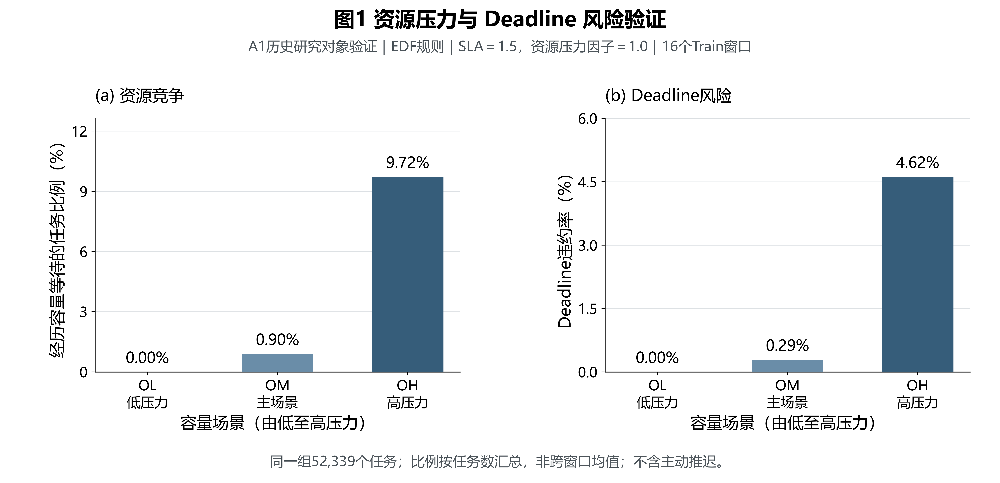
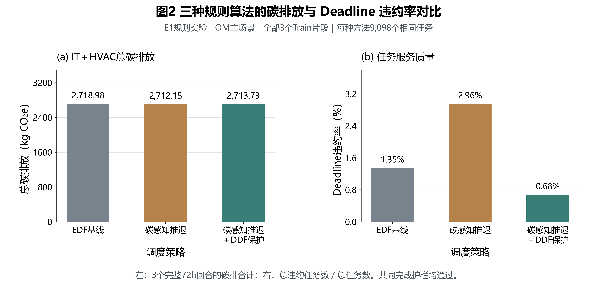
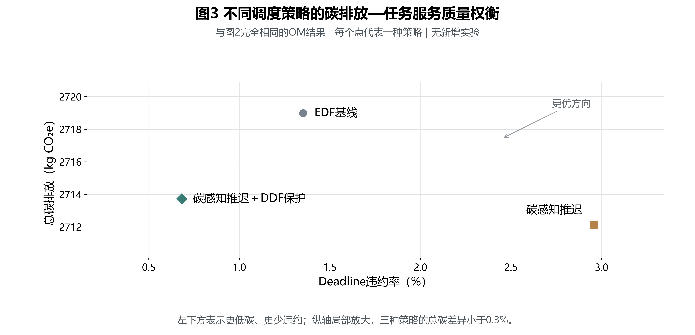
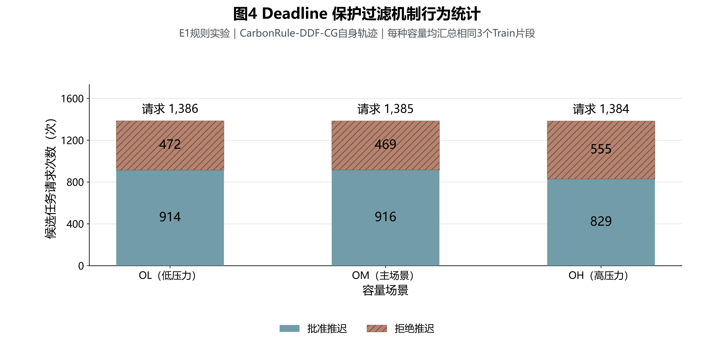

# 开题报告科研图说明

日期：2026-10-22。仅生成4张图，每张PNG/PDF/SVG，共12个图文件；没有新调度、模型评价或训练。
全部图为定量比较图：研究问题验证 → 已完成规则实验 → 碳与服务质量权衡 → 保护机制行为。
正文优先推荐图1与图3；说明方法实现进度时可配图4。不得把这些开发性结果称为独立泛化测试或PPO优势。

## 共同数据、统计与复现口径

- Python/matplotlib；字体统一为Microsoft YaHei。画布12×5.8英寸，白底，标题18pt、坐标轴14pt、刻度/注释12pt及以上；PNG为600dpi（7200×3480像素），PDF嵌入TrueType字体，SVG保留可编辑文字。跨机器查看SVG需安装对应中文字体。
- 柱图均从0起；图3使用明确标记的局部纵轴，不用双y轴、不连接成最优前沿、不画训练曲线。
- 采用完整任务计数的汇总比例和完整回合碳合计，不是随机重复实验均值。因此不添加虚构SD/SE/CI或显著性标记；跨窗口、容量、方法并非独立随机样本。
- 图1：A1候选汇总原有90行，固定选择Observed×1、OL/OM/OH、EDF、压力因子1.0、SLA1.5，共3行；其余87行为不同映射/压力/SLA/规则，非删除困难任务。每行含相同16窗52,339任务，全部完成。
- 图2/3：E1原有27行，按用户优先OM的要求选择全部3片段×3方法共9行；未选择的18行是OL/OH容量，图4另使用其中DDF方法。OM未挑选日期或seed，每种方法9,098个相同任务。
- 图4：同一E1原表选择全部3容量×3片段的DDF方法9行，其他18行为无DDF对照，不能混入DDF机制统计。所有27回合的完整性/CG/尾段验证通过；脚本读取时逐项断言。
- E1窗口：2023-03-02、2023-04-04、2023-05-01，均05:00起，24h任务到达、72h固定评价、SLA1.5、HVAC请求20°C。它们已用于平台验收/方法开发，非独立泛化样本。
- A1是历史逻辑容量与规则诊断阶段，E1是冻结V2执行及能耗口径；即使容量标签相同，也不能把图1与图2的DMR差直接归因为某项算法。所有需求保留观测使用量代理、合成Deadline与原始重复任务的既有限制。
- 未读取原始工作负载、年度PKL或任何封存Development/Validation/Test输入；仅读取以下已存在的轻量Train结果表。

| 原始结果文件（仓库相对路径） | SHA256 |
|---|---|
| `docs/research/object-validity/data/a1/rules/candidate-summary.csv` | `e3d7b220f9c7f07cfa14be4bce0351c1db1fe178f6e8e1b7bffc82dd68e74a6e` |
| `docs/research/sca-ppo/e1-results/case-summary.csv` | `e588c2d8eb929dc650d6a8239ae1dfa30f4f0b84e4b785fd4fa9da8f37be5021` |
| `docs/research/sca-ppo/e1-results/analysis-summary.json` | `e68f3b8d5c269eca67353912a47b6ab781c6ad548b05b85385cc83d753287d30` |
| `docs/research/platform-v2-final/evidence/result-methods.json` | `491e115f3b6e04442d69a5b15dfb2676619390919ec4e9a5b24429ca070b634e` |

来源结果沿用既有A1和E1源码身份，E1逐回合source_sha/workload_sha256保留在源CSV；E1执行源码SHA为`d65076b4397f8301e81f1527c2b9f0520bd23870`。本次绘图不改变任何输入；单位由冻结V2结果方法清单独立核对。

## 图1：资源压力与 Deadline 风险验证



**数据来源：** `docs/research/object-validity/data/a1/rules/candidate-summary.csv`，与既有A1-capacity-competition图相同的汇总源；固定EDF/Observed×1/压力1/SLA1.5。

**Caption：** 相同16个Train窗口下，低至高压力容量的资源等待率与Deadline违约率。左图为至少经历一次容量不足等待的任务数／到达任务数，右图为违约任务数／到达任务数，均按任务汇总。等待不包括策略主动推迟。

**结论：** OL无容量等待，OM出现少量竞争，OH的容量等待和Deadline风险明显上升。这支持有限资源与Deadline耦合这一研究问题，而不是证明某个算法能够解决它。

**放置位置：** 研究背景后的“研究对象与问题验证”；答辩PPT的科学问题动机页。优先使用。

**局限：** 16窗非16个随机种子；汇总率可能掩盖短期峰值。OH的最坏窗口DMR为15.88%，有4/16窗超过5%；不能只因汇总DMR低于5%就称全部场景达标。A1不是当前V2的性能对比。

| 场景 | CPU / GPU等价 / MEM容量 | 容量等待任务 / 总任务 | 等待率 | 违约数 | DMR |
|---|---|---|---|---:|---|
| OL | 11584.0 / 312.0 / 16000.0 | 0 / 52,339 | 0.000000% | 0 | 0.000000% |
| OM | 10000.0 / 200.0 / 16000.0 | 470 / 52,339 | 0.897992% | 151 | 0.288504% |
| OH | 5888.0 / 132.0 / 16000.0 | 5,087 / 52,339 | 9.719330% | 2416 | 4.616061% |

## 图2：三种规则算法的碳排放与 Deadline 违约率对比



**数据来源：** `docs/research/sca-ppo/e1-results/case-summary.csv` 的全部OM记录；`analysis-summary.json`核对矩阵完整性。真实方法为EDF-CG、CarbonRule-CG、CarbonRule-DDF-CG，E1没有FIFO-CG，不伪造或混用其他阶段结果。

**Caption：** OM主场景下三种已实现规则的完整72h总IT＋HVAC碳排和任务加权DMR。碳为3个相同片段回合的合计，不是单回合或均值；DMR为三回合总违约数／9,098。CG表示共同完成护栏，DDF表示Deadline非恶化过滤器。

**结论：** 碳感知推迟比EDF略低碳，但最终DMR上升；增加DDF后违约显著减少，同时放弃部分减碳机会。它展示了已实现且完整评价的规则基线，不意味着PPO已经胜出。

**放置位置：** “已完成工作／前期实验”；规则基线实现与平台验收进展页。

**局限：** 总碳中包含公共空闲背景，差异小；柱图从0开始不会夸大小幅变化，图3再展示细节。不能将局部预测保护称为未知未来到达下的全局安全保证。背景增量碳仍完整列于下表，未用增量口径替代总碳。

| 源方法名 | 总碳/kg CO₂e | 背景增量碳/kg CO₂e | 违约数 / 总任务 | DMR |
|---|---:|---:|---:|---|
| EDF-CG | 2718.981912 | 368.750419 | 123 / 9098 | 1.351945% |
| CarbonRule-CG | 2712.149451 | 361.917957 | 269 / 9098 | 2.956694% |
| CarbonRule-DDF-CG | 2713.727628 | 363.496134 | 62 / 9098 | 0.681468% |

图中文字对应：EDF基线＝EDF-CG；碳感知推迟＝CarbonRule-CG；碳感知推迟＋DDF保护＝CarbonRule-DDF-CG。碳单位kg CO₂e与冻结V2的`result-methods.json`中`units.carbon=kgCO2e`一致；仅表示既有CI积分的运行碳核算，不额外包含设备生命周期排放。

## 图3：不同调度策略的碳排放—任务服务质量权衡



**数据来源：** 与图2完全相同的9行OM源记录、同一张数值表、同一汇总方法，无额外实验或重选窗口。

**Caption：** 每个点为一种规则在相同三个OM片段上的任务加权DMR和完整回合总碳合计，左下表示更低碳与更少违约。纵轴局部放大，以显示总碳不足0.3%的细微差异；点不构成理论最优前沿。

**结论：** 无DDF推迟获得最低总碳，却具有最高违约率；带DDF规则相对它增加1.578kg总碳、减少207个违约。这给出了“碳收益与服务风险如何权衡”的直接证据，DDF只保护已知任务的局部参考结果。

**放置位置：** 核心科学问题、研究目标或方法动机页；最适合作为答辩主图之一，与图1优先组合。

**局限：** 仅三种确定性规则与一个容量的描述性比较，不提供因果机制消融、统计显著性或跨容量最优结论。不能把箭头理解为任何新算法已达到的改进轨迹。

## 图4：Deadline保护过滤机制行为统计



**数据来源：** `docs/research/sca-ppo/e1-results/case-summary.csv` 的CarbonRule-DDF-CG全部9回合；次数来自attempts/approved/rejected。

**Caption：** 每个容量汇总三片段DDF自身真实轨迹中的候选推迟请求。柱总高为请求总数，蓝色为批准，棕色斜线为拒绝；两段恰好相加为全部请求。次数包含同一任务跨多个时槽的重复请求，不是唯一任务数。

**结论：** DDF在三个压力水平下都拒绝约三至四成请求，表明机制确实进行筛选。高压力OH的拒绝比例更高；批准数不等于实际主动等待，因为真实执行还遵守容量先判断与回填规则。

**放置位置：** “拟采用方法／已实现保护机制”；说明算法不是盲目推迟的机制证据页。

**局限：** 每种容量的请求来自其自身轨迹，不能把不同轨迹下总请求数的差都当作DDF直接拦截的效果。源CSV中拒绝原因标记存在重叠（例如同时破坏按时集合并增加超期），因此本图使用互斥的批准／拒绝，而不直接堆叠这些原因。全局primary_reason_partition可互斥分类，但不是现成的逐容量分类表。

| 场景 | 全部请求 | 批准 | 拒绝 | 拒绝比例 |
|---|---:|---:|---:|---:|
| OL | 1386 | 914 | 472 | 34.055% |
| OM | 1385 | 916 | 469 | 33.863% |
| OH | 1384 | 829 | 555 | 40.101% |

## 复现与导出自检

```powershell
python docs/research/sca-ppo/proposal-figures/generate_proposal_figures.py
# 如需指定其他已安装中文字体：在同一命令后添加 --font 字体文件路径
```

脚本只读取四个既有轻量结果/方法文件，断言A1选择唯一、E1全部27回合完整且相同任务、CG和尾段有效、请求＝批准＋拒绝，缺失或不一致直接报错。SVG保留文字，PDF嵌入字体；PNG保留完整画布与600dpi，不对某个策略单独裁剪、修饰或重算结果。没有p值、置信区间、3D或双y轴。四图所有标签和图例使用同一中文字体（₂符号使用兼容无衬线回退字体），方法原名、数据单位和局限在本说明中明确对应。

最终源码预检18项通过、0失败；两项提示分别为PNG而非TIFF，以及画布比期刊单栏宽，均按本次PPT/开题用途和指定格式保留，不增加多余版本。PDF逐图最小文字12pt；缩放至183mm正文宽度时相当于约7.2pt。已逐图检查标题、子图、数值、图例与点旁标注，不存在重叠或截断；图3整数刻度与真实坐标一致。PNG尺寸与DPI、12个导出文件、全部输入源在Git中无变更均另行复核。上表记录实际读取字节的SHA256；CSV文本的CRLF/LF行尾可能随Git检出平台转换，不改变数据值。
