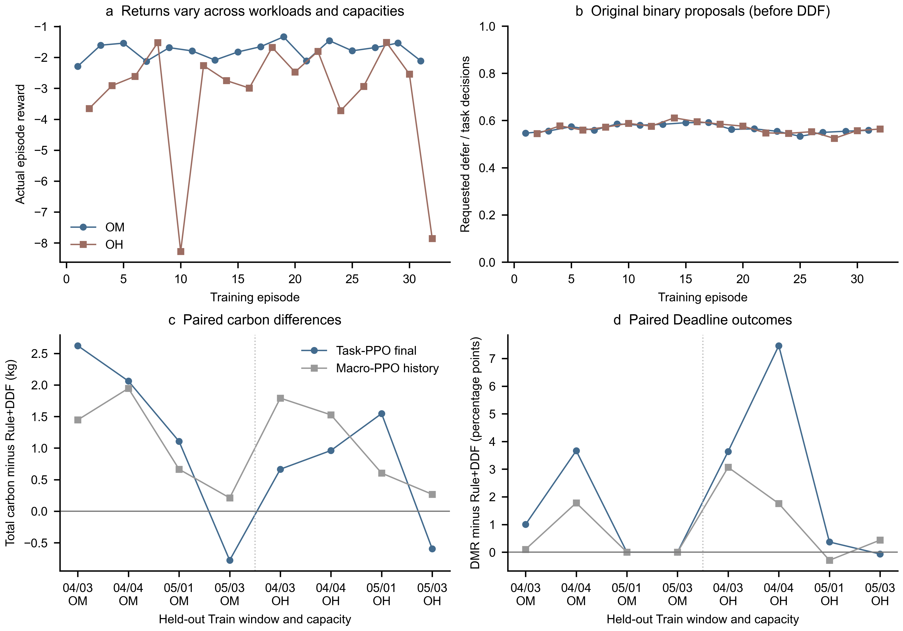

# Task-PPO V1：任务级执行/推迟首次pilot报告

2026-10-21（Asia/Shanghai）。本报告对应从 `865f1ef05cd3f663fe4e0392790854cbff4e9466` 新建的 `research/task-ppo-v1` 分支。

**结论：任务级PPO真实完成了神经网络训练，物理与奖励账本通过；本次没有学会有用的任务区分，最终确定性策略仍几乎对所有候选申请推迟，未优于固定规则。建议仅有条件继续最小诊断，不直接扩大正式多seed训练。**

## 1. 研究范围与可归因边界

本轮把原来“选择一种排序及推迟数量”的7宏动作替换为逐候选二元proposal。冻结V2、原EDF资源日历、DDF严格条件、3960min共同完成护栏、任务数据、Observed×1资源代理、SLA1.5合成Deadline、15min调度步、20°C制冷请求及72h责任窗口均保留。原始请求、保护器批准和实际执行分别记账；没有新增预测器、风险评分、奖励塑形或其他复杂模块。

对照包括EDF-CG、CarbonRule-DDF-CG、任务级PPO初始化与最终策略，以及原7动作PPO历史模型。所有评价在同一Train内部留出任务、相同容量/CI/天气/设备与72h窗口进行。旧PPO仅在OM上训练，种子、27维状态、动作空间和熵正则均与本轮不同；应用于OH属于历史模型迁移。它可以作为相同评价输入下的参考，**不能构成只改变动作空间的严格单变量消融**。

任务需求仍是既有观测使用量代理，不是真实申请资源；Deadline仍是合成SLA。结果属于未重新校准的冻结物理平台内核算，不能声称为真实数据中心实测减碳。

## 2. 同槽任务决策与真实时间

槽开始从当前已知pending/running状态生成无主动推迟EDF计划，冻结该计划本槽原本能够启动的全部任务，并按 `(deadline,arrival,task_id)` 遍历。每个候选只产生一个二元原始proposal：0不主动推迟，1请求当前15min周期推迟；0不保证一定启动，实际容量与回填仍由V2决定。没有16个候选上限，没有因拒绝而补位，也不根据后续结果重选候选。

同槽内部不推进物理时钟、不释放真实资源、不读取新到达/未来CI/天气，只维护累计批准prefix。对新请求1，检查 `approved_prefix+[current_id]` 的联合反事实是否保持原参考按时集合、原迟到集合总超期及CG。最终将全部原始1请求按顺序交回旧 `ResearchAdapter.decide`，以原DDF全量重放核验每项批准、拒绝理由、受影响按时任务及trial prefix，批准集一致后再通过旧 `execute` 真实执行一次15min。

DDF仅限制当前已知任务在参考预测中的恶化，不是对未知未来到达的全程Deadline保证。CG是统一完成责任约束，不是任务Deadline；一旦失败锁存无defer EDF直至72h，不删除任务，不恢复主动推迟。所有未完成、censored、尾段无效、动作/预演/奖励失配或非有限更新均保留证据并停止后续训练。

## 3. 网络、联合概率与奖励

共享64×64 Tanh骨干，二分类actor和标量critic。actor输入48维：旧27维因果全局状态、当前任务12维、已批准prefix8维及actor query标志1。任务特征包括CPU/GPU/MEM需求占比、Duration、已等待年龄、剩余Deadline、个人Slack、动态IT功率代理、参考剩余完成时间、网格运行时间、arrival及绝对Deadline；prefix表示候选规模、位置、已批准数/资源及拒绝数。所有尺度预先固定，不利用留出统计。没有TaskID嵌入。critic使用槽开始的27维全局状态加21个零，作为与本槽联合动作无关的canonical query。

任务级条件分布组成同槽自回归proposal联合概率：

`log π(b_t|s_t) = Σ_j log π(b_t,j | 当前任务、槽前全局状态、原路径prefix_j)`。

全部原proposal均计入，包括0及被DDF拒绝的1。更新时teacher-force已保存的48维原条件观测，不重采样、不用新模型重建prefix，也不把批准动作概率冒充原proposal概率。联合log求和和importance ratio使用float64；每物理槽仅一个ratio、一次clip与一个Advantage，不按候选数取平均log或复制真实奖励。

GAE沿完整288个物理槽计算，`gamma=1`、`lambda_gae=.95`，真正72h终止bootstrap为0；没有把任务内部选择计为新的物理步。空候选/CG强制槽无actor样本但保留critic、GAE和实际奖励；有候选全选0或全被拒绝仍是正常联合proposal样本。熵系数预注册为0，条件熵和仅记录为诊断，避免把固定旧prefix下的条件熵误称精确联合熵梯度。

奖励完全沿用E2：

`r_t = −(C_actual,t−C_common_idle,t)/100 − .01×N_new_irreversible_miss,t`。

每个ID一次不可逆miss，不能用EDF预测迟到替代真实事件。每槽执行后才读取同槽公共空闲碳，公共背景不进入策略状态。没有任务中间奖励，没有为推迟动作重复发放碳收益或Deadline惩罚。

| 预注册项 | 固定配置 |
|---|---|
| 输入/网络/动作 | 48维、共享64×64 Tanh、二分类proposal |
| Adam | learning rate3e−4、epsilon1e−5 |
| PPO | clip.2、每回合4epochs、每minibatch64个物理槽 |
| Value与梯度 | value coefficient.5、value loss为half MSE；grad norm上限.5 |
| 折扣/GAE/熵 | gamma1、GAE lambda.95、entropy coefficient0 |
| 奖励尺度 | 100kg/奖励单位、每新增miss扣.01，即1kg等价服务偏好 |
| 容量与预算 | 冻结OM/OH各16回合，共32个72h回合、9216物理训练步 |
| 随机性 | 单seed20261021、CPU单线程、确定性设置 |
| 模型选择 | 更新前保存initial；最终固定用第32回合，不按留出挑checkpoint |

完整定义见[任务级MDP设计](task-level-MDP-design.md)及[机器配置](pilot-config.json)。

## 4. Train分组与公平评价

复用E2已审计的16个 `r1-s1.5` Train快照：Jan–Mar12窗训练，Apr–May4窗内部留出。按原始任务身份和连续环境时间连接块隔离，跨组无共享原始任务身份或环境覆盖；分组、payload身份和来源哈希在读取前按白名单固定。既有重复任务全部保留，不改需求或Deadline。未读取封存Development、Validation、Test、年度PKL或原始CSV。

这16窗来自同一处理trace，分为5个连续输入块，4个留出窗口也曾用于既有方法/平台开发。它们不是4份独立现场测试，更不是封存泛化测试；不同容量与重复训练不能增加独立源样本数。OM与OH按预声明顺序交替训练，12窗打乱/轮转序列、seed和预算在真实性能实验前提交。

4留出窗×2容量×5方法均使用24h到达、72h责任及同一公共空闲背景。评价冻结网络，不更新、不调参。汇总DMR采用总miss/总任务，JCT按完成任务数加权；总碳和背景增量碳同时报告。每组同时核对IT能量一致与末温差≤.05K，不能因安排共同尾段就假定所有方法末态天然公平。

## 5. 工程验证、中断与等价修订

首次实现提交 `7ad4ab18249cb2b1825a15cbbd0f084ece43b251` 的训练前评价暴露计算性能问题：首OM场景第20个完整槽附近出现297个候选、单槽55.39s。反复将所有已批准prefix交回原filter导致二次增长的日历重验。此时**尚无任何训练更新**；没有依据策略分数改配置。

`pilot-001`保留32个完整公共背景、3个完整旧方法评价及20个持久化真实物理槽，中断发生在后续槽的纯候选计算阶段。部分episode不计作完整评价；未持久化的内存prefix不补造。旧marker和全部文件保留，未删除后假装首次运行成功。工程中断信息见[中断清单](engineering-interruption.json)。

修订提交 **`7dbe02397781a5f5b89ee9c1558e366b7fbbbac6`** 只缓存初始reference的按时集合、迟到集合和总超期；对每个新原始1仅模拟一次联合trial，原EPS、判据和理由顺序不变。槽末仍调用原DDF全量重放，逐请求核验批准、理由、lost IDs与trial defer prefix。冻结DDF源码、任务、特征、奖励、参数、场景、seed与训练顺序均未改变。

继续运行保存为独立`pilot-002`。在任何训练前，初始模型fingerprint必须与旧尝试相同，首同场景已保存20槽的taskID、48维特征、原动作/logprob、批准/拒绝、实际row及奖励必须逐字段一致；只有耗时和内部调用量诊断可变化。该真实前缀同一性门禁通过后才允许更新。

训练前人工验证 **177项PASS**，包括原有受控回归及任务级联合概率、teacher forcing、物理槽GAE/clip、一次step/奖励、全0/全拒绝、CG锁存、72h完整责任、多资源回填、增量DDF与原实现枚举等价，以及完整checkpoint/RNG/Adam恢复。事后另补3项浮点排序审计回归，最终新鲜测试为 **180项PASS（40任务级+108旧SCA+32平台）**。不因性能删除候选或放宽过滤。测试细目见[工程验证记录](engineering-validation.md)。

## 6. 最终执行与对照结果

`pilot-002`状态为`completed`、`errors=[]`，耗时 **679.501304s**。实际完成 **32训练回合、9216物理训练步、32次PPO update、640次Adam step**；另有40个完整评价回合/11520步、32个完整公共背景/9216步。合计 **104个完整账本、29952个真实物理槽**，全部保存核验通过。001的35个完整账本及20个部分槽另列保留，不进入主训练或比较均值，也不假装额外训练样本。

实际执行源码为 `7dbe02397781a5f5b89ee9c1558e366b7fbbbac6`；protocol SHA256为 `097bba7dd4076d56fe5dda7f5d8336f862005faf5d55a3452f1fd4ee98d8c369`，admission SHA256为 `3a777b16e160f97df16ebf394fc1ab9e2b64f9f8ef80d242c43a1c0943e160f2`。初始模型fingerprint `419ebda3d021ba3b94ec4f5b8fc4fb88761f96232a9945e143f853d7c516e3a0`，最终为 `f220adef6e86c84127565ea74c94be2a325f5cf025abfd4332de785f61cbaa7a`。34个checkpoint（initial、32逐回合、final）全部哈希匹配；每回合保存、加载完整网络、Adam、RNG与计数。运行后的三份训练/执行核心源码与execution记录的字节哈希一致，没有在结果产生后修改训练实现。

### 6.1 真实训练与风险反馈

每次独占policy head参数L2变化为 **0.003532–0.019917**，全部网络变化为0.071141–0.299905，证明不是随机动作或仅critic更新。联合clip fraction均值 **0.084244**、范围0–0.240385；approximate KL均值0.007568、范围0.000749–0.027364，未出现NaN/Inf。value loss范围0.008740–0.536116、末次0.375203，没有可据此宣称收敛的单调趋势。

| 训练容量 | 回合 | 任务曝光 | 实际miss / DMR | 总回报 | 候选二元决策 | 原始1 / 比例 | DDF拒绝 / 比例 |
|---|---:|---:|---:|---:|---:|---:|---:|
| OM | 16 | 50516 | 17 / 0.033653% | −28.590537 | 86030 | 48635 / 56.532605% | 13007 / 26.744114% |
| OH | 16 | 49923 | 2351 / 4.709252% | −51.484186 | 78292 | 44500 / 56.838502% | 14192 / 31.892135% |
| 合计 | 32 | 100439 | 2368 / 2.357650% | −80.074722 | 164322 | 93135 / 56.678351% | 27199 / 29.203844% |

这里任务数是重复窗口及不同容量下的曝光，不能当成独立新任务。实际actor仅 **3217个物理联合动作槽**，其余5999槽没有actor提议样本；164322次任务条件查询不是164322个物理时间步。4epochs重复使用这些数据不增加独立轨迹数。GAE、真实奖励和critic始终保留全部9216物理槽。

与旧E2训练全部零miss不同，本次 **17个OM及2351个OH真实miss已经进入原奖励**。不能再把本次效果不佳简单归因于“完全没有风险反馈”；有风险惩罚也不等于已学会跨任务风险权衡。

### 6.2 相同留出输入的OM结果

每个方法均完成同一组 **14477个任务**。DMR为总miss/14477，JCT按完成任务数加权；总碳为完整72h的IT+HVAC，增量碳减去同组公共空闲背景，主动等待按逐任务逐槽累计。没有排除困难任务或失败子集。

| 方法 | 总碳/kg | 背景增量碳/kg | Miss / DMR | JCT/min | 主动等待/min | DDF尝试/批准/拒绝 | 拒绝率 |
|---|---:|---:|---:|---:|---:|---:|---:|
| EDF-CG | 3190.270383 | 440.849880 | 151 / 1.043034% | 88.132953 | 0 | 0/0/0 | — |
| CarbonRule-DDF-CG | 3185.935155 | 436.514653 | 90 / 0.621676% | 89.381486 | 20010 | 1976/1339/637 | 32.236842% |
| MacroPPO-history | 3190.203761 | 440.783258 | 164 / 1.132831% | 94.879172 | 95130 | 6461/6361/100 | 1.547748% |
| TaskPPO-initial | 3190.855395 | 441.434893 | 281 / 1.941010% | 122.017391 | 478515 | 46102/31913/14189 | 30.777407% |
| TaskPPO-final | 3190.948176 | 441.527673 | 281 / 1.941010% | 121.701372 | 473940 | 45723/31608/14115 | 30.870678% |

最终任务级PPO相对规则 **多5.013021kg碳、191个miss、32.319887min平均JCT**；相对旧宏历史模型多0.744415kg碳、117个miss及26.822201min JCT。相对初始化miss相同，JCT减少0.316019min，但碳增加0.092780kg，回报稍降0.000928。没有得到超越初始化或规则的有效目标收益。

### 6.3 相同留出输入的OH结果

| 方法 | 总碳/kg | 背景增量碳/kg | Miss / DMR | JCT/min | 主动等待/min | DDF尝试/批准/拒绝 | 拒绝率 |
|---|---:|---:|---:|---:|---:|---:|---:|
| EDF-CG | 2108.322840 | 446.155259 | 1326 / 9.159356% | 94.334169 | 0 | 0/0/0 | — |
| CarbonRule-DDF-CG | 2104.264391 | 442.096811 | 1323 / 9.138634% | 95.351645 | 19005 | 1969/1268/701 | 35.601828% |
| MacroPPO-history | 2108.453601 | 446.286020 | 1546 / 10.679008% | 101.461682 | 89955 | 6455/6027/428 | 6.630519% |
| TaskPPO-initial | 2106.853324 | 444.685744 | 1809 / 12.495683% | 124.861557 | 377355 | 37759/25199/12560 | 33.263593% |
| TaskPPO-final | 2106.841855 | 444.674275 | 1798 / 12.419700% | 124.635682 | 374205 | 37530/24986/12544 | 33.423928% |

最终任务级PPO相对规则 **多2.577464kg碳、475个miss、29.284037min JCT**。相对宏历史模型少1.611745kg碳，却多252个miss及23.174000min JCT，原奖励总和下降2.503883。相对初始化少11个miss、0.011469kg碳和0.225876min JCT，回报提升0.110115；这是有限的同输入改善，但远不足以超过规则或历史方法。

OH下EDF和规则本身DMR约9.1%，本次没有方法达到5%目标；不得将全部任务完成或CG通过冒充Deadline约束已满足，也不能为改善比例改容量、Deadline或任务分母。OM与OH来自同一源任务，不把两容量合并当作独立泛化样本。

### 6.4 完整责任与功率账本

104/104保存核验通过，所有任务完成、无unfinished/censored、CG失败或无效共同尾段，`execution.errors=[]`。8个留出容量配对组均含全部5方法，最大末温差为0K、最大IT能量差为0kWh，末态储热差因此也为0；碳差不是漏算工作或借用末端热量造成。

独立逐槽/逐ID核验的奖励守恒误差最大 **8.881784×10⁻¹⁶**，真实碳、增量碳、逐步奖励及联合log-prob求和误差均为0；原始0/1proposal、DDF批准、实际主动等待和被动容量等待分别保留。最后统计只计最终原DDF每个原1一次，不把内部增量核验和最终重放重复算作DDF尝试。完整证据见[账本复核](results/ledger-audit.json)。

事后初版审计曾把两个合法EDF顺序误报：不同原始deadline `462.54999999999995` 和 `462.55` 除以4320后合并为相同归一化值，从该值重建次排序会丢失原始精度。初始误报JSON仍保留；修正只读分析器后，另从已授权16窗的原始字段独立核对 **48个任务级回合、13824物理槽、331561次任务查询**，全部精确EDF顺序和arrival≤now检查通过，0错误。此核验没有新模拟、重评或训练，运行时三个核心文件未改。`evidence.py`属于事后分析修订，其当前哈希与execution最初记录不同；没有改变模型、原始CSV或真实性能轨迹。见[精确原字段排序审计](results/exact-order-audit.json)与[保留的初审误报](results/ledger-audit-normalized-order-initial.json)。

## 7. 是否学会区分任务及阶段判断

### 7.1 有非零任务概率响应，但没有有用的任务选择

最终确定性评价的原始二元选择如下；0仅指不主动推迟，DDF可能拒绝原始1。

| 容量 | 原始0 / 1 | 原始1比例 | 有不同二元动作的槽 / 可采样槽 | 最终P(defer)范围 | 同槽原始概率差均值 |
|---|---:|---:|---:|---:|---:|
| OM | 74 / 45723 | 99.838419% | 7 / 419 | 0.492246–0.599842 | 0.018266 |
| OH | 51 / 37530 | 99.864293% | 4 / 415 | 0.493741–0.611475 | 0.017220 |

初始化确定性策略在两容量均对全部候选提议1；训练后仍约99.8%提议1。因此不能把“改成任务级动作”本身当作学会了有效选择，也不能把99.8%的greedy选择误称为网络输出99.8%的推迟概率。

进一步只读网络probe冻结每个保存槽首候选的全局27维与prefix8维，只替换该槽实际保存的任务12维，initial/final使用完全相同上下文。该probe不执行环境、不计算新奖励、不更新或选择模型。

| 容量 | 初始task-only概率range均值 | 最终task-only概率range均值 | 初始/最终task-only混合argmax槽 |
|---|---:|---:|---:|
| OM | 0.001992 | 0.000480 | 0 / 0 |
| OH | 0.001882 | 0.000519 | 0 / 0 |

随机初始化本来就随任务属性有非零概率变化，最终同上下文范围反而更小，且两者都没有形成混合argmax任务选择。原轨迹同槽概率差还混合了候选位置、已批准prefix及拒绝历史变化，不能全部归因于任务属性。特征Pearson关系仅是相关任务曝光的描述性诊断，不是因果证明或显著性检验。

因此明确回答：**模型具备读取不同任务属性并改变概率的表达能力，权重确实改变；本次未证明学会了能改善碳/Deadline目标的任务区分。**

### 7.2 三个最有依据的限制

**第一，随机训练与逐任务greedy部署的联合行为分布存在明显差异。** 训练中原始1约56.5%/56.8%，多数槽是混合二元请求；最终greedy评价却约99.8%提议1。对多任务联合向量，单任务概率略高于.5就会使逐步argmax形成几乎全1路径，而这种路径在随机采样时可能很罕见，后续prefix状态也随之不同。这是重要的可观察解释，尚未通过部署方式消融证明；逐步greedy也不应称为整个自回归联合向量的全局MAP。

**第二，任务查询多不等于物理训练样本充分。** 本次164322次条件查询仍只对应3217个actor联合槽和32个完整回合，每槽只有一个共享Advantage，难以把长期碳、容量外部性和风险归因到具体任务。联合clip确实发挥作用且参数更新，但仅凭更新或较大查询数不能证明已学会条件决策。48维仍是聚合部分观测，未证明Markov充分；没有执行credit或状态消融，不能断言某一个因素为唯一根因。

**第三，风险反馈已出现，但最终行为与目标改善仍脱节。** 本次17/2351个OM/OH miss真实计奖，不能继续沿用旧E2“风险惩罚完全缺失”的解释。初始化和最终都接近全1，任务-only响应较弱，新增主动等待显著多于规则，局部DDF不能替代未知未来到达下的风险学习。奖励权重依旧是原工程偏好，未根据留出分数重新调参；本轮不以失败为由随意增加奖励机制或复杂模块。

### 7.3 阶段结论与下一步

**技术验收PASS；研究效果仅CONDITIONAL GO，不建议直接扩大正式多seed训练。** 已证明可真实训练、联合轨迹/概率/GAE正确执行、完整责任与checkpoint通过；本次规则在OM/OH均具有更低碳、更少miss和更短JCT。任务级方法没有相对历史宏动作形成更好的奖励权衡，历史条件又不同，不能作严格动作空间因果结论。

若继续，最小下一步应先另行预注册训练采样与greedy部署差异、任务归因及同上下文选择覆盖的诊断，再决定是否增加预算或进行正式多seed。不能直接承诺更多训练会修复问题，不能用重选seed、换留出、改物理参数或增加复杂模块制造胜出。本轮没有执行这些后续步骤。

## 8. 证据与复现边界

大日志和checkpoint保留在本地Git忽略目录；Git提交代码、预注册、测试、轻量统计与必要证据。轻量[训练指标](results/training-metrics.csv)、[逐窗评价指标](results/evaluation-summary.csv)、[聚合及任务响应诊断](results/aggregate.json)、[配对差](results/paired-differences.csv)及[本地证据哈希清单](results/local-evidence-manifest.json)足以核对报告数值，不上传原始任务明细。

运行环境为Python3.14.0、PyTorch2.11.0+cu128实际CPU单线程、NumPy2.4.4、matplotlib3.10.9，版本与执行条件见[runtime-environment.json](results/runtime-environment.json)。冻结V1/V2、全部旧SCA源码、旧分支`865f1ef`与冻结tag所指`e372f502`均保持不变。

[结果图](results/task-ppo-pilot.svg)只使用全量保存结果，提供可编辑SVG/PDF和PNG。图源检查19项PASS、0项FAIL，唯一警告为PNG而非投稿TIFF；这是技术报告而非投稿材料。PDF最小字体7pt，已目视检查全部面板。单seed与相关Train窗口不提供伪造的置信区间，不作统计显著性或独立泛化主张。



以下命令只读保存结果/原授权字段或绘图，不重训、不重新运行已消耗的pilot：

```powershell
python -m experiments.task_ppo.evidence --input research_notes/task-ppo-v1/pilot-002 --interrupted-input research_notes/task-ppo-v1/pilot-001 --output docs/research/task-ppo-v1/results
python -m experiments.task_ppo.exact_order_audit
python -m experiments.task_ppo.plot_results
python -m unittest discover -s tests/task_ppo -t . -q
python -m unittest discover -s tests/sca_ppo -t . -q
python -m unittest tests.platform_v1.test_platform tests.platform_v1.test_saved_verification tests.platform_v2.test_platform tests.platform_v2.test_verification tests.platform_v2.test_acceptance -q
```

独立冻结模型恢复接口为 `JointPPOTrainer.load(path)`，checkpoint带Adam和全部RNG；支持恢复不表示失败或已完成pilot可自动追加训练。001额外工程开销和其部分轨迹明确另列，002的679.501s不冒充包含未捕获中断计算的全任务墙钟。

本轮到首次受控pilot及报告为止，不自动增加模块、修改奖励或追加正式多seed训练。
